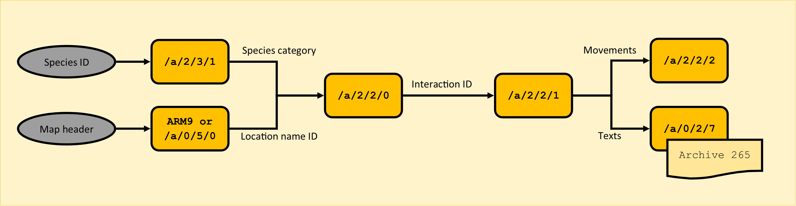

# Following Pokémon Interactions
> Author(s): [MrHam88](https://github.com/DevHam88).  
> Research: [pret/pokeheartgold](https://github.com/pret/pokeheartgold).

This page explains how HeartGold and SoulSilver choose the movements, cries and dialogue shown when speaking to the following Pokémon. It covers the links between species, location rules, interaction definitions and message text, with examples for Bellsprout, Eevee and Pikachu.

---

## Data Locations

The system is distributed across four NARCs and the message archive:

| Data | Location | How it is indexed |
|---|---|---|
| Species categories | `a/2/3/1` | Single member `0000`; byte at `species ID - 1` |
| Interaction conditions | `a/2/2/0` | Member `location-name ID + 1`; member `0000` contains shared rules |
| Interaction definitions | `a/2/2/1` | Member `interaction ID - 1` |
| Movement definitions | `a/2/2/2` | Member `movement ID - 1` |
| Ordinary follower dialogue | Text archive **265**, inside `a/0/2/7` | Message index `stored message reference - 1` |

Each member is a file inside the archive. IDs and member numbers such as `0205` are decimal. Offsets use hexadecimal with an `0x` prefix, and byte sequences such as `4C 02` show the bytes in file order.

---

## How Selection Works

> Research: [Follower interaction selection](https://github.com/pret/pokeheartgold/blob/0985e8718df4f25e64d6507d89c0c97c0d288981/asm/overlay_02_02248728.s), [Map headers](https://github.com/pret/pokeheartgold/blob/0985e8718df4f25e64d6507d89c0c97c0d288981/include/map_header.h).

1. Read the following Pokémon's species category from `a/2/3/1`, member `0000`.
2. Read the current map header's **location-name ID** (called `mapsec` in the decomp). Load member `location-name ID + 1` from `a/2/2/0`.
3. Evaluate that location's rules together with the shared rules in member `0000`. Return the first passing rule's interaction ID.
4. Load member `interaction ID - 1` from `a/2/2/1` and execute its actions. An action can reference a movement in `a/2/2/2`, play a cry, show an emote and print a message from text archive `265`.



Vanilla map headers are stored in ARM9. The `a/0/5/0` route shown in the diagram applies when using DSPRE’s **Dynamic Headers** patch.

Different map headers with the same location-name ID share one location member. A rule may *additionally* require a particular header, so individual headers (floors of a building or cave for example) can still be distinguished.

---

## Choosing What to Edit

| Intended change | Data to edit |
|---|---|
| Change which category a species belongs to | Species byte in `a/2/3/1`, member `0000` |
| Change where/when an interaction can be selected | Relevant rule in `a/2/2/0` |
| Change movements, cries, emotes, messages or mood effects | Interaction member in `a/2/2/1` |
| Change the movement pattern itself | Movement member in `a/2/2/2` |
| Change the wording | Corresponding message in text archive 265 |

Check for reuse before editing: changing an `a/2/2/1` interaction or an `a/2/2/2` movement changes every rule/action that references it.

For unpacking and repacking, see [Unpacking NARCs](/docs/universal/guides/unpacking_narcs/).

See the [case studies](#case-studies) for worked examples with Bellsprout, Eevee and Pikachu.

---

## Shared and Location Rules

`a/2/2/0` contains **236 members** in vanilla:

| Members | File size | Contents |
|---|---:|---|
| `0000` | 1,400 bytes | 70 shared records |
| `0001`-`0235` | 600 bytes each | 30 location records per member |

Each record is **20 bytes**.

The evaluation order is:

1. Shared records 0-11.
2. Location records 0-29.
3. Shared records 12-69.

Rules can check species category, type, mood, friendship, HP, status, time, terrain, flags and other conditions. A zero species-category field means **no species restriction**, not category zero. Selectors 250-254 match category ranges instead of one exact category.

Conditions are cumulative within a record. If the conditions require friendship of 'x' and time of 'y', both must pass for the record to be eligible for selection when evaluated.

:::info What is mood?
**Mood** is a signed value from **-127 to +127** representing the Pokémon's current "connection" with the player since it has been the follower. It is separate from **friendship**, which ranges from **0 to 255**. An interaction can check either value, both values, or neither.

The condition table (`a/2/2/0`) can require a particular mood range before selecting an interaction. The interaction definition (`a/2/2/1`) can then add or subtract mood when its action sequence finishes. For example, Bellsprout's swaying interactions add **60 mood** but **zero friendship**; the result is capped at +127. This can affect which mood-dependent interactions qualify the next time the player speaks to the follower.

Mood carries between maps while the same Pokémon remains registered as the follower. On normal steps with a visible follower, mood moves **one point towards zero**. The game uses species and personality to identify the follower. It resets mood to **zero** when it registers a different follower or first registers the follower after loading a save.
:::

Each enabled rule has its own chance to pass. The first rule that passes all its checks wins. The game considers up to 100 slots in the same order for every location, and the number of enabled rules varies.

Shared record **69**, at offset **`0x564`** in member `0000`, provides the vanilla fallback: it has no conditions, a **100%** acceptance threshold and selects interaction **254**.

:::caution
Keep an unrestricted rule with 100% acceptance at the end of the shared rules. It gives the game an interaction to use when every earlier rule fails.
:::

### Key Rule Fields

| Offset within record | Meaning |
|---|---|
| `0x06` | Species-category selector; zero skips this check |
| `0x0A`-`0x0B` | Packed interaction ID and conditions: `interaction ID = halfword >> 6` |
| `0x0C`-`0x0D` | Optional header restriction: zero skips; otherwise `stored value - 1` is the required header |
| `0x11` | Acceptance threshold: chance for the rule to pass this check. Zero always fails and 100 or more always passes |
| `0x12`-`0x13` | Required set flag; zero skips |

An interaction ID of zero disables the record before condition evaluation. Other fields may still restrict an otherwise matching species. The complete layout and selector values are included below.

### Complete Condition Record Reference

> Research: [Interaction conditions](https://github.com/pret/pokeheartgold/blob/0985e8718df4f25e64d6507d89c0c97c0d288981/asm/overlay_02_02248728.s).

<details>
<summary>20-byte layout: every field and unused bit</summary>

Offsets are relative to the beginning of a record. Bit 0 is the least significant bit. Masks apply to the byte shown unless the row specifies a halfword. All two-byte fields are little-endian.

| Offset | Bits / mask | Meaning |
|---|---|---|
| `0x00` | Entire byte | HP-percentage category |
| `0x01` | Bits 0-3 / `0x0F` | Mood category |
| `0x01` | Bits 4-7 / `0xF0` | Friendship category |
| `0x02` | Bits 0-2 / `0x07` | Nature group |
| `0x02` | Bits 3-4 / `0x18` | Gender group |
| `0x02` | Bits 5-7 / `0xE0` | Status category |
| `0x03` | Bits 0-4 / `0x1F` | Held-item pocket category |
| `0x03` | Bits 5-7 / `0xE0` | Not read by the matcher |
| `0x04` | Bits 0-4 / `0x1F` | Type category |
| `0x04` | Bits 5-7 / `0xE0` | Highest Pokéathlon performance stat |
| `0x05` | Entire byte | Walking-encounter tile condition |
| `0x06` | Entire byte | Species-category selector |
| `0x07` | Entire byte | Required missing Shiny Leaf |
| `0x08` | Bits 0-2 / `0x07` | Weather category |
| `0x08` | Bits 3-7 / `0xF8` | Not read by the matcher |
| `0x09` | Bits 0-4 / `0x1F` | Not read by the matcher |
| `0x09` | Bits 5-7 / `0xE0` | Follower facing direction |
| `0x0A` | Bits 0-2 / `0x07` | Nearby map-object count |
| `0x0A` | Bits 3-5 / `0x38` | Time of day |
| `0x0A`-`0x0B` | Halfword bits 6-15 / `0xFFC0` | Interaction ID |
| `0x0C`-`0x0D` | Entire halfword | Required map-header ID + 1 |
| `0x0E`-`0x0F` | Entire halfword | Required metatile behaviour |
| `0x10` | Bit 0 / `0x01` | Not read by the matcher |
| `0x10` | Bits 1-2 / `0x06` | Level-related selector; unusable as implemented |
| `0x10` | Bits 3-4 / `0x18` | Overworld-object selector; unusable as implemented |
| `0x10` | Bits 5-7 / `0xE0` | Uncollected hidden-item count |
| `0x11` | Entire byte | Random acceptance threshold |
| `0x12`-`0x13` | Entire halfword | Required set flag |

The **14 unread bits** are zero in all vanilla records. Both unusable selectors are also zero throughout that data.

Record `N` begins at file offset `N × 0x14`.

When replacing an interaction ID in `a/2/2/0`, preserve the lower six condition bits of the halfword at `0x0A`:

```text
new_halfword = (old_halfword & 0x003F) | (new_interaction_id << 6)
```

</details>

### Condition Selector Values

**Unless stated otherwise, selector zero skips that condition.** Nonzero conditions in a record must all pass. The random threshold and interaction ID have their own zero behaviour, described below.

#### HP, Mood and Friendship

<details>
<summary>Click for details</summary>

HP uses `floor(current HP × 100 / maximum HP)`. HP categories are mutually exclusive bands, not minimum thresholds.

| Selector | HP category | Mood category | Friendship category |
|---:|---|---|---|
| 1 | Exactly 100% | Exactly 127 | Exactly 255 |
| 2 | 75-99% | 100-126 | 200-254 |
| 3 | 50-74% | 50-99 | 150-199 |
| 4 | 25-49% | 30-49 | 90-149 |
| 5 | Below 25% | -29 through 29 | 60-89 |
| 6 | No generated match | -49 through -30 | 30-59 |
| 7 | No generated match | -126 through -50 | 1-29 |
| 8 | No generated match | Exactly -127 | Exactly 0 |
| 9 | No generated match | At least 0 | At least 90 |
| 10 | No generated match | Below 0 | Below 60 |

The byte at offset `0x01` holds two selectors. If it contains `95`, the right-hand hex digit is mood selector **5** and the left-hand digit is friendship selector **9**. Both conditions must pass. To change mood to selector **2** while keeping friendship at **9**, overwrite `95` with `92`. This works here because each selector fits in one hex digit. See [Bits and bitmasks](../../../universal/guides/hex_editing/hex_editing.md#bits-and-bitmasks) for fields that cross digit boundaries.

</details>

#### Nature

<details>
<summary>Click for details</summary>

| Selector | Natures |
|---:|---|
| 1 | Naughty, Impish, Jolly, Naive, Sassy |
| 2 | Relaxed, Lax, Calm, Gentle |
| 3 | Docile, Serious, Modest, Quiet, Careful |
| 4 | Hardy, Brave, Adamant, Bold |
| 5 | Lonely, Timid, Bashful |
| 6 | Hasty, Mild, Rash, Quirky |

</details>

#### Gender and Status

<details>
<summary>Click for details</summary>

Gender selector **1** means male; **2** means female **or genderless**. The comparison builder groups those latter two together. Selector **3** cannot match a generated gender category.

Status selectors are **1 = healthy**, **2 = burn**, **3 = freeze**, **4 = paralysis**, and **5 = poison or bad poison**. Selector **6** has no generated counterpart. Selector **7** accepts any of the ailment categories, including sleep.

:::info
The builder represents sleep internally as category **8**, which cannot fit directly in the record's three-bit field. Therefore selector 7 can include sleep, but this field cannot directly request only sleep.
:::

</details>

#### Held Item

<details>
<summary>Click for details</summary>

This checks the held item's **bag pocket**, not its item ID or hold effect.

| Selector | Required pocket or condition |
|---:|---|
| 1 | Poké Balls |
| 2 | Medicine |
| 3 | Battle Items |
| 4 | Items |
| 5 | Mail |
| 6 | Berries |
| 7 | TMs/HMs |
| 8 | No held item |
| 9 | Any held item |

</details>

#### Type

<details>
<summary>Click for details</summary>

Either Pokémon type can satisfy the type condition. These are specific identifiers to this code, *not the usual internal type IDs* generally used:

| ID | Type |
|---:|---|
| 1 | Normal |
| 2 | Fire |
| 3 | Water |
| 4 | Electric |
| 5 | Grass |
| 6 | Ice |
| 7 | Fighting |
| 8 | Poison |
| 9 | Ground |
| 10 | Flying |
| 11 | Psychic |
| 12 | Bug |
| 13 | Rock |
| 14 | Ghost |
| 15 | Dragon |
| 16 | Dark |
| 17 | Steel |

:::info
Because this doesn't use the normal type IDs, there is no Mystery type (`???`) available, which means that there is no easy way to add a condition for a custom type assigned to this ID in a ROM hack.
:::

</details>

#### Pokéathlon Performance

<details>
<summary>Click for details</summary>

The Pokéathlon selector checks the greatest current performance star value, including Aprijuice modifiers: **1 = Power, 2 = Stamina, 3 = Skill, 4 = Jump, 5 = Speed**. Ties favour Power, then Stamina, Jump, Skill and Speed, in that order.

</details>

#### Species Category

<details>
<summary>Click for details</summary>

Species selectors **1-249** require an exact match against the category read from `a/2/3/1`. The special range selectors are:

| Selector | Accepted category |
|---:|---|
| 250 | At most 19 |
| 251 | At most 130 |
| 252 | 140-149 |
| 253 | At least 160 |
| 254 | At least 220 |

Species selector **255** is invalid.

</details>

#### Shiny Leaf

<details>
<summary>Click for details</summary>

Shiny Leaf selectors **1-5** require the corresponding leaf **A-E to be missing**. This tests one particular leaf, not the total number of leaves.

</details>

#### Tile, Weather, Facing and Time

<details>
<summary>Click for details</summary>

- **Walking-encounter tile:** 1 = the follower's tile permits walking encounters; 2 = it does not. This is not a check for an encounter table.
- **Weather:** 1 = weather ID 0 (clear); 3 = weather ID 1 (ordinary rain). Other weather IDs do not match.
- **Facing:** 1 = East; 2 = West; 3 = North; 4 = South.
- **Time:** 1 = morning; 2 = day; 3 = evening; 4 = night; 5 = late night.
- **Metatile behaviour:** a nonzero halfword requires an exact match with the follower tile's behaviour. The builder stores the comparison value as a byte, so record values above 255 cannot match this path.

</details>

#### Nearby Objects and Hidden Items

<details>
<summary>Click for details</summary>

The nearby-object count covers active map objects ("overworlds", "actors") within **one tile in both directions of the player**, a 3×3 area. It excludes object IDs `0xFD` (follower) and `0xFF` (player); sprites `0x54`, `0x55` and `0x56` (movable and breakable rocks and cuttable trees) are handled separately rather than counted here. Selector **5** requires at least five counted objects. Other nonzero selectors require exactly that many.

The hidden-item count covers hidden-item background events on the current map whose collected flags are not set. Selector **4** requires at least four uncollected items. Other nonzero selectors require exactly that many.

</details>

#### Header and Flag

<details>
<summary>Click for details</summary>

- **Map header:** stored zero skips the check; stored `N` requires current header `N - 1`. This can distinguish headers that share a location-name ID.
- **Flag:** a nonzero flag ID must be set. There is no inversion bit for requiring it to be clear.

</details>

#### Random Check

<details>
<summary>Click for details</summary>

`LCRandom() % 100 < threshold`. Zero always rejects; 100 or more always passes this check. Each candidate gets its own roll, **before** its other conditions are evaluated. These values are not weights or guaranteed overall selection rates.

</details>

#### Unusable Selectors

<details>
<summary>Click for details</summary>

The **level selector** can encode only 0-3, but the comparison builder produces **4** for ordinary levels at least 48 and **6** for ordinary levels below 48. Consequently, no nonzero selector can pass its equality check.

The **overworld-object selector** has preliminary checks involving movable rocks (`0x54`) and breakable rocks (`0x55`), but **every nonzero branch returns failure**. The builder also tracks cuttable trees (`0x56`), but this condition does not consult that flag.

Both selectors are zero in all vanilla records: they do not currently provide working level or rock/tree filters.

</details>

---

## Interaction Definitions

> Research: [Follower interaction definitions](https://github.com/pret/pokeheartgold/blob/0985e8718df4f25e64d6507d89c0c97c0d288981/asm/overlay_02_02248728.s).

Each member of `a/2/2/1` is **52 bytes**:

| File offsets | Contents |
|---|---|
| `0x00`-`0x27` | Up to five 8-byte actions |
| `0x28`-`0x2B` | Enable Yes/No choice: zero = disabled |
| `0x2C`-`0x2D` | Interaction ID to load for Yes; zero ends |
| `0x2E`-`0x2F` | Interaction ID to load for No; zero ends |
| `0x30` | Signed friendship change |
| `0x31` | Signed follower mood change |
| `0x32` | Accessory ID + 1; zero = none |
| `0x33` | Shiny Leaf reward: zero = none, 1-5 = leaves A-E |

Each action has this layout:

| Offset within action | Size | Meaning |
|---|---:|---|
| `+0x00` | 2 | Movement ID: zero skips movement; `FFFF` terminates the action sequence |
| `+0x02` | 2 | Message reference: zero = none; otherwise archive 265 index `reference - 1` |
| `+0x04` | 2 | Sound/cry selector: zero = none; `4B 09` = normal cry; `4C 09` = cry mode 11 |
| `+0x06` | 1 | Emote selector: zero = none; 1-14 dispatch effect `selector - 1` |
| `+0x07` | 1 | Additional delay counter; zero in all active vanilla actions |

Actions execute movement/sound, then emote, then message, then delay. The sound is triggered through the movement definition's sound-enable field. Movement and message references are both one-based, but point to different resources. Ordinary follower messages always use archive `265`; the archive number is supplied by code rather than stored in each action.

At sequence completion, friendship and mood changes are applied, then the executor handles a configured choice or reward. Accessory/Shiny Leaf result messages use a separate built-in path through text archive `40`.

<details>
<summary>Additional action, choice and reward behaviour</summary>

- A movement ID of **zero** skips movement without ending the action. `FFFF` terminates the entire sequence; later slots are ignored. There is no separate action-count field in the file.
- Sound values **1-2378** are sound-effect IDs. Value **2379** (`4B 09`) selects normal cry mode 0; other values above 2378 select cry mode 11. Only zero, 2379 and 2380 occur in the vanilla actions.
- Emote selectors **1-14** invoke effect `selector - 1`; the graphics are listed below. Selectors **15-255** are skipped. This emote path is suppressed on metatile behaviours **46, 113 and 114**.
- The delay is an update counter, not a message or movement reference. It is zero in all vanilla instances.
- The signed friendship modifier is applied with a resulting range of **0-255**. The signed mood modifier is applied with a resulting range of **-127 to +127**. These are signed bytes because they store increases or decreases. The byte `EC` is 236 when read as unsigned. In a signed field, subtract 256 to get **−20**. The byte `3C` gives **+60**. See [Signed and unsigned bytes](../../../universal/guides/hex_editing/hex_editing.md#signed-and-unsigned-bytes).
- Yes/No branch values are **interaction IDs**, not message references: zero ends the interaction; `N` loads `a/2/2/1` member `N - 1`.
- Accessory value `N` attempts to give accessory `N - 1`; the code checks whether it can be awarded. Leaf selectors 1-5 attempt to award leaves A-E and check whether the leaf is already present. Both paths display built-in success/failure or already-owned text.
- At completion, a configured Yes/No choice takes precedence over accessory and leaf handling; an accessory takes precedence over a leaf.
- Ordinary message buffers are populated with the follower's nickname, species name, player name, current location and held item name.

</details>

### Emote Graphics and Scripted Use

> Research: [Follower emote graphics](https://github.com/pret/pokeheartgold/blob/0985e8718df4f25e64d6507d89c0c97c0d288981/asm/overlay_01_02203A18.s), [Field script commands](https://github.com/pret/pokeheartgold/blob/0985e8718df4f25e64d6507d89c0c97c0d288981/src/scrcmd_c.c).

Follower emotes use resources in **`a/1/0/3`**, not `a/2/2/2`. The mapping is a table of fourteen pairs of 32-bit member indices in **overlay 1** (US HeartGold RAM address `0x02209544`, decompressed overlay-1 file offset `0x23C44`). Each pair contains a texture-member index and a custom animation-member index.

| `a/2/2/1` emote selector | Internal effect | Graphic | `a/1/0/3` NSBTX member | `a/1/0/3` custom animation member |
|---:|---:|---|---:|---:|
| 0 | None | None | - | - |
| 1 | 0 | Red heart | 2 | 150 |
| 2 | 1 | Joyful face | 3 | 151 |
| 3 | 2 | Angry face | 4 | 152 |
| 4 | 3 | Worried face | 5 | 153 |
| 5 | 4 | Smiling face | 6 | 154 |
| 6 | 5 | Concerned face | 7 | 155 |
| 7 | 6 | Music note | 8 | 156 |
| 8 | 7 | Question mark (`?`) | 9 | 157 |
| 9 | 8 | Exclamation point (`!`) | 10 | 158 |
| 10 | 9 | Blue water droplet | 11 | 159 |
| 11 | 10 | Angry crying face | 12 | 160 |
| 12 | 11 | Purple poison symbol | 13 | 161 |
| 13 | 12 | Speechless (`...`) | 14 | 162 |
| 14 | 13 | Sleeping (`zzz`) | 15 | 163 |

The follower-emote renderer also loads shared model member **130**, animation member **140** and texture member **28** from `a/1/0/3`.

#### Movement Actions Versus Script Commands

`EmoteExclamation`, ID **`0x4B`**, is a **movement action**, executed within a sequence started by the top-level script command `ApplyMovement` (`0x5E`).

The standard movement actions use a **different renderer and resource set** from the fourteen follower emotes, although both obtain resources from `a/1/0/3`:

| Route | Entry point | `a/1/0/3` texture | Model | Shared animation |
|---|---|---:|---:|---:|
| Movement action `0x4B` / 75 | `ov01_02200540`, variant 0 | 17 | 118 | 140 |
| Movement action `0x67` / 103 | `ov01_02200540`, variant 1 | 24 | 125 | 140 |
| Follower emotes | `ov01_02203AB4` → `ov01_02203A48` | 2-15 | 130 | 140 |

#### Existing Follower-Heart Script Command

Top-level **`ScrCmd_597`**, opcode **`0x255`**, takes **no parameters** and calls:

```text
ov01_02203AB4(fieldSystem, followingPokemonObject, 0)
```

It therefore uses the **same follower-emote renderer** as `a/2/2/1` selector 1: internal effect 0, texture member `2` and animation member `150`. The database describes this as a heart above the following Pokémon. It has an implemented native handler, and its task wrapper waits for the effect to finish.

The vanilla script sources contain **two occurrences**, both in script archive member **0163**. Both lie in unreachable script blocks: the member's sole entry calls `FollowMonInteract` and then jumps directly to the release/end block at `0xF0`. Thus the command survives in unused follower-script code, but has no reachable vanilla use. The native follower interaction executor can still show emotes directly without executing command 597.

This existing command exposes only the following Pokémon and the fixed effect 0.

### Movement Definitions

> Research: [Follower movement definitions](https://github.com/pret/pokeheartgold/blob/0985e8718df4f25e64d6507d89c0c97c0d288981/asm/overlay_02_02248728.s).

The vanilla `a/2/2/2` contains **108 members**, each **80 bytes**: up to ten 8-byte movement segments. A nonzero movement ID in an `a/2/2/1` action loads member `movement ID - 1`.

<details>
<summary>Movement segment layout and execution</summary>

| Offset within segment | Size | Meaning |
|---|---:|---|
| `+0x00` | 1 byte | Facing override: zero leaves facing unchanged; otherwise internal direction + 1; `FF` ends the movement |
| `+0x01` | 1 byte | Segment duration in executor updates |
| `+0x02` | 1 signed byte | X displacement |
| `+0x03` | 1 signed byte | Vertical displacement |
| `+0x04` | 1 signed byte | Z displacement |
| `+0x05` | 1 byte | Nonzero triggers the current `a/2/2/1` action's sound/cry selector |
| `+0x06`-`+0x07` | 2 bytes | Not read by this movement executor |

Facing overrides are **1 = North, 2 = South, 3 = West, 4 = East**. These use the native direction enumeration **plus one**, unlike the remapped facing condition in `a/2/2/0`.

**Diglett** and **Dugtrio** ignore the vertical movement value. This exception checks species IDs **50** and **51**, so changing their species categories has no effect. At the end of the movement, the follower returns to its original position and facing.

For Bellsprout, movement IDs **50** and **51** load members **0049** and **0050**. They contain the same ten-segment horizontal sway, with segment durations of **8** and **4** updates respectively. The latter therefore performs the pattern faster. Their first segment enables the cry specified by the action.

</details>

---

## Case Studies

Here, a **special interaction** means a location rule restricted to a species' dedicated category. A thematic behaviour may have several action/text variants or be reused in several locations.

### Bellsprout: One Bespoke Behaviour, Two Variants

Bellsprout is species **69**. At offset `69 - 1 = 0x44` in `a/2/3/1`, member `0000`, the byte is `83`: category **131**.

Sprout Tower has location-name ID **204**, so its rules are in `a/2/2/0`, member **0205**. Its headers 110, 155 and 156 share that location member.

| Record index | Record offset | Category | Packed interaction bytes | Interaction | Acceptance check |
|---:|---|---:|---|---:|---:|
| 3 | `0x3C` | 131 | `00 A9` → `0xA900 >> 6` | 676 | 50% |
| 6 | `0x78` | 131 | `C0 A8` → `0xA8C0 >> 6` | 675 | 50% |

Both records have no other conditions. These are *sequential* checks, **not** two equally weighted alternatives.

| Interaction | `a/2/2/1` member | Performance | Text archive `265` |
|---:|---|---|---|
| 675 | `0674` | Movement 50 twice; normal cry in the first action; emote 7 and text in the second | **587**: "[Pokémon] swayed and danced around as it pleased." |
| 676 | `0675` | Faster movement 51 three times; normal cry in the first action; emote 7 and text in the third | **588**: "[Pokémon] swayed around, dancing in a strange manner." |

Both interactions add **60 mood** and zero friendship. Bell Tower also uses both variants through its category-131 rules in member **0206**.

#### Change what Bellsprout says

1. Start with interaction **675**. Open member **`0674`** of `a/2/2/1` because the member number is one less than the interaction ID.
2. At file offset **`0x0A`**, read the bytes **`4C 02`**. In little-endian order they represent **588**, so the message index is **587**.
3. Open text archive **265** and edit message **587**. Check which other interactions use that message before changing it. Since Bell Tower also uses interaction **675**, this edit changes the line there too.
4. Save the change and rebuild the ROM. To see the edited line, talk to Bellsprout in Sprout Tower until that variant is chosen.

### Eevee: No Dedicated Species Rules

Eevee is species **133**. Its category byte is `1D` (**29**), at offset `0x84` of `a/2/3/1`, member `0000`.

There are **no category-29 selectors anywhere in vanilla `a/2/2/0`**. Eevee therefore has no dedicated species-category interaction rules in this table. It still qualifies for the unrestricted rules, applicable category-range rules and their associated conditions.

For example, Sprout Tower member **0205**, record 0 at offset `0x00`, has no species restriction and a 30% acceptance check. It selects interaction **336**:

```text
Any eligible species, including Eevee
  → a/2/2/0 member 0205, record 0
  → interaction 336
  → a/2/2/1 member 0335
  → stored message reference 276
  → text archive 265, message 275
```

The text is "[Pokémon] is dancing around the pillar!" This is a generic location interaction, not an Eevee-specific one. Earlier passing rules may select a different interaction.

### Pikachu: Several Location-Specific Behaviours

Pikachu is species **25**, mapped to category **23** (`17` at species-table offset `0x18`). Four dedicated category-23 records select three interaction definitions across three locations:

| Location | `a/2/2/0` member | Record offset | Interaction → `a/2/2/1` member | Archive `265` message | Acceptance check |
|---|---|---|---|---|---:|
| Power Plant | `0202` | `0x28` | 653 → `0652` | **566**: "had fun dancing a dance!" | 40% |
| Power Plant | `0202` | `0x64` | 654 → `0653` | **567**: "is so happy, it began to dance!" | 40% |
| Mt. Silver Cave | `0220` | `0x1F4` | 651 → `0650` | **562**: "is trembling with eagerness!" | 90% |
| Viridian Forest | `0225` | `0x00` | 654 → `0653` | **567**: same happy-dance interaction | 40% |

The listed text follows the Pokémon-name placeholder. These records have no additional conditions beyond species category and their random checks. Interaction **654 is reused**, demonstrating that each location rule need not have its own unique `a/2/2/1` member.

---

## [Advanced] Adding Members

The following distinguishes **limits visible in the code** from **expansion approaches that have not been tested in-game**. Adding members is different from increasing the size of an existing member.

| Archive | Restriction visible in the code | Likely expansion route |
|---|---|---|
| `a/2/2/0` | Member is `location-name ID + 1`; map headers store an **8-bit** location-name ID | Append location members, then assign corresponding new location-name IDs to headers |
| `a/2/2/1` | `a/2/2/0` stores only a **10-bit** interaction ID; all 1,023 nonzero IDs already have members | Reuse existing members, widen/change selection code, or investigate the wider Yes/No branch references |
| `a/2/2/2` | Actions store a **16-bit** movement ID; zero skips and `FFFF` terminates | Append 80-byte movement members and reference their new IDs from actions |

### a/2/2/0: Location IDs

The vanilla archive ends at member **0235**, corresponding to location-name ID **234**. A single byte map-header field can hold IDs up to **255**, so this loader can theoretically address members through **0256**. That leaves **21 additional location-member indices**, 0236-0256, without widening the header field.

Appending member **0236** would make it the interaction table for location-name ID **235**. Matching location-name text and other consumers of that location-name ID must also support the chosen value.

Keep each new location member at **600 bytes / 30 records**. The shared member remains **1,400 bytes / 70 records**. The loader and candidate order use fixed buffer offsets and counts; appending records within a member does not increase the number evaluated. Oversized members can overwrite adjacent working data because the loader reads the whole member into those fixed regions.

### a/2/2/1: Interaction IDs

The first appended member would be **1023**, requiring interaction ID **1024**. The `a/2/2/0` field can encode only **0-1023**, with zero disabled. Therefore a newly appended `a/2/2/1` member cannot be selected directly by an unchanged `a/2/2/0` record.

There is, however, a possible exception: **Yes/No branch references are 16-bit**, and the branch code passes them to the same interaction loader without the `a/2/2/0` field's ten-bit extraction. A branch value of **1024** should therefore load appended member **1023**. This would make the new interaction reachable after a choice, not directly through location-rule selection.

Interaction members must be **52 bytes**, with at most five action slots. Adding more actions to the file would require changes to the slot limits and working-buffer layout.

### a/2/2/2: Movement IDs

The vanilla archive has members **0000-0107**. Appending member **0108** would give it movement ID **109**, which fits the existing action field.

The field can encode movement IDs **1-65534**; zero skips movement and `65535` (`0xFFFF`) ends the action sequence.

Movement members must be **80 bytes**, with at most ten movement segments. More segments within one member would require code and buffer changes.
