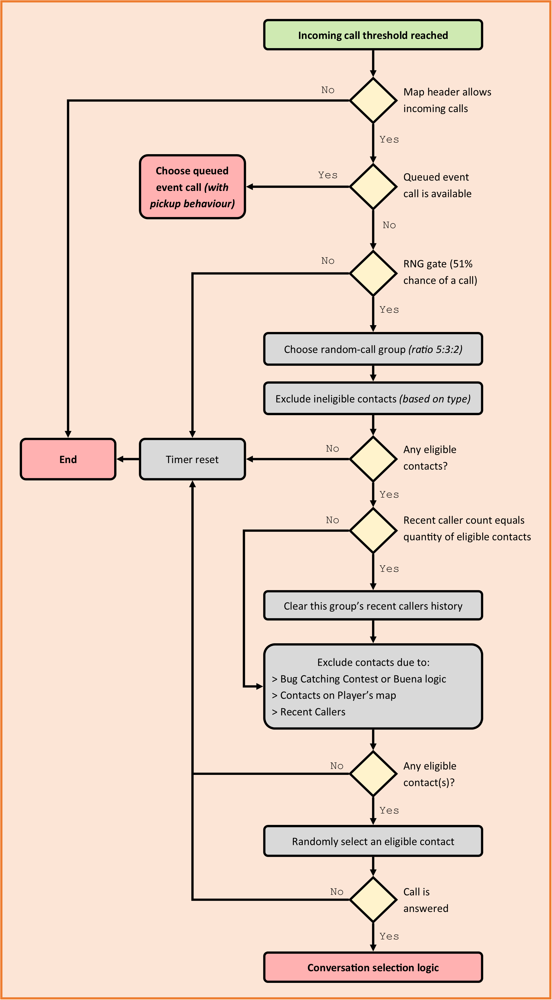
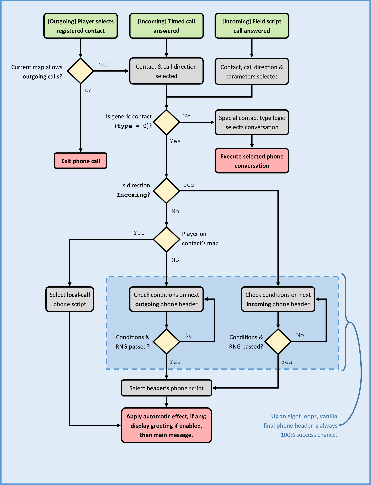
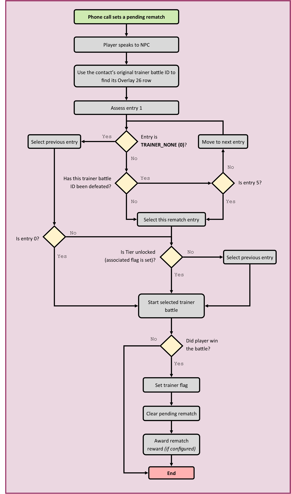

# Pokégear Phone System

> Author(s): [MrHam88](https://github.com/DevHam88/).  
> Research: [pokeheartgold (decomp)](https://github.com/pret/pokeheartgold), [Eclipse (Luna)](https://discord.com/channels/446824489045721090/761649785920815114/1541642009457197117), [Senate](https://discord.com/channels/1221517397874446557/1221525392217735378/1539025825431814176), [BlackShark](https://projectpokemon.org/home/forums/topic/49014-hgss-pokegear-phone-numbers-memory-location/), [Mixone](https://github.com/Mixone-FinallyHere), [MrHam88](https://github.com/DevHam88/).  

This guide explains how the Pokégear phone system works and how to edit its data in Pokémon HeartGold and SoulSilver.

:::info
Unless stated otherwise, offsets and byte values are for US HeartGold; overlay offsets refer to decompressed files.
:::

---

## Overview

The system is easiest to follow in the same order as a call moves through it:

1. [**Phonebook data**](#phonebook-data) defines the contacts and their properties; [field scripts register their numbers](#registering-phone-numbers).
2. [**Incoming and outgoing calls**](#incoming-and-outgoing-calls) explains how a call starts and, for a random incoming call, how the caller is chosen.
3. [**Phone conversations**](#phone-conversations) explains what the chosen contact says and does. A generic contact (contact type `0`) uses phone headers and phone scripts; a special contact uses its own selection logic.
4. [**Trainer rematches**](#trainer-rematches) and [**gifts after calls and rematches**](#gifts-after-calls-and-rematches) explain how battles are selected and items are awarded.

Later sections describe [saved phone state](#saved-phone-state), illustrate the system through [case studies](#case-studies), and give [example edits](#example-edits). Expansion sections cover [rematch tiers](#extending-rematch-tiers), [queued event calls](#expanding-queued-event-calls), and [additional contacts](#expanding-beyond-75-contacts).

For concrete walkthroughs of these systems working together, start with the [case studies](#case-studies).

### Field scripts and game code

**Field scripts** control NPC dialogue, command arguments and branches; these can be edited in DSPRE. **Script commands** invoke compiled game code: their internal checks and side effects require a code patch when their arguments cannot express the desired change. The **phone system** also runs independently, using compiled code and editable tables to select callers and conversations.

The guide's **phone scripts** are conversation records read by that system, not field scripts. Editing a record changes its messages and effect; changing how that effect works requires editing the code that reads it.

### Data structure
The following table maps the phone data and code.

| Component | Location | Role |
|---|---|---|
| Contact records | `tel/pmtel_book.dat` | 75 contacts with their contact type, trainer battle, map, item, local-call phone script, schedule, and random-call group. |
| Contact text-archive lookup | ARM9 `0x10847C`-`0x108511` | One message-archive ID for each contact ID; archive message `0` is the contact name. |
| Conversation data | Overlay 101 `0x1143C`-`0x13B6B` | Generic phone headers, plus phone-script and greeting tables also used by some special contacts. |
| Contact-specific conversation code | Overlay 101 `0xB0A4`-`0xCD3F` | Special-contact selectors and display routines, with generic-call code interleaved. See the [decomp routines](https://github.com/pret/pokeheartgold/tree/master/src/application/pokegear/phone/scripts). |
| Queued system-event definitions | Overlay 2 `0xE104`-`0xE151` | Caller, phone-script ID, and forced-pickup setting for the 13 queued triggers. |
| Rematch battle lookup | Overlay 26 `0x20C`-`0x4FF` | Six battle IDs for each of 63 ordinary-trainer or Gym Leader rematch rows. |
| Saved phone state | Save data | Registered-contact order; 75 per-contact rematch and phone-call-gift records; Mom's five-item purchase queue; random-caller history; and queued event triggers. |

---

## Phonebook data

> Research: [pokeheartgold: phonebook reader](https://github.com/pret/pokeheartgold/blob/master/src/phonebook_dat.c), [phone-contact structures](https://github.com/pret/pokeheartgold/blob/master/include/gear_phone.h), [time-of-day conversion](https://github.com/pret/pokeheartgold/blob/master/src/gf_rtc.c).

The ROM file is a direct NitroFS file: `tel/pmtel_book.dat`. It is **not** a NARC member.  

### Graphics

See the sprite-location reference for [Pokégear UI graphics](/docs/generation-iv/resources/sprite_locations/hgss-sprite_locations#pokegear-ui-graphics) and [Pokégear phone graphics](/docs/generation-iv/resources/sprite_locations/hgss-sprite_locations#pokegear-phone-graphics).

### File layout

The first four bytes are a little-endian entry count (75). They are followed by 20-byte contact records for each entry.

| Offset | Size (bytes) | Decomp field | Meaning |
|:---:|:---:|---|---|
| `00` | 1 | `id` | Contact ID (`PHONE_CONTACT_*`). |
| `01` | 1 | `type` | Contact type. It chooses the contact's call-selection route: generic headers for type `0`, or specialised logic for the other values; see [Contact type values](#contact-type-values). |
| `02` | 1 | `unk2` | Unknown. There is no *known* consumer of this byte. |
| `03` | 1 | `trainerClass` | Title label shown in the Pokégear contact list. Standard trainer classes and special phone-contact labels use different text paths; see [Title](#title). |
| `04` | 2 | `trainerId` | The contact's original trainer battle ID, or `TRAINER_NONE` (`0`) for a non-trainer. See the [rematch battle table](#rematch-battle-table) for team selection and [gifts](#gifts-after-calls-and-rematches) for the separate item paths. |
| `06` | 2 | `mapId` | The contact's **map-header ID**. It controls local-call behaviour, random-call filtering, location text, and the limited rematch/gift map marker; see [What `mapId` controls](#what-mapid-controls). |
| `08` | 2 | `gift` | Rematch reward item. Awarded after the rematch battle by the shared NPC field-script path. |
| `0A` | 2 | `phoneScriptIfLocal` | Generic contact's **local-call phone-script ID**: used for an outgoing call when the player is on this contact's `mapId`. |
| `0C` | 1 | `unkC` | Greeting-set index. Values `0`-`7` select a row from the shared phone-greeting table; `FF` suppresses the greeting. |
| `0D` | 1 | `rematchWeekday` | `0` to `6` (Sunday to Saturday); `7` prevents a match, i.e. no outgoing rematch call can occur. Used by outgoing rematch schedule checks; see [Rematch availability conditions](#rematch-availability-conditions). |
| `0E` | 1 | `rematchTimeOfDay` | `0` Morning (04:00-09:59), `1` Daytime (10:00-19:59), `2` Night (20:00-03:59); `3` prevents a match, i.e. no outgoing rematch call can occur. Used by outgoing rematch schedule checks; see [Rematch availability conditions](#rematch-availability-conditions). |
| `0F` | 1 | `unkF` | Random incoming-call group. The game chooses group `0` (50% of the time), group `1` (30% of the time), and group `2` (20% of the time). |
| `10` | 1 | `sortParam[0]` | Stored Pokégear title-sort rank. |
| `11` | 1 | `sortParam[1]` | Stored Pokégear alphabetical-sort rank. |
| `12` | 1 | `sortParam[2]` | Stored Pokégear location-sort rank. |
| `13` | 1 | `sortParam[3]` | Padding (`00` in vanilla). |

:::caution  
The entry count controls only how many 20-byte records the file loader reads. Raising it does not create a usable new contact; the phone system has a hardcoded 75-contact limit. See [Expanding beyond 75 contacts](#expanding-beyond-75-contacts) for the coordinated work a real expansion needs.  
:::

<details>
<summary>Vanilla phonebook records</summary>

Values from `tel/pmtel_book.dat`, in file order. Record offsets are hexadecimal; other numbers are decimal. Weekdays and times use the labels above; “Unused” denotes weekday `7` or time `3`. Names are reader labels, not stored in this file. The omitted `unk2` and padding bytes are `0` in all 75 records.

| Contact ID | Name | Record offset | Type | Title | Trainer battle ID | Map-header ID | Rematch reward | Local phone script | Greeting set | Weekday | Time of day | Random-call group |
|---|---|---|---|---|---|---|---|---|---|---|---|---|
| 0 | Mother | `0x4` | 1 | 200 | 0 | 63 | 0 | 23 | 255 | Wednesday | Unused | 0 |
| 1 | Prof. Elm | `0x18` | 2 | 201 | 0 | 61 | 0 | 1 | 255 | Unused | Unused | 0 |
| 2 | Prof. Oak | `0x2C` | 3 | 201 | 0 | 505 | 0 | 68 | 255 | Unused | Unused | 1 |
| 3 | Ethan | `0x40` | 11 | 202 | 0 | 384 | 0 | 101 | 255 | Unused | Unused | 0 |
| 4 | Lyra | `0x54` | 11 | 202 | 0 | 384 | 0 | 102 | 255 | Unused | Unused | 0 |
| 5 | Kurt | `0x68` | 4 | 203 | 0 | 164 | 0 | 83 | 255 | Unused | Unused | 1 |
| 6 | Day-Care Man | `0x7C` | 8 | 204 | 0 | 331 | 0 | 94 | 255 | Unused | Unused | 0 |
| 7 | Day-Care Lady | `0x90` | 9 | 204 | 0 | 331 | 0 | 97 | 255 | Unused | Unused | 0 |
| 8 | Buena | `0xA4` | 10 | 205 | 0 | 186 | 0 | 98 | 255 | Unused | Unused | 1 |
| 9 | Bill | `0xB8` | 7 | 206 | 0 | 203 | 0 | 92 | 2 | Unused | Unused | 2 |
| 10 | Joey | `0xCC` | 0 | 2 | 8 | 34 | 45 (HP Up) | 29 | 0 | Monday | Daytime | 1 |
| 11 | Ralph | `0xE0` | 0 | 11 | 57 | 36 | 0 | 46 | 4 | Wednesday | Morning | 0 |
| 12 | Liz | `0xF4` | 0 | 5 | 27 | 36 | 0 | 53 | 7 | Thursday | Daytime | 0 |
| 13 | Wade | `0x108` | 0 | 6 | 4 | 35 | 0 | 36 | 0 | Tuesday | Night | 2 |
| 14 | Anthony | `0x11C` | 0 | 9 | 61 | 37 | 0 | 61 | 4 | Friday | Night | 0 |
| 15 | Bike Shop | `0x130` | 5 | 205 | 0 | 182 | 0 | 84 | 255 | Unused | Unused | 1 |
| 16 | Kenji | `0x144` | 6 | 14 | 17 | 47 | 51 (PP Up) | 86 | 3 | Unused | Daytime | 0 |
| 17 | Whitney | `0x158` | 12 | 70 | 30 | 398 | 0 | 175 | 255 | Saturday | Daytime | 2 |
| 18 | Falkner | `0x16C` | 12 | 66 | 20 | 398 | 0 | 103 | 255 | Saturday | Morning | 2 |
| 19 | Jack | `0x180` | 0 | 60 | 178 | 96 | 0 | 104 | 0 | Monday | Morning | 0 |
| 20 | Chad | `0x194` | 0 | 60 | 397 | 42 | 0 | 112 | 0 | Friday | Morning | 0 |
| 21 | Brent | `0x1A8` | 0 | 68 | 131 | 45 | 0 | 120 | 4 | Monday | Morning | 0 |
| 22 | Todd | `0x1BC` | 0 | 4 | 66 | 38 | 0 | 128 | 0 | Saturday | Morning | 0 |
| 23 | Arnie | `0x1D0` | 0 | 6 | 78 | 39 | 0 | 134 | 0 | Tuesday | Morning | 0 |
| 24 | Baoba | `0x1E4` | 13 | 207 | 0 | 173 | 0 | 140 | 255 | Unused | Unused | 1 |
| 25 | Irwin | `0x1F8` | 14 | 31 | 7 | 39 | 0 | 155 | 255 | Unused | Unused | 0 |
| 26 | Janine | `0x20C` | 12 | 106 | 257 | 398 | 0 | 176 | 255 | Monday | Daytime | 2 |
| 27 | Clair | `0x220` | 12 | 76 | 35 | 398 | 0 | 177 | 255 | Friday | Night | 2 |
| 28 | Erika | `0x234` | 12 | 105 | 256 | 398 | 0 | 178 | 255 | Sunday | Morning | 2 |
| 29 | Misty | `0x248` | 12 | 103 | 254 | 398 | 0 | 179 | 255 | Wednesday | Morning | 2 |
| 30 | Blaine | `0x25C` | 12 | 108 | 259 | 398 | 0 | 180 | 255 | Tuesday | Daytime | 2 |
| 31 | Blue | `0x270` | 12 | 110 | 261 | 398 | 0 | 181 | 255 | Sunday | Night | 2 |
| 32 | Chuck | `0x284` | 12 | 75 | 34 | 398 | 0 | 182 | 255 | Wednesday | Night | 2 |
| 33 | Brock | `0x298` | 12 | 98 | 253 | 398 | 0 | 183 | 255 | Saturday | Night | 2 |
| 34 | Bugsy | `0x2AC` | 12 | 67 | 21 | 398 | 0 | 184 | 255 | Thursday | Daytime | 2 |
| 35 | Sabrina | `0x2C0` | 12 | 107 | 258 | 398 | 0 | 185 | 255 | Sunday | Daytime | 2 |
| 36 | Lt. Surge | `0x2D4` | 12 | 104 | 255 | 398 | 0 | 186 | 255 | Friday | Morning | 2 |
| 37 | Morty | `0x2E8` | 12 | 72 | 31 | 398 | 0 | 187 | 255 | Tuesday | Night | 2 |
| 38 | Jasmine | `0x2FC` | 12 | 74 | 33 | 398 | 0 | 188 | 255 | Wednesday | Daytime | 2 |
| 39 | Pryce | `0x310` | 12 | 73 | 32 | 398 | 0 | 189 | 255 | Monday | Morning | 2 |
| 40 | Huey | `0x324` | 0 | 46 | 211 | 220 | 46 (Protein) | 190 | 4 | Wednesday | Night | 1 |
| 41 | Gaven | `0x338` | 0 | 24 | 102 | 30 | 0 | 196 | 0 | Thursday | Morning | 1 |
| 42 | Jamie | `0x34C` | 0 | 25 | 113 | 30 | 0 | 203 | 5 | Friday | Daytime | 1 |
| 43 | Reena | `0x360` | 0 | 25 | 114 | 31 | 0 | 210 | 1 | Sunday | Morning | 1 |
| 44 | Vance | `0x374` | 0 | 69 | 137 | 46 | 48 (Carbos) | 217 | 0 | Wednesday | Night | 1 |
| 45 | Parry | `0x388` | 0 | 9 | 145 | 47 | 47 (Iron) | 223 | 4 | Friday | Daytime | 1 |
| 46 | Erin | `0x39C` | 0 | 5 | 151 | 48 | 49 (Calcium) | 229 | 5 | Saturday | Night | 1 |
| 47 | Beverly | `0x3B0` | 0 | 21 | 182 | 96 | 0 | 236 | 5 | Unused | Unused | 2 |
| 48 | Jose | `0x3C4` | 0 | 69 | 414 | 31 | 0 | 242 | 4 | Saturday | Night | 2 |
| 49 | Gina | `0x3D8` | 0 | 5 | 65 | 38 | 0 | 251 | 1 | Sunday | Daytime | 2 |
| 50 | Alan | `0x3EC` | 0 | 60 | 24 | 40 | 0 | 260 | 0 | Wednesday | Daytime | 2 |
| 51 | Dana | `0x400` | 0 | 3 | 400 | 42 | 0 | 268 | 7 | Thursday | Night | 2 |
| 52 | Derek | `0x414` | 0 | 20 | 44 | 43 | 0 | 276 | 0 | Unused | Unused | 2 |
| 53 | Tully | `0x428` | 0 | 11 | 123 | 44 | 0 | 283 | 4 | Sunday | Daytime | 2 |
| 54 | Tiffany | `0x43C` | 0 | 5 | 402 | 45 | 0 | 291 | 7 | Tuesday | Daytime | 2 |
| 55 | Wilton | `0x450` | 0 | 11 | 124 | 46 | 0 | 300 | 4 | Thursday | Morning | 2 |
| 56 | Krise | `0x464` | 0 | 3 | 184 | 96 | 0 | 308 | 1 | Sunday | Morning | 1 |
| 57 | Ian | `0x478` | 0 | 2 | 64 | 38 | 149 (Cheri Berry)\* | 315 | 0 | Saturday | Morning | 0 |
| 58 | Walt | `0x48C` | 0 | 64 | 388 | 39 | 0 | 322 | 4 | Monday | Daytime | 2 |
| 59 | Alfred | `0x4A0` | 0 | 34 | 401 | 220 | 0 | 330 | 6 | Tuesday | Daytime | 2 |
| 60 | Doug | `0x4B4` | 0 | 6 | 140 | 10 | 0 | 337 | 0 | Wednesday | Morning | 1 |
| 61 | Rob | `0x4C8` | 0 | 6 | 48 | 10 | 0 | 346 | 0 | Friday | Morning | 1 |
| 62 | Kyle | `0x4DC` | 0 | 11 | 59 | 20 | 0 | 355 | 0 | Wednesday | Daytime | 2 |
| 63 | Kyler | `0x4F0` | 0 | 11 | 558 | 20 | 0 | 362 | 0 | Thursday | Daytime | 2 |
| 64 | Tim & Sue | `0x504` | 0 | 122 | 559 | 21 | 0 | 369 | 5 | Friday | Daytime | 2 |
| 65 | Kenny | `0x518` | 0 | 9 | 358 | 21 | 0 | 376 | 4 | Saturday | Daytime | 2 |
| 66 | Tanner | `0x52C` | 0 | 4 | 561 | 21 | 0 | 383 | 0 | Monday | Night | 2 |
| 67 | Josh | `0x540` | 0 | 69 | 565 | 22 | 0 | 392 | 0 | Tuesday | Night | 2 |
| 68 | Torin | `0x554` | 0 | 60 | 567 | 22 | 0 | 401 | 0 | Wednesday | Night | 1 |
| 69 | Hillary | `0x568` | 0 | 77 | 382 | 23 | 0 | 408 | 7 | Thursday | Night | 0 |
| 70 | Billy | `0x57C` | 0 | 60 | 331 | 23 | 0 | 416 | 0 | Friday | Night | 0 |
| 71 | Kay & Tia | `0x590` | 0 | 8 | 569 | 23 | 0 | 421 | 7 | Saturday | Night | 2 |
| 72 | Reese | `0x5A4` | 0 | 65 | 313 | 25 | 0 | 430 | 4 | Sunday | Night | 2 |
| 73 | Aiden | `0x5B8` | 0 | 65 | 574 | 25 | 0 | 439 | 4 | Monday | Morning | 2 |
| 74 | Ernest | `0x5CC` | 0 | 65 | 579 | 25 | 0 | 448 | 4 | Sunday | Daytime | 1 |

\* Ian receives a random berry; see the [rematch-reward berry special case](#rematch-rewards).

</details>

### Contact type values

> Research: [pokeheartgold: contact-type call dispatcher](https://github.com/pret/pokeheartgold/blob/master/src/application/pokegear/phone/overlay_101_021F1D74.c), [contact-type constants](https://github.com/pret/pokeheartgold/blob/master/include/application/pokegear/phone/phone_internal.h#L54).

`type` is a numeric contact-type selector, not a trainer class and not a random-call frequency. It selects the contact's call-selection route; it does **not** directly identify one display routine. The vanilla values are:

<details>
<summary>Click for details...</summary>

| Value | Decomp name | Contacts / effect |
|:---:|---|---|
| `0` | `GENERIC` | 45 contacts (60% of the phonebook). Uses generic phone-header and phone-script tables. |
| `1` | `MOM` | Mom's savings and gift-queue logic. |
| `2` | `PROF_ELM` | Elm's story-flag, badge, Egg, and Pokérus logic. |
| `3` | `PROF_OAK` | Oak's dedicated call logic. |
| `4` | `KURT` | Kurt's dedicated call logic. |
| `5` | `BIKE_SHOP` | Bike Shop call logic. |
| `6` | `KENJI` | Black Belt Kenji call logic. |
| `7` | `BILL` | Bill call logic. |
| `8` | `DAYCAREMAN` | Day-Care Man call logic. |
| `9` | `DAYCARELADY` | Day-Care Lady call logic. |
| `10` | `BUENA` | Buena call logic. |
| `11` | `ETHAN_LYRA` | Childhood-friend call logic. |
| `12` | `GYMLEADER` | Fighting Dojo/Gym Leader rematch logic. |
| `13` | `BAOBA` | Safari Zone Warden call logic. |
| `14` | `IRWIN` | Juggler Irwin call logic. |
| `15` | `UNK15` | Unnamed/unknown call logic. |

</details>

Changing this byte changes which selection route reads the contact. For example, changing an ordinary trainer from `0` to `12` does not create a Gym Leader rematch: the Gym Leader logic expects Gym Leader message layouts and Fighting Dojo map, event & script state.

### Title

> Research: [pokeheartgold: phone contact-list display](https://github.com/pret/pokeheartgold/blob/master/src/application/pokegear/phone/overlay_101_021F1D74.c).

The title label in the phone list comes from the normal `trainerClass` text archive, from archive `271`, or is empty.

| title (`trainerClass` in decomp) range/value | Source of the displayed label |
|---|---|
| `0`-`199` | Normal trainer-class formatter. Vanilla class-name data is populated only through class `128`; a hack using `129`-`199` must also supply normal class-name text. |
| `200` (`PHONE_MOM`) | Empty label. Mom displays no title. |
| `201`-`207` | Text archive `271`, message used = `trainerClass` value - `163`. |

The special values are:

- 201 Pokémon Professor (message 38)
- 202 Childhood Friend (message 39)
- 203 Poké Ball Creator (message 40)
- 204 Day-Care (message 41)
- 205 Radio Personality (message 42)
- 206 Poké Maniac (message 43)
- 207 Safari Warden (message 44)

The contact name comes from message `0` of that contact's [own phone text archive](#dialogue-common-greeting-text-and-contact-specific-text).

#### Compatibility with expanded trainer classes

<details>
<summary>Click for details...</summary>

The phone UI selects title text by value:

```text
if trainerClass == 200:
    show no title
else if trainerClass >= 201:
    show message trainerClass - 163 from archive 271
else:
    show the normal trainer-class name
```

For values `201`-`255`, duplicate the desired title into archive `271` at message `trainerClass - 163`. This also changes the title of any other contact using that value. For example, class `210` reads message `47`. Value `200` always displays no title: use another phonebook title value or patch the display logic.

The one-byte field cannot hold a value above `255`; exceeding that limit requires changing the record format and its readers.

</details>

### What `mapId` controls

> Research: [pokeheartgold: generic call display and encounter selection](https://github.com/pret/pokeheartgold/blob/master/src/application/pokegear/phone/scripts/phone_scripts_generic.c), [incoming-call filtering](https://github.com/pret/pokeheartgold/blob/master/src/field/overlay_2_gear_phone.c).

`mapId` has several proven uses:

- Supplies the contact location name for conversation text; see [Text substitutions](#text-substitutions).
- Random incoming calls exclude a contact when the player is on the same `mapId`.
- For outgoing calls, most special-contact logic and the generic logic use a same-map check to select their "local" response.
- Supplies the wild-encounter data used for Pokémon names in generic conversations; see [Text substitutions](#text-substitutions).
- If the contact's map-header ID is exactly `96` (`0x60`, `MAP_NATIONAL_PARK`), the random incoming-call manager excludes that contact when flag `0x996` (`2454`, decomp name: `FLAG_UNK_996`) is set. The decomp calls its direct helper `Save_VarsFlags_CheckBugContestFlag`. The generic rematch/gift header conditions use the same check.
- The Pokégear map shows its pending battle marker when a **generic** contact (type `0`) at that `mapId` has either a valid ordinary rematch or a queued **phone-call gift**.

### Sorting phone numbers

> Research: [pokeheartgold: phone-list sorting and saved order](https://github.com/pret/pokeheartgold/blob/master/src/application/pokegear/phone/overlay_101_021F0880.c).

There are a number of ways of sorting phone numbers in the Pokégear. The first three use a stored one-byte rank in each contact record. The ordering is **not** derived or recalculated from displayed text or `mapId` at runtime, so changes to titles, names, and locations require changes to these sort parameters as well.

- Title (`sortParam[0]`)
- Alphabet (`sortParam[1]`)
- Location (`sortParam[2]`)
- Manual arrangement

The selected rank determines the displayed order, then the Pokégear saves that resulting contact-ID order when it closes. See [Registered contacts](#registered-contacts) for the saved list and its layout.

### Hex-editing notes

<details>
<summary>For binary hacking, extract and edit this file directly</summary>

1. Extract or open the direct NitroFS file `tel/pmtel_book.dat`.
2. Read the 32-bit little-endian count at `0x0`.
3. Contact record `n` starts at `0x4 + (n * 0x14)`.
4. Use the table in [Phonebook data](#phonebook-data) for field offsets.
5. Keep the record count and record size unchanged unless you also understand every contact-ID-indexed table in the game.

For example, record-relative offset `0xA` is the two-byte local-call phone-script ID. Record-relative offset `0xF` is the random-call group. All multi-byte values are little-endian.

</details>

## Registering phone numbers

> Research: [pokeheartgold: phone-related field commands](https://github.com/pret/pokeheartgold/blob/master/src/scrcmd_c.c), [DSPRE HGSS script-command reference](https://docs.google.com/spreadsheets/d/1WE6aCJeVbIMDfWYPykQEqLyBAZCDK8YlYFBD6hChiVA/edit?gid=1231989829#gid=1231989829).

The static phonebook table does not immediately and fully populate contacts in the player's Pokégear. The player’s registered contact IDs are saved separately; see [Registered contacts](#registered-contacts).

Normal field scripts use the following command IDs. The first name is the established scrcmd/DSPRE name; the second is the current decomp name for the same command.

| Opcode | scrcmd / editor name | Decomp name | Use |
|---|---|---|---|
| `0x92` | `RecordPokegearNumber contact` | `RegisterGearNumber contact` | Add a valid contact ID to the player's phonebook. |
| `0x93` | `CheckPokegearNumberRegistered contact result` | `CheckRegisteredPhoneNumber contact result` | Write 0 or 1 depending on registration state. |

:::info
Unlike in the original Generation II games, the Pokégear phonebook can hold every available contact. This means there is no vanilla field-script command or game code to de-register a phone contact.
:::

---

## Incoming and outgoing calls

> Research: [pokeheartgold: phone ring manager and queued-event table](https://github.com/pret/pokeheartgold/blob/master/src/field/overlay_2_gear_phone.c), [map-header phone permissions](https://github.com/pret/pokeheartgold/blob/master/include/map_header.h).

Incoming calls start in three ways:

- **Field-script calls** start from a scripted event, such as entering a map or speaking to an NPC.
- **Random incoming calls** provide recurring conversations, rematches and gifts, subject to conditions including story progress.
- **Queued event calls** follow a recorded event, such as Elm's Egg hatching, without requiring a field script on the player's current map. They wait until incoming calls are permitted.

Incoming and outgoing calls use different map permissions and different dialogue selection paths.

| Direction | Decomp function | What it controls |
|---|---|---|
| Outgoing | `MapHeader_CanPlacePhoneCalls` | Whether the player can successfully start a call from the Pokégear. |
| Incoming | `MapHeader_CanReceivePhoneCalls` | Whether random callers and queued event calls can ring on the current map. |

These are independent one-bit fields in the map header. A map can permit outgoing calls while blocking incoming calls. DSPRE's map-header editor can be used to set or clear these independently.

The call-mode field (`isScriptedCall` in decomp) uses `0` for normal outgoing and random incoming calls, `2` for special field-script calls, and `3` for queued event calls; direction is stored separately.

### Outgoing

An outgoing call begins when the player selects a registered contact in the Pokégear. Outgoing calls must be enabled in the current map header. The selected contact's `type`, `mapId`, and, for contacts of type `0`, the generic outgoing phone headers determine the conversation.

### Incoming: time trigger

> Research: [pokeheartgold: incoming-call timer and trigger scheduler](https://github.com/pret/pokeheartgold/blob/master/src/unk_02092BE8.c), [pokeheartgold: random-caller selection](https://github.com/pret/pokeheartgold/blob/master/src/field/overlay_2_gear_phone.c), [recent-caller save helpers](https://github.com/pret/pokeheartgold/blob/master/src/save_misc.c).

The game keeps a runtime counter of elapsed **real-time minutes** for incoming calls. This timing gate is shared by queued system-event calls and ordinary random calls. While the player is in the normal overworld and no field task is running, completed minutes are added to this counter. At `10` minutes, the next normal input update when the player is standing still or has finished a movement checks for a call. It is not based on steps, frames, or a random per-step chance.

Queued system-event calls are checked first. Their triggering code can set the counter to one minute below the current threshold, making the queued call eligible after the next completed minute; this uses the threshold dynamically. A map which disallows incoming calls does not clear the counter; the check instead waits until the player reaches an allowed map. The timer is runtime state, so it is reset when a call is accepted or otherwise cleared.



:::info Disable random calls from one contact
Set the contact's `unkF` byte (record offset `0xF` in `pmtel_book.dat`) to `3`. Only groups `0`-`2` are selected, so this contact never enters the random-caller pool. Outgoing, queued-event and direct field-script calls are unaffected.
:::

The call starts with `isScriptedCall = 0`. A contact of type `0` uses the generic call-data route; contact types `10`, `11`, `12`, and `14` each use their own selection logic.

#### Where the allowed-type list is defined

<details>
<summary>Click for details...</summary>

The five allowed-type comparisons begin at Overlay 2 file offset `0xC4F8` (RAM `0x2252078`):

```text
type == 0 || type == 12 || type == 11 || type == 10 || type == 14
```

These Thumb comparisons must be patched to allow another contact type.

</details>

#### What "recently called" means

<details>
<summary>Click for details...</summary>

Each `unkF` group remembers recent callers. Before applying map, recent-caller, Buena and Bug-Catching Contest exclusions, the game counts registered contacts in the selected group whose types are allowed. If this nonzero count equals the number of stored recent callers, it clears that group's history. An empty final candidate pool does not itself clear the history or restart selection.

Only answering an ordinary random incoming call adds its caller to the history. Queued event and field-scripted calls do not use it.

See [Random-caller history](#random-caller-history) for the saved layout.

</details>

#### Changing the shared incoming-call threshold

<details>
<summary>Binary edits</summary>

The vanilla ten-minute interval can be changed with two ARM9 binary edits. Both values must be changed to the same whole-minute value `N` (`1`-`255`).

| ARM9 file offset | RAM address | Vanilla bytes | Meaning | Change for `N` minutes |
|:---:|:---:|---|---|---|
| `0x92DB2` | `0x2092DB2` | `0A 20` | Sets the call interval to `10` minutes. | Replace `0A` with `N`; retain `20`. |
| `0x92E44` | `0x2092E44` | `0A 29` | Compares the first elapsed-time update against `10` minutes. | Replace `0A` with `N`; retain `29`. |

For example, to use twenty minutes, change `0A 20` to `14 20` at `0x92DB2` and `0A 29` to `14 29` at `0x92E44`. The second edit keeps the first-update safeguard consistent with the interval. A queued trigger which sets the timer to one minute below the threshold still becomes eligible after one completed minute, because it uses the changed threshold value dynamically; a queued trigger which does not expedite itself waits for the shared threshold.

</details>

---

### Incoming: queued system-event trigger  
  
> Research: [pokeheartgold: queued-event table and ring manager](https://github.com/pret/pokeheartgold/blob/master/src/field/overlay_2_gear_phone.c), [queued-trigger constants](https://github.com/pret/pokeheartgold/blob/master/include/constants/phone_constants.h).

A queued event records a call for the next permitted timed check. Each trigger selects a caller, conversation and pickup behaviour.

The 13 trigger IDs (`0`-`12`) are bits in a separate [two-byte saved field](#saved-phone-state), rather than normal script flags or variables.

In vanilla, native game code sets these bits when it detects its own condition, such as an Egg hatching, cycling 1,024 steps, or a full PC. Field scripts can also set one with command `ScrCmd_148` (`0x94`): it takes two bytes, `triggerId` (`0`-`12`) and `expedite` (`0` or nonzero). It sets that trigger bit; when `expedite` is nonzero, it advances the shared incoming-call timer to one minute before its threshold if necessary. Command `UnsetPhoneCallTrigger` (`0x95`) takes one `triggerId` byte and clears that bit.

The caller, predefined phone script, and pickup behaviour come from a 13-record table at Overlay 2 file offsets `0xE104`-`0xE151` (decomp: `ov02_02253C84`). Record `n` is the definition for trigger bit `n`; its file offset is `0xE104 + (n * 6)`.

```text
callerId (u8), unknown (u8), phoneScriptId (u16 little-endian), forcePickUp (u8), unknown (u8)
```

:::info Phone-script selection
The contact's code interprets the supplied phone-script ID. For triggers `4` and `5`, Oak and the Day-Care Man ignore it and select scripts from Pokédex progress or an Egg-call flag respectively. For trigger `6`, Baoba interprets `0` as his specialised Safari Zone conversation, which chooses dialogue from the saved list of changed areas. Changing this field therefore cannot universally force a particular phone script.
:::

:::warning  
Although stored as two bytes, `phoneScriptId` is truncated to one byte when passed to the call manager: only values `0`-`255` survive unchanged. Higher IDs require widening that interface and its stored fields.
:::

<details>
<summary>Vanilla system-event triggers</summary>

| Bit | File offset | Trigger ID | Caller ID | Phone script ID | Condition that queues it | Forced Pickup |
|:---:|:---:|---|:---:|:---:|---|:---:|
| `0` | `0xE104` | `ELM_EGG_HATCHED` | `1` Elm | `13` | The gift Togepi Egg hatches. | No |
| `1` | `0xE10A` | `ELM_POKERUS` | `1` Elm | `7` | Pokérus is discovered. | No |
| `2` | `0xE110` | `BIKE_SHOP_STEPS` | `15` Bike Shop | `85` | 1,024 bicycling steps, before the Bike Shop call flag is set. | Yes |
| `3` | `0xE116` | `BILL_PC_FULL` | `9` Bill | `93` | Every PC storage slot is full; the one-time Bill condition allows it. | Yes |
| `4` | `0xE11C` | `OAK_DEX_PROGRESS` | `2` Oak | `0` | A National Dex ownership milestone is reached before its acknowledgement flag is set. | No |
| `5` | `0xE122` | `DAYCARE_HAS_EGG` | `6` Day-Care Man | `0` | An egg is available and the Day-Care call flags allow it. | No |
| `6` | `0xE128` | `BAOBA_NEW_POKEMON` | `24` Baoba | `0` | Safari Zone encounters change after the daily object-level update. | No |
| `7` | `0xE12E` | `BAOBA_NEXT_TEST` | `24` Baoba | `142` | The timer permits the next-test invitation (second challenge; see dialogue context below). | Yes |
| `8` | `0xE134` | `BAOBA_OBJECT_ARRANGEMENT` | `24` Baoba | `143` | The timer permits the Object Arrangement introduction. | Yes |
| `9` | `0xE13A` | `BAOBA_MORE_OBJECTS` | `24` Baoba | `144` | The timer permits another batch of objects. | Yes |
| `10` | `0xE140` | `BAOBA_EVEN_MORE_OBJECTS` | `24` Baoba | `145` | The timer permits the final batch of objects. | Yes |
| `11` | `0xE146` | `BAOBA_MEMORY_LOSS` | `24` Baoba | `146` | Inferred failsafe at the play-time limit: combined Object Arrangement/new-objects announcement. | Yes |
| `12` | `0xE14C` | `MOM_BOUGHT_SOMETHING` | `0` Mom | `27` | Mom spends the player's saved money on an item. | No |

</details>  

Pending events exclude callers on the player's map header, except the Day-Care Man, whose number must be registered instead. If several events remain eligible, one is chosen randomly.

When a set trigger is selected, the ring manager reads its matching table record, assigns the caller and `phoneScriptId`, and marks the call as an event call (`isScriptedCall = 3`). The `forcePickUp` byte decides what happens next:

| `forcePickUp` | Result |
|:---:|---|
| `0` (No) | The phone rings normally; the player can answer or ignore it. |
| `1` (Yes) | The game begins the call immediately. The player does not get a normal opportunity to ignore the ring. |

Both unknown bytes are `00` in every record; their purpose is not known.

An unanswered ring times out after about 30 seconds. Battles, map transitions and most menu actions cancel it; opening the Start menu or selecting Save or Pokégear does not. Cancellation resets the timer but preserves the trigger bit, allowing a later call unless another script or game condition clears it. Answering clears the bit when the phone application opens.

:::caution
The bytes after the queued-event table **are occupied**. Adding a record would require table relocation and code changes; see [Expanding queued event calls](#expanding-queued-event-calls).
:::

##### Vanilla trigger setters (decomp references)

<details>
<summary>Click for details...</summary>

> Research: [pokeheartgold: trigger scheduling](https://github.com/pret/pokeheartgold/blob/master/src/unk_02092BE8.c), [queued-event definitions](https://github.com/pret/pokeheartgold/blob/master/src/field/overlay_2_gear_phone.c).

The event-record table above defines what each pending bit does. This table instead records every vanilla path which **sets** a bit. It is a source map for advanced edits: most paths call `sub_02092E14`, which sets the persistent bit and, when its final argument is true, advances the shared incoming-call timer. Bit `1` is set by a field script, and bit `6` writes the persistent bit directly.

| Bit | Vanilla setter and condition | Expedites the incoming timer? |
|:---:|---|:---:|
| `0` | `sub_02093134` in `src/unk_02092BE8.c`, called by `src/hatch_egg_task.c` after an egg hatches. It sets the bit only when `MonIsFromTogepiEgg` identifies the special Elm Egg. | Yes |
| `1` | The shared Nurse Joy field script, `files/fielddata/script/scr_seq/scr_seq_0003.s`, uses `ScrCmd_148 CALL_TRIGGER_ELM_POKERUS, FALSE` when it first detects Pokérus after healing. | No |
| `2` | `FieldSystem_UpdateBikeShop` in `src/field/field_control.c`: the Bike Shop call has not already happened, bit `2` is not already pending, and `GAME_STAT_STEPS_BIKED` is at least `1024`. | Yes |
| `3` | `sub_02093070` in `src/unk_02092BE8.c`: Bill is registered, the full-PC call flag is clear, and every PC storage slot is full. This helper is called after several battle and storage-related return paths. | Yes |
| `4` | `sub_020930C4` in `src/unk_02092BE8.c`: Oak is registered, the National Dex owned count has reached a nonzero multiple of `50`, and the corresponding Oak acknowledgement flag is clear. | No |
| `5` | `sub_0209316C` in `src/unk_02092BE8.c`, called when the Day-Care generates an Egg in `src/get_egg.c`: the Day-Care Man is registered, and the script-flag guard permits the Egg call. | Yes |
| `6` | `SaveData_SafariZone_CheckAreasWithUpdatedEncounters` in `src/unk_02097268.c`: after at least one day has passed outside an active Safari session, it compares the Safari Zone's encounter lists before and after the daily object-level update. It sets bit `6` if an area now has changed encounters, and clears it when none do. | No |
| `7` | `sub_02092E54` in `src/unk_02092BE8.c`: no Baoba bits `7`-`11` are already pending, Safari progress variable `0x4057` (`16471`, decomp name: `VAR_UNK_4057`) is `3`, and the Safari Zone's three-hour timer has elapsed. | Yes |
| `8` | `sub_02092E54`: Safari progress is at least `6`, the player has the National Dex, the three-hour timer reports its ordinary elapsed state, and the Safari object-unlock level is `0`. | Yes |
| `9` | `sub_02092E54`: the same post-National-Dex three-hour branch, with object-unlock level `1` or `2`. | Yes |
| `10` | `sub_02092E54`: the same branch, with object-unlock level `3`; also selected at that level by the play-time-limit condition below. | Yes |
| `11` | `sub_02092E54`: Safari progress is at least `6`, the National Dex is obtained, object-unlock level is below `3`, and `sub_0202F798` returns `2`: play time is at least 59,999 minutes (999:59), but fewer than three hours have elapsed since the stored Safari timestamp. No Baoba trigger `7`-`11` may already be pending. | Yes |
| `12` | `src/battle/battle_setup.c` calls `MomGift_TryEnqueueGiftOnBalanceChange` after Mom's savings balance changes. If that helper successfully queues a purchase, it sets bit `12`. The purchase and its quantity are stored in Mom's separate gift queue; see [Mom's purchases](#moms-purchases) for item collection.| Yes |

`VAR_UNK_4057` is a normal script variable, separate from the queued-call bits. Baoba's outgoing dialogue associates value `3` with waiting for the second challenge, `5` with catching Sandshrew, and `6` with waiting for a new activity. These story labels are supported by archive 667's dialogue and [community progression descriptions](https://bulbapedia.bulbagarden.net/wiki/Johto_Safari_Zone), but aren't directly traced from game code.

Baoba's [call logic](https://github.com/pret/pokeheartgold/blob/master/src/application/pokegear/phone/scripts/phone_scripts_baoba.c) uses archive `667` messages `4`-`13` for triggers `7`-`11` (successive male/female pairs). Trigger `6` instead uses messages `14`-`23` to name one to five changed areas through buffers `10`-`14`, messages `24`-`25` for six or more areas without listing names, or `38`-`39` if the stored list is empty.

The [Safari timer](https://github.com/pret/pokeheartgold/blob/master/src/safari_zone.c) checks the normal three-hour interval before the play-time limit. Trigger `11` advances object-unlock level to `4`: an **inferred failsafe** against stalled unlocks at the [play-time cap](https://github.com/pret/pokeheartgold/blob/master/src/igt.c), not verified in-game.

</details>

---

### Incoming: field-script trigger

> Research: [pokeheartgold: `SetPhoneCall` and `RunPhoneCall`](https://github.com/pret/pokeheartgold/blob/master/src/scrcmd_c.c).

Not every incoming call uses the queued trigger-bit table. A normal field script can configure and immediately launch a phone call with these commands. Elm's stolen-Pokémon call is a vanilla direct field-scripted call: it selects `PHONE_SCRIPT_002` and does not set or consume any queued event-trigger bit.

| Opcode | scrcmd / editor name | Source name | Use |
|---|---|---|---|
| `0x1AE` | `SetPhoneCall contact scriptedFlag predefinedScript` | `SetPhoneCall` | Configure a field-scripted phone call. |
| `0x1AF` | `RunPhoneCall` | `RunPhoneCall` | Launch the configured phone call. |
:::info
`SetPhoneCall` can select any valid contact, but cannot universally force a particular phone script. The contact's selection logic interprets `scriptedFlag` (call mode) and `predefinedScript` (phone script ID). With call mode `2`, Elm accepts indices `0`-`4` for scripts `2`-`6`; Mom starts her savings conversation, Oak selects script `82`, and Baoba selects script `141`.  

`predefinedScript` is also limited to `0`-`255` by the call manager.

Generic contacts ignore the supplied script value and use their incoming phone headers if `SetPhoneCall` *[contactId]* `2` `0`, followed by `RunPhoneCall` were used.
:::

#### Starting a call on map entry

Use a **Variable/Value level-script trigger** for the call. Map-initialisation scripts cannot run the waiting commands and common-script sequence required.

The trigger can check a story variable, or an unused map-cleared temporary variable (`0x4000`-`0x401F`) against `0`. Change that variable in the event script so the trigger stops matching. A persistent flag can prevent the call on later visits; the `0x8000` script variables are not suitable for this level-trigger condition.

Use **`MecScript` (`0x261`, decomp `ScrCmd_609`)** to reset the following Pokémon's movement before the phone call commands. Set `0x8004` to the contact, `0x8005` to the call mode and `0x8006` to the predefined script, then use `CommonScript 2039` for ringing, fades and the call. See the [Elm example](#create-a-direct-field-scripted-call-from-professor-elm).

---

## Phone conversations

> Research: [pokeheartgold: phone-call dispatch and effects](https://github.com/pret/pokeheartgold/blob/master/src/application/pokegear/phone/overlay_101_021F1D74.c).

A **phone conversation** is the interaction shown to the player. Its messages and effects come from a **phone-script record** or specialised call code.

- **Generic contacts** (type `0`; 45 of the 75 contacts) use phone headers to select phone scripts. Their conversations are linear, with no Yes/No choices.
- **Special contacts** (all other types) use their own selection code and may reuse phone scripts. Some conversations are interactive: Mom can ask about savings, and Gym Leaders can ask whether to arrange a rematch.

Special-contact conditions are defined in the [phone scripts source directory](https://github.com/pret/pokeheartgold/tree/master/src/application/pokegear/phone/scripts). The sections below cover [Professor Elm](#professor-elm-story-calls-and-status-calls) and [all 16 Gym Leaders](#gym-leader-conversations).



Conversation selection and display run in the phone application’s compiled code. A field script can launch the call, but does not perform the phone-header checks or apply the phone-script effect itself.

### Phone conversations: the four parts

> Research: [pokeheartgold: generic phone headers and greetings](https://github.com/pret/pokeheartgold/blob/master/src/application/pokegear/phone/phone_generic_headers.c), [phone-script definitions](https://github.com/pret/pokeheartgold/blob/master/src/application/pokegear/phone/phone_script_defs.c), [generic call selection](https://github.com/pret/pokeheartgold/blob/master/src/application/pokegear/phone/scripts/phone_scripts_generic.c).

The same four parts explain generic and special-contact conversations:

| Part | Purpose | How it works |
|---|---|---|
| **Conversation selection** | Chooses what the contact will discuss. | Generic contacts use [phone headers](#phone-headers-selecting-a-conversation), or their local-call phone script. Special contacts use type-specific code. Queued and field-script calls can supply a script ID or selection index. |
| **Messages and effects** | Determines dialogue, choices and changes to game state. | A [phone-script record](#phone-scripts-message-and-automatic-effect) supplies message IDs and an optional automatic effect, or specialised code controls the conversation. |
| [**Greeting selection (optional)**](#greeting-selection-selecting-an-opening-remark) | Selects a separate opening remark. | Calls using the shared greeting routine select from the greeting table. Other conversations can include their greeting in their own text. |
| [**Dialogue text**](#dialogue-common-greeting-text-and-contact-specific-text) | Supplies the displayed words, including substitutions. | The contact's text archive supplies its messages; shared greetings use archive `0640`. |

For calls using the basic phone-script display routine, the automatic effect is applied first, followed by any shared greeting and the main message.

### Phone headers: selecting a conversation

> Research: [pokeheartgold: generic phone headers](https://github.com/pret/pokeheartgold/blob/master/src/application/pokegear/phone/phone_generic_headers.c), [generic header conditions and selection](https://github.com/pret/pokeheartgold/blob/master/src/application/pokegear/phone/scripts/phone_scripts_generic.c).

Every contact has 16 six-byte phone-header slots: eight incoming and eight outgoing, regardless of contact type. The table occupies Overlay 101 offsets `0x11F4C`-`0x13B6B`. Only the generic contact route (type `0`) uses these headers to select a conversation; special-contact logic uses its own selection route.

For contact ID `c`, the outgoing block begins at `0x11F4C + (c × 0x60)` and the incoming block at `0x11F7C + (c × 0x60)`. Each block holds eight six-byte slots; add `slot × 6` for slot `0`-`7`.

Each slot has this layout:

```text
byte 0: condition type
byte 1: chance value
bytes 2-3: `scriptType` - selects the code which displays the selected phone script
bytes 4-5: little-endian phone-script ID
```

The generic selector checks up to eight slots for the current direction, in order. Unused slots use `NIL` (`00 64 00 00 00 00`), a terminator with unused 100%-chance/script-`0` fields, or `NONE` (`FF 00 00 00 00 00`), a zeroed placeholder. An outgoing call made while the player is on the contact's own `mapId` bypasses those outgoing slots. It forces `scriptType` to `0` and uses the contact record's `phoneScriptIfLocal` value as the phone-script ID.

#### Phone-header condition types

The first byte of a phone header determines whether its phone script is eligible. Where a condition reaches its final chance test, it makes a random roll from `0` through `99` and succeeds when the result is **less than or equal to** the header's chance byte. Thus chance `100` always succeeds, while values `0`-`99` succeed `1%`-`100%` of the time.

<details>
<summary>Click for details...</summary>

| Byte | Decomp name | Header is eligible when... |
|:---:|---|---|
| `00` | `NIL` | Stops the current group of up to eight phone headers. Vanilla uses `00 64 00 00 00 00`; the chance and phone-script fields are not read. |
| `01` | `RAND1` | Its chance roll succeeds. Identical to `RAND6`. |
| `02` | `FIGHTPOSTROCKETS` | No rematch is pending and no phone-call gift is queued (`PhoneRematch.seeking` and `PhoneRematch.giftItem` are clear); if this header uses `scriptType` `0` and selects a `REMATCH` phone script, flag `0xC6` (`198`, decomp name: `FLAG_BEAT_RADIO_TOWER_ROCKETS`) is set; then its chance roll succeeds. |
| `03` | `POSTROCKETWEEKTIME` | `FLAG_BEAT_RADIO_TOWER_ROCKETS` (`0xC6`) is set, the contact's weekday (`rematchWeekday`) and time-of-day (`rematchTimeOfDay`) fields match the current time, and its chance roll succeeds. |
| `04` | `BUGCONTESTDAYS` | The current RTC weekday is Tuesday, Thursday, or Saturday, and its chance roll succeeds. The Bug-Catching Contest need not be active. |
| `05` | `DURINGROCKETS` | Script variable `0x4077` (`16503`, decomp name: `VAR_SCENE_ROCKET_TAKEOVER`) is `2`, `3`, or `4`, and its chance roll succeeds. |
| `06` | `RAND6` | Its chance roll succeeds. Identical to `RAND1`. |
| `07` | `FIGHTPOSTROCKETSNOTBUGCONTEST` | `FLAG_BEAT_RADIO_TOWER_ROCKETS` (`0xC6`) is set; a rematch is already pending (`PhoneRematch.seeking` is set); either the contact's `mapId` is not National Park or `FLAG_UNK_996` (`0x996`) is clear; then its chance roll succeeds. |
| `08` | `GIFTNOTBUGCONTEST` | A phone-call gift is already queued (`PhoneRematch.giftItem` is set); either the contact's `mapId` is not National Park or `FLAG_UNK_996` (`0x996`) is clear; then its chance roll succeeds. |
| `FF` | `NONE` | Stops the current group of up to eight phone headers. Vanilla uses `FF 00 00 00 00 00` for unused slots. |

`NIL` and `NONE` stop the scan. If no header passes, the selector uses the last tested header even though its condition failed; an initial terminator returns script `0`. Keep an unconditional final candidate when editing headers.

</details>

`scriptType` is unrelated to the contact type and to the result stored in the phone script. For generic phone headers, vanilla uses these three values:

<details>
<summary>Click for details...</summary>

| `scriptType` | What the selected code does |
|:---:|---|
| `0` | Applies the record's automatic effect, prints the greeting, then prints the record's gender-specific message. |
| `1` | Does the same, but first prepares a random Pokémon from the caller's trainer party and a random wild Pokémon from the caller's map for text substitutions. |
| `2` | Does the same, but randomly chooses one of eleven consecutive message variants before printing it. |

The field is a direct index into the game's table of call code. It is not another contact category; special-contact selection logic can select other values from that same table.

</details>

<details>
<summary>Phone-header binary reference</summary>

The generic selector is `PhoneCall_GetScriptId_Generic`. The generic display-code pointers for `scriptType` `0`, `1`, and `2` are in the Overlay 101 dispatch table at file offset `0x10F3C`; they point to RAM addresses `0x21F2681`, `0x21F2F51`, and `0x21F2FFD` respectively.

</details>

### Phone scripts: message and automatic effect

> Research: [pokeheartgold: phone-script definitions](https://github.com/pret/pokeheartgold/blob/master/src/application/pokegear/phone/phone_script_defs.c), [phone-script lookup and automatic effects](https://github.com/pret/pokeheartgold/blob/master/src/application/pokegear/phone/overlay_101_021F1D74.c).

A phone-script record is six bytes; the table occupies Overlay 101 offsets `0x1143C`-`0x11EEB`. Generic contacts and some special contacts use these records. The first two bytes select messages for male and female players in the caller's archive; the remaining bytes describe an optional automatic effect.

```text
byte 0: message ID for a male player
byte 1: message ID for a female player
bytes 2-3: little-endian word: low 4 bits = result value; upper 12 bits = parameter 0
bytes 4-5: little-endian parameter 1
```

The packed word is `(parameter 0 × 16) + result`; parameter 0 therefore ranges from `0` to `4095`. Parameter 1 is a separate 16-bit value. Their meanings below are established by `PhoneCall_ApplyGenericNPCcallSideEffect`; the vanilla column counts records in the table, not necessarily reachable conversations.

| Result / decomp name | Effect | Parameter 0 | Parameter 1 | Vanilla records |
|---|---|---|---|---|
| `0` / `NONE` | Dialogue only. | Ignored. | Ignored. | 382; both parameters are `0`. |
| `1` / `UNK1` | Sets or clears a script flag. | `0`: clear; nonzero: set. | Flag ID. | None. |
| `2` / `FLAG` | Sets or clears a script flag. | `0`: clear; nonzero: set. | Flag ID. | 12; only used to *set* flags. |
| `3` / `REMATCH` | Sets the caller's pending-rematch state. | Ignored; it does not select a tier or enable/disable the effect. | Ignored. | 43; parameters are `1`, `0`. |
| `4` / `ITEM` | Queues a phone-call gift. | Ignored. | Item ID; see the [gift special cases](#phone-call-gifts). Item `0` clears the queued gift. | 17; parameter 0 is always `1`. |
| `5` / `WORD` | Chooses text from the caller's archive and inserts it into message buffer `4`. | Number of consecutive messages to choose from; must be greater than `0`. | First message ID in that range. | Two: script `59` and `296`. |

For `WORD`, the main dialogue must reference buffer `4` to show the chosen text, and every message in the selected range must exist. This selects a text substitution, not another phone-script record.

For example, Gina's Leaf Stone script `257` at Overlay 101 offset `0x11A42` is `0D 0D 14 00 55 00`: message `13` for either player gender, result `4`, parameter 0 = `1`, and parameter 1 = `85` (`0x55`, Leaf Stone). The item ID occupies the last two bytes.

#### Reusing existing phone-script records

The table has 456 records (IDs `0`-`455`). Only script `0` is all zeroes; it is the shared `PHONE_SCRIPT_NONE` record, not a spare slot.

The following 15 populated records appear to have no vanilla selection path (phone headers, phonebook local-call IDs, queued events, field-script calls and special-contact selectors), they are possible candidates for reuse without enlarging the table.

<details>
<summary>Unreferenced records and Overlay 101 offsets</summary>

| Original contact | Phone-script ID (file offset) |
|---|---|
| Mom | `24` (`0x114CC`); `28` (`0x114E4`) |
| Liz | `54` (`0x11580`); `55` (`0x11586`) |
| Professor Oak | `78` (`0x11610`); `79` (`0x11616`) |
| Jack | `105` (`0x116B2`); `106` (`0x116B8`); `107` (`0x116BE`) |
| Chad | `113` (`0x116E2`); `114` (`0x116E8`); `115` (`0x116EE`) |
| Brent | `121` (`0x11712`); `122` (`0x11718`); `123` (`0x1171E`) |

All contain message IDs with result `NONE` and both parameters `0`. Be aware that any existing contact archive's messages may still be used by other conversation code. Supply message IDs from the intended caller's archive and select the reused record through that caller's phone headers or special-call logic.

Elm's script `6` is a separate case: his direct-call table references it, but no vanilla field script selects that table entry. It is therefore not included in the unreferenced list.

</details>

### Greeting selection: selecting an opening remark

> Research: [pokeheartgold: greeting table](https://github.com/pret/pokeheartgold/blob/master/src/application/pokegear/phone/phone_generic_headers.c), [greeting display code](https://github.com/pret/pokeheartgold/blob/master/src/application/pokegear/phone/overlay_101_021F1D74.c).

Calls using the shared greeting routine select an opening remark independently of the phone script. The Overlay 101 table occupies `0x11EEC`-`0x11F4B`: eight rows of 12 one-byte message IDs. The contact record's `unkC` byte selects the row; row `g` begins at `0x11EEC + (g × 0xC)`. `FF` suppresses this separate greeting.

Each selected byte is a message ID in shared archive `0640`. The 12 bytes in each row are arranged as follows:

| Byte within row | Call direction | Time of day | Player gender |
|:---:|---|---|---|
| `00`-`01` | Outgoing | Morning | Male / female |
| `02`-`03` | Outgoing | Day | Male / female |
| `04`-`05` | Outgoing | Night | Male / female |
| `06`-`07` | Incoming | Morning | Male / female |
| `08`-`09` | Incoming | Day | Male / female |
| `0A`-`0B` | Incoming | Night | Male / female |

The table contains only rows `0`-`7`. A generic contact can safely reuse one of those rows or use `FF`.

### Dialogue: common greeting text and contact-specific text

> Research: [pokeheartgold: phone text-archive mapping](https://github.com/pret/pokeheartgold/blob/master/src/phonebook_dat.c#L60).

The greeting table uses shared archive `0640`. For both generic and special contacts, an ARM9 lookup maps each contact ID to its caller-specific archive: 75 little-endian `u16` archive IDs at `0x10847C`-`0x108511` (RAM `0x210847C`-`0x2108511`, decomp's `sPhoneMessageGmm` table). The lookup has 75 entries and no count field; see [contact expansion](#expanding-beyond-75-contacts) for adding entries.

The caller's contact ID indexes it directly: contact ID `c` reads the two-byte archive ID at `0x10847C + (c × 2)`. For example, contact ID `0` (Mom) contains `0x298`, selecting archive `664`; contact ID `1` (Elm) contains `0x2CC`, selecting archive `716`.

A phone script supplies a main-message ID, but that ID is always read from the **current caller's** archive. The same phone script can therefore show different wording when used by another contact. Changing text changes wording only; it does not change the condition or automatic effect which selected it.

#### Text substitutions

> Research: [pokeheartgold: generic call display and encounter selection](https://github.com/pret/pokeheartgold/blob/master/src/application/pokegear/phone/scripts/phone_scripts_generic.c).

Conversation code prepares names in message buffers for dialogue to reference:

| Buffer | Text supplied | When prepared |
|---|---|---|
| `2` | Player’s current location name. | Conversation initialisation. |
| `3` | Contact’s location name, from `mapId`. | Conversation initialisation. |
| `10` | A random Pokémon from the caller’s `trainerId` battle party. | Generic display type `1` (`scriptType = 1`). |
| `11` | A wild Pokémon species from the contact’s `mapId`. | Generic display type `1`. |

Buffer `11` uses these rules:

- Phonebook `trainerClass = 11` (`0xB`, Fisherman): choose one of the five Good Rod slots, including the night-fishing replacement at night.
- Other title values: choose one of the twelve land slots for the current morning/day/night.
- No wild encounters on the map: use Rattata.

The Pokémon selections are implemented by `GearPhoneCall_Generic` and `getRandomEncounterSlot` in Overlay 101.

### Special contacts

This section includes some details on some of the special call logic (that doesn't use the generic flow). It isn't exhaustiive, but intends to provide an example of what that logic can look like.

#### Professor Elm: story calls and status calls

> Research: [pokeheartgold: Professor Elm call logic](https://github.com/pret/pokeheartgold/blob/master/src/application/pokegear/phone/scripts/phone_scripts_prof_elm.c), [Route 30's direct call](https://github.com/pret/pokeheartgold/blob/master/files/fielddata/script/scr_seq/scr_seq_0227_R30.s).

<details>
<summary>Click for details...</summary>

Elm is contact type `2`, so he does not use generic phone headers. His selector has three routes:

| Call route | How the conversation is chosen |
|---|---|
| Direct field-script call | Call mode `2` treats the supplied index as one of five fixed entries, selecting phone scripts `002`-`006`. Vanilla map scripts use indices `0`-`3`: the stolen-Pokémon call, the Egg collection call, the Team Rocket radio call, and a request to visit Elm's Lab. Index `4` is defined as another Lab request, but has no field-script use in the supplied source. |
| Queued incoming call | The queued-event record supplies the phone-script ID directly. This route includes the hatched-Egg call (`013`) and the Pokérus call (`007`). |
| Player's outgoing call | The selector walks the priority list below and returns the first matching phone script. |

Elm's selector, `PhoneCall_GetScriptId_ProfElm`, starts at Overlay 101 offset `0xB2E8` (RAM `0x21F2A28`).

All three routes use display handler `0`, the ordinary phone-script display routine (`GearPhoneCall_Simple` at Overlay 101 offset `0xAF40`). The direct-call and queued-call routes therefore choose an existing phone script; they do not use generic phone headers.

<details>
<summary>Outgoing calls: priority conditions and phone-script IDs</summary>

For an outgoing call, the first matching condition wins:

| First matching condition | Phone script | Purpose |
|---|:---:|---|
| Player is on Elm's map | `001` | Local-call conversation. |
| `FLAG_GOT_ELMS_PANIC_CALL` (`0xEE`, `238`) is clear | `008` | Before the stolen-Pokémon call has happened. |
| `FLAG_GAVE_RIVAL_NAME_TO_OFFICER` (`0x79`, `121`) is clear | `009` | Before the player names the rival. |
| `FLAG_GOT_PICK_UP_EGG_CALL_FROM_ELM` (`0x9F`, `159`) is clear | `010` | Before Elm directs the player to collect the Egg. |
| `FLAG_GOT_EGG_FROM_ELMS_ASSISTANT` (`0x70`, `112`) is clear | `011` | Before the player receives the Egg. |
| Fewer than seven badges; `FLAG_SYS_HATCHED_TOGEPI_EGG` (`0x983`, `2435`) is clear | `012` | Egg has not hatched. |
| Fewer than seven badges; Egg hatched; `FLAG_GOT_EVERSTONE_FROM_ELM` (`0x11A`, `282`) is clear | `013` | Egg has hatched, before Elm gives the Everstone. |
| Fewer than seven badges; Egg hatched; Everstone flag set | `014` or `015` | Random ordinary conversation. |
| `VAR_SCENE_ROCKET_TAKEOVER` (`0x4077`, `16503`) is `2`-`4` | `016` | Radio Tower takeover. |
| Seven badges | `017` | Before the eighth badge. |
| `FLAG_GAME_CLEAR` (`0x964`, `2404`) is clear | `018` | Before the first Hall of Fame completion. |
| `FLAG_GOT_SS_TICKET_FROM_ELM` (`0xF2`, `242`) is clear | `019` | Before Elm gives the S.S. Ticket. |
| Everstone flag clear | `012` or `013` | Selected by whether the Egg has hatched. |
| `FLAG_WAS_TOLD_ABOUT_POKERUS` (`0x65`, `101`) is set | `020`-`022` | One of three random late-game conversations. |
| Otherwise | `020` or `021` | One of two random late-game conversations. |

</details>

</details>

#### Gym Leader conversations

> Research: [pokeheartgold: Gym Leader call logic](https://github.com/pret/pokeheartgold/blob/master/src/application/pokegear/phone/scripts/phone_scripts_gym_leader.c).

<details>
<summary>Click for details...</summary>

All sixteen Gym Leaders use contact type `12`. They do not use generic phone headers or the ordinary Radio Tower availability condition. Their shared selector chooses display handler `13` for an outgoing call and `14` for an incoming call; these are handler indexes, not contact types or phone-script IDs.

The shared routines start at these Overlay 101 offsets:

| Routine | File offset | Decomp name |
|---|---|---|
| Conversation selection | `0xC768` | `PhoneCall_GetScriptId_GymLeader` |
| Outgoing conversation | `0xC7D0` | `GearPhoneCall_GymLeader_Outgoing` |
| Incoming conversation | `0xC924` | `GearPhoneCall_GymLeader_Incoming` |

The outgoing handler uses the following sequence:

| Condition | Conversation result |
|---|---|
| Player is on the Gym Leader's map | Local-call message; no rematch offer. |
| Player has fewer than 16 badges | Message explaining that the rematch cannot yet be arranged. |
| A rematch with that leader is already pending | Pending-rematch message. |
| The contact's `rematchWeekday` or `rematchTimeOfDay` does not match | Schedule message. |
| Otherwise | The leader asks whether to arrange a rematch. Choosing Yes sets that leader's `PhoneRematch.seeking` bit; choosing No does not. |

An incoming Gym Leader call does not offer a rematch. It either acknowledges that leader's existing pending rematch or selects one of three ordinary incoming messages.

<details>
<summary>The unused capacity limit</summary>

The handler contains a five-Leader capacity check on the Fighting Dojo, but its vanilla helper only inspects Falkner's pending state and can count at most one pending rematch. It therefore always accepts an otherwise valid offer; the handler's capacity-full message is not reached in unmodified gameplay.

</details>

</details>

---

## Trainer rematches

> Research: [pokeheartgold: rematch-table selector](https://github.com/pret/pokeheartgold/blob/master/src/overlay_26_022598C0.c), [shared phone-trainer field script](https://github.com/pret/pokeheartgold/blob/master/files/fielddata/script/scr_seq/scr_seq_0953.s).

### Rematch availability conditions

> Research: [pokeheartgold: ordinary generic rematch conditions](https://github.com/pret/pokeheartgold/blob/master/src/application/pokegear/phone/scripts/phone_scripts_generic.c).

Rematch availability conditions decide whether a phone call can set `PhoneRematch.seeking`. They are separate from tier unlocks, which decide which battle is selected after `seeking` is set.

Ordinary trainers use different conditions depending on who starts the call:

| Direction | How a new rematch is offered | Requirements |
|---|---|---|
| Player calls trainer | A scheduled offer | Radio Tower cleared; matching weekday and time of day; chance roll. |
| Trainer calls player | A random offer | Radio Tower cleared; chance roll; no weekday or time check. |

For a scheduled outgoing rematch offer, both weekday (`0`-`6`) and time (`0`-`2`) must be valid and match the current clock; weekday `7` or time `3` prevents the offer, even when the other field matches.

The player-call route applies when the trainer is on a different map. A call to a trainer on the current map uses that contact's local-call phone script instead. If a rematch is already pending, the ordinary-trainer phone scripts select an existing-rematch message rather than making another offer.

Weekday and time are therefore not universal rematch requirements: they apply to ordinary trainers only when the player initiates the new offer. Gym Leaders are a separate case; their outgoing logic also checks those fields, as described under [Gym Leader conversations](#gym-leader-conversations).

#### Radio Tower availability condition (ordinary contacts only)

For ordinary generic contacts, flag `0xC6` (`198`, `FLAG_BEAT_RADIO_TOWER_ROCKETS`) controls rematch availability. It is separate from tier flag `0x97D`, which unlocks entry `2` in the battle table, although vanilla Radio Tower completion sets both.

<details>
<summary>Changing the availability flag: binary locations and alternative milestones</summary>

The three [phone-header conditions](#phone-header-condition-types) below read this flag. File offsets are in Overlay 101, which loads at `0x21E7740`:

| Header condition | What the condition adds | Function entry | `0xC6` load |
| --- | --- | --- | --- |
| `FIGHTPOSTROCKETS` | Rejects a rematch script before Radio Tower; also rejects a caller already seeking a rematch or holding a phone-call gift. | `0xB578` (RAM `0x21F2CB8`) | `0xB5A4` |
| `FIGHTPOSTROCKETSNOTBUGCONTEST` | Requires Radio Tower, rejects National Park during an active Bug-Catching Contest, and requires an already-pending rematch. | `0xB608` (RAM `0x21F2D48`) | `0xB612` |
| `POSTROCKETWEEKTIME` | Requires Radio Tower, then checks the contact's weekday and time-of-day bytes. | `0xB5D0` (RAM `0x21F2D10`) | `0xB5D8` |

Overlay 101 calls these three conditions separately at `0xB4C4`, `0xB4CE`, and `0xB4E2`. Each condition loads `0xC6` with the Thumb instruction `MOVS R1, #0xC6`, so patch every condition whose availability rule should change. A replacement flag from `0x0` through `0xFF` can use the existing one-byte immediate; `0x100` or above, including `0x97C`, requires code that loads a full 16-bit flag ID. Do not move the normal setter for `0xC6` without caution: the flag also controls unrelated game behaviour.

The following existing low-byte milestone flags could be substituted for some other vanilla conditions:

| Vanilla milestone flag | Immediate byte | Replacement availability condition first passes after |
|---|:---:|---|
| `FLAG_GOT_POKEGEAR` (`0x9C`, `156`) | `9C` | Receiving the Pokégear. |
| `FLAG_GOT_EGG_FROM_ELMS_ASSISTANT` (`0x70`, `112`) | `70` | Receiving the Togepi Egg; Route 32 progression is blocked until this flag is set. |
| `FLAG_GOT_TM30_FROM_MORTY` (`0xA6`, `166`) | `A6` | Beating Morty and receiving TM30. |
| `FLAG_GOT_HM03` (`0xA2`, `162`) | `A2` | Receiving HM03 at the Dance Theatre. |

Use these existing flags as read-only conditions; changing their setters affects their original behaviour. Tier unlocks and the other phone-header conditions still apply.

</details>

### Rematch battle table

Ordinary trainers and Gym Leaders share a trainer-ID table in Overlay 26 at `0x20C`. It has 63 rows of 12 bytes (`0x20C`-`0x4FF`), each holding six little-endian `u16` trainer battle IDs: the original trainer ID and five possible rematch teams.

| Entry | Relative offset | Tier unlock flag | Meaning |
|:---:|:---:|---|---|
| `0` | `00` | None | Original/base battle ID. It identifies the row and is the selector’s final fallback. |
| `1` | `02` | `0x97C` (`2428`) | Duplicate base battle ID. Vanilla never sets this flag. It is a redundant positive-index fallback: selecting it produces the same battle as entry `0`. |
| `2` | `04` | `0x97D` (`2429`) | First distinct rematch team. Set by the Radio Tower story sequence. |
| `3` | `06` | `0x97E` (`2430`) | Second distinct rematch team. Set by the Hall of Fame sequence. |
| `4` | `08` | `0x97F` (`2431`) | Third distinct rematch team. Set when the player receives the Earth Badge at Viridian Gym. |
| `5` | `0A` | `0x980` (`2432`) | `TRAINER_NONE` (`0x0`) in every vanilla ordinary-trainer row. It is a terminator in vanilla, but can hold a fourth distinct rematch team in a hack. |

An **entry** is a physical slot in a table row. A **rematch tier** is an entry used as a progressively unlocked battle team: entries `1` through `5` can serve as tiers, while entry `0` is the base battle and fallback. The decomp calls the corresponding flag check a “rematch group”; there is no separate tier data structure.

Rows `0`-`46` are ordinary trainers; rows `47`-`62` are Gym Leaders.

<details>
<summary>Vanilla Overlay 26 table</summary>

| Row | Overlay 26 offset | Trainer | Entry 0 | Entry 1 | Entry 2 | Entry 3 | Entry 4 | Entry 5 |
|:---:|---|---|---|---|---|---|---|---|
| 0 | `0x20C` | Bird Keeper Jose | `414` | `414` | `303` | `446` | `602` | `0` |
| 1 | `0x218` | Picnicker Erin | `151` | `151` | `335` | `453` | `603` | `0` |
| 2 | `0x224` | Picnicker Liz | `27` | `27` | `276` | `277` | `518` | `0` |
| 3 | `0x230` | School Kid M Chad | `397` | `397` | `434` | `435` | `507` | `0` |
| 4 | `0x23C` | Sailor Huey | `211` | `211` | `440` | `441` | `509` | `0` |
| 5 | `0x248` | Bug Catcher Wade | `4` | `4` | `461` | `460` | `512` | `0` |
| 6 | `0x254` | Youngster Joey | `8` | `8` | `279` | `280` | `510` | `0` |
| 7 | `0x260` | School Kid M Jack | `178` | `178` | `430` | `431` | `503` | `0` |
| 8 | `0x26C` | Ace Trainer M Gaven | `102` | `102` | `456` | `457` | `604` | `0` |
| 9 | `0x278` | Black Belt Kenji | `17` | `17` | `250` | `278` | `605` | `0` |
| 10 | `0x284` | Hiker Parry | `145` | `145` | `451` | `452` | `606` | `0` |
| 11 | `0x290` | Picnicker Tiffany | `402` | `402` | `466` | `467` | `522` | `0` |
| 12 | `0x29C` | Hiker Anthony | `61` | `61` | `100` | `155` | `523` | `0` |
| 13 | `0x2A8` | Ace Trainer F Reena | `114` | `114` | `444` | `445` | `607` | `0` |
| 14 | `0x2B4` | Fisherman Wilton | `124` | `124` | `325` | `450` | `608` | `0` |
| 15 | `0x2C0` | Ace Trainer F Jamie | `113` | `113` | `458` | `459` | `609` | `0` |
| 16 | `0x2CC` | Juggler Irwin | `7` | `7` | `454` | `455` | `527` | `0` |
| 17 | `0x2D8` | Poké Maniac Brent | `131` | `131` | `172` | `173` | `530` | `0` |
| 18 | `0x2E4` | School Kid M Alan | `24` | `24` | `432` | `433` | `505` | `0` |
| 19 | `0x2F0` | Pokéfan M Derek\* | `44` | `44` | `438` | `439` | `610` | `0` |
| 20 | `0x2FC` | Picnicker Gina | `65` | `65` | `142` | `334` | `520` | `0` |
| 21 | `0x308` | Fisherman Tully | `123` | `123` | `323` | `324` | `517` | `0` |
| 22 | `0x314` | Pokéfan F Beverly\* | `182` | `182` | `436` | `437` | `611` | `0` |
| 23 | `0x320` | Bird Keeper Vance | `137` | `137` | `447` | `448` | `612` | `0` |
| 24 | `0x32C` | Fisherman Ralph | `57` | `57` | `462` | `463` | `515` | `0` |
| 25 | `0x338` | Camper Todd | `66` | `66` | `274` | `275` | `525` | `0` |
| 26 | `0x344` | Bug Catcher Arnie | `78` | `78` | `360` | `449` | `513` | `0` |
| 27 | `0x350` | Lass Dana | `400` | `400` | `464` | `465` | `528` | `0` |
| 28 | `0x35C` | Lass Krise | `184` | `184` | `613` | `614` | `615` | `0` |
| 29 | `0x368` | Youngster Ian | `64` | `64` | `616` | `617` | `618` | `0` |
| 30 | `0x374` | Firebreather Walt | `388` | `388` | `619` | `620` | `621` | `0` |
| 31 | `0x380` | Bug Catcher Doug | `140` | `140` | `622` | `623` | `624` | `0` |
| 32 | `0x38C` | Bug Catcher Rob | `48` | `48` | `625` | `626` | `627` | `0` |
| 33 | `0x398` | Biker Reese | `313` | `313` | `628` | `629` | `630` | `0` |
| 34 | `0x3A4` | Biker Aiden | `574` | `574` | `631` | `632` | `633` | `0` |
| 35 | `0x3B0` | Biker Ernest | `579` | `579` | `634` | `635` | `636` | `0` |
| 36 | `0x3BC` | Teacher Hillary | `382` | `382` | `637` | `638` | `639` | `0` |
| 37 | `0x3C8` | School Kid M Billy | `331` | `331` | `640` | `641` | `642` | `0` |
| 38 | `0x3D4` | Twins Kay & Tia | `569` | `569` | `643` | `644` | `645` | `0` |
| 39 | `0x3E0` | Bird Keeper Josh | `565` | `565` | `646` | `647` | `648` | `0` |
| 40 | `0x3EC` | School Kid M Torin | `567` | `567` | `649` | `650` | `651` | `0` |
| 41 | `0x3F8` | Young Couple Tim & Sue | `559` | `559` | `652` | `653` | `654` | `0` |
| 42 | `0x404` | Hiker Kenny | `358` | `358` | `655` | `656` | `657` | `0` |
| 43 | `0x410` | Camper Tanner | `561` | `561` | `658` | `659` | `660` | `0` |
| 44 | `0x41C` | Fisherman Kyle | `59` | `59` | `661` | `662` | `663` | `0` |
| 45 | `0x428` | Fisherman Kyler | `558` | `558` | `664` | `665` | `666` | `0` |
| 46 | `0x434` | Gentleman Alfred | `401` | `401` | `672` | `673` | `674` | `0` |
| 47 | `0x440` | Gym Leader Falkner | `20` | `20` | `712` | `0` | `0` | `0` |
| 48 | `0x44C` | Gym Leader Bugsy | `21` | `21` | `713` | `0` | `0` | `0` |
| 49 | `0x458` | Gym Leader Whitney | `30` | `30` | `714` | `0` | `0` | `0` |
| 50 | `0x464` | Gym Leader Morty | `31` | `31` | `715` | `0` | `0` | `0` |
| 51 | `0x470` | Gym Leader Jasmine | `33` | `33` | `717` | `0` | `0` | `0` |
| 52 | `0x47C` | Gym Leader Chuck | `34` | `34` | `718` | `0` | `0` | `0` |
| 53 | `0x488` | Gym Leader Pryce | `32` | `32` | `716` | `0` | `0` | `0` |
| 54 | `0x494` | Gym Leader Clair | `35` | `35` | `719` | `0` | `0` | `0` |
| 55 | `0x4A0` | Gym Leader Brock | `253` | `253` | `720` | `0` | `0` | `0` |
| 56 | `0x4AC` | Gym Leader Misty | `254` | `254` | `721` | `0` | `0` | `0` |
| 57 | `0x4B8` | Gym Leader Lt. Surge | `255` | `255` | `722` | `0` | `0` | `0` |
| 58 | `0x4C4` | Gym Leader Erika | `256` | `256` | `723` | `0` | `0` | `0` |
| 59 | `0x4D0` | Gym Leader Janine | `257` | `257` | `724` | `0` | `0` | `0` |
| 60 | `0x4DC` | Gym Leader Sabrina | `258` | `258` | `725` | `0` | `0` | `0` |
| 61 | `0x4E8` | Gym Leader Blaine | `259` | `259` | `726` | `0` | `0` | `0` |
| 62 | `0x4F4` | Gym Leader Blue | `261` | `261` | `727` | `0` | `0` | `0` |

\* Beverly and Derek have rematch teams, but their vanilla phone conversations never arrange a rematch. Their gift scripts (`240` and `280`, respectively) queue Nuggets instead. Changing their unused weekday/time values alone will not enable rematches.

</details>

### Rematch flow

After a phone call sets a pending rematch, the NPC field script calls `GetPhoneBookRematch`. The entry scan and tier selection below run in compiled game code invoked by that command. The field script then starts the returned battle and handles the result:



This means rematch teams can be fought repeatedly. Trainer flags normally move selection towards the next team, but they do not prevent a selected fallback team from being fought again after another qualifying phone call.

Entry `0` is therefore a real fallback, not only the row's lookup ID. For example, a custom unbeaten entry `1` with `0x97C` clear falls back to entry `0`.

In vanilla, entry `1` duplicates the base battle and entry `5` is `TRAINER_NONE`. Once entry `4` has been beaten, the scan reaches entry `5`, selects entry `4`, and allows that final upgraded team to be fought repeatedly.

### Field-script support for phone-trainer NPCs

> Research: [pokeheartgold: relevant script commands](https://github.com/pret/pokeheartgold/blob/master/src/scrcmd_c.c), [trainer-message commands](https://github.com/pret/pokeheartgold/blob/master/src/scrcmd_battle.c), [shared phone-trainer field script](https://github.com/pret/pokeheartgold/blob/master/files/fielddata/script/scr_seq/scr_seq_0953.s).

Vanilla's shared phone-trainer field script uses these commands to turn the pending state into a battle or an item. 

| Opcode | Command name | Arguments | Effect |
|---|---|---|---|
| `0x8E` | `GetPhoneBookRematch` | `contact, result` | Writes the selected rematch trainer battle ID to `result`, or `0` when that contact has no usable pending rematch. The field script passes the nonzero result to its trainer-battle path. |
| `0xD8` | `GetRematchMsgParams` | `result0, result1, result2` | Writes three trainer-message type selectors for the active trainer script, including the rematch introduction. Does not read or change phone state. |
| `0x1CC` | `LoadPhoneDat` | `trainerBattleId, result` | Finds the phonebook record whose `trainerId` matches, copies it into the current caller context, and writes its contact ID to `result`; writes `FF` if no matching record exists. Vanilla uses it before the shared trainer-NPC flow. |
| `0x1CD` | `GetPhoneContactMsgIds` | `messageIndex, archive, message` | Writes the current caller's phone text-archive ID and one of the shared trainer-NPC message IDs. Vanilla uses indices `0`-`4` for registration, refusal, and item dialogue. |
| `0x1CE` | `ScrCmd_462` *(unnamed)* | `contact` | Clears that contact's pending-rematch bit (`seeking`). It does not clear a phone-call gift. Vanilla calls it after winning a rematch. |

The field script loads the contact from the trainer battle ID and calls `GetPhoneBookRematch`. A nonzero result leads to a battle; victory clears `seeking` and checks for a rematch reward. Defeat leaves the rematch pending. If no rematch is selected, the script instead retrieves and clears any [phone-call gift](#phone-call-gifts). This script ordering gives rematches priority over gifts.

When assigning a generic contact to a different existing trainer, add rematch-introduction text to that trainer's messages: type `17` for a single trainer, or `18`/`19` for double trainers. Registration and gift dialogue remain in messages `1`-`5` of the contact's phone text archive; update their wording as needed. An NPC using the standard trainer script needs no common-script changes.

Special contacts may have additional rematch rules: Kenji (type `6`, contact `16`) can only be rematched during daytime (10:00-19:59), enforced by [the rematch lookup](https://github.com/pret/pokeheartgold/blob/master/src/unk_020932A4.c).

### Gym Leader rematches

Accepting an [outgoing Gym Leader rematch](#gym-leader-conversations) sets its pending state. The Fighting Dojo script checks the Overlay 26 lookup result to decide whether the leader appears, but launches a fixed trainer battle ID. Changing or adding rematch tiers therefore also requires editing the [Dojo field script (`832`)](https://github.com/pret/pokeheartgold/blob/master/files/fielddata/script/scr_seq/scr_seq_0832_T11R0101.s) to battle the returned trainer ID. Editing the existing fixed trainer's team requires no script change.

To add earlier or later rematch teams, see [Extending rematch tiers](#extending-rematch-tiers).

---

## Gifts after calls and rematches

> Research: [pokeheartgold: phone gift commands](https://github.com/pret/pokeheartgold/blob/master/src/scrcmd_c.c), [phone-script item effects](https://github.com/pret/pokeheartgold/blob/master/src/application/pokegear/phone/overlay_101_021F1D74.c), [Mom's purchases](https://github.com/pret/pokeheartgold/blob/master/src/mom_gift.c).

### Rematch rewards

A **rematch reward** remains the raw `PhoneBookEntry.gift` value until the shared NPC field script calls `GetPhoneContactRandomGiftBerry` (`0x265`) after the battle. The command’s compiled code replaces Cheri Berry (`149`, `0x95`, `ITEM_CHERI_BERRY`) with a random one of the [first ten berries by item ID](https://bulbapedia.bulbagarden.net/wiki/List_of_items_by_index_number_in_Generation_IV). Every other item ID, including Poké Ball (`4`, `0x4`, `ITEM_POKE_BALL`), is returned unchanged.

| Opcode | Command name | Arguments | Effect |
|---|---|---|---|
| `0x265` | `GetPhoneContactRandomGiftBerry` | `result` | Writes the current caller's rematch reward item, applying the berry special case described above. |

For a nonzero reward, the shared field script always displays message `5` from the contact's phone text archive, then checks Bag space and awards the item. When adding a reward, supply suitable dialogue there; if a phone script already uses that message, move its dialogue and update its message IDs. See the [Ralph example](#add-a-lure-ball-rematch-reward-for-fisherman-ralph).

In vanilla, the nonzero rewards are Joey (HP Up), Kenji (PP Up), Huey (Protein), Vance (Carbos), Parry (Iron), Erin (Calcium), and Ian (a random berry through the Cheri special case).

### Phone-call gifts

A **phone-call gift** is resolved earlier, by the Overlay 101 phone code when it applies a `PHONESCRIPTTYPE_ITEM` phone script. It uses its own RNG to convert either special-case item before saving the result in `PhoneRematch.giftItem`: Cheri Berry (`149`, `0x95`) becomes one of the [first ten berries by item ID](https://bulbapedia.bulbagarden.net/wiki/List_of_items_by_index_number_in_Generation_IV) and Poké Ball (`4`, `0x4`) becomes an Ultra Ball, Great Ball, or Poké Ball. The field command below retrieves this already-selected item without another roll.

| Opcode | Command name | Arguments | Effect |
|---|---|---|---|
| `0x266` | `GetPhoneContactGiftItem` | `result` | Writes the current caller's already-resolved phone-call gift, then clears that gift and its `hasGift` bit immediately. |

Consequently, a normal `PHONESCRIPTTYPE_ITEM` definition cannot award a fixed Cheri Berry or Poké Ball. In contrast, `PhoneBookEntry.gift = ITEM_POKE_BALL` is a fixed Poké Ball rematch reward.

The NPC field script checks for an available rematch before retrieving a phone-call gift, so the player collects a queued gift only when no rematch battle is selected.

:::caution
The field script checks Bag space after retrieving the gift. A full Bag therefore displays the full-Bag message but loses the gift.
:::

### Mom's purchases

Mom's purchases use their own five-entry queue rather than `PhoneRematch.giftItem`. The Poké Mart deliveryman's field script uses these commands:

| Opcode | Command name | Arguments | Effect |
|---|---|---|---|
| `0x32D` | `MomGiftCheck` | `result` | Writes `1` when Mom's queue has a first entry, otherwise `0`. |
| `0x32B` | `ScrCmd_811` *(unnamed)* | `item, quantity` | Reads the first queued Mom item and its quantity without removing it. |
| `0x32C` | `ScrCmd_812` *(unnamed)* | None | Removes the first queued Mom item and shifts the remaining entries forwards. |

The queued call announces the purchase. The deliveryman's field script checks Bag space, then removes the queued item and clears `CALL_TRIGGER_MOM_BOUGHT_SOMETHING` only after a successful award. A full Bag leaves the purchase queued.

---

## Saved phone state

> Research: [pokeheartgold: Pokégear save data](https://github.com/pret/pokeheartgold/blob/master/src/save_pokegear.c), [recent-caller save helpers](https://github.com/pret/pokeheartgold/blob/master/src/save_misc.c), [BlackShark’s earlier contact-list research](https://projectpokemon.org/home/forums/topic/49014-hgss-pokegear-phone-numbers-memory-location/).

Offsets below are relative to the named save structure, not absolute save-file offsets. Multi-byte values are little-endian.

| Saved data | Location | Layout / purpose |
|---|---|---|
| <span id="registered-contacts">Registered contacts</span> | `SavePokegear + 0x60C` | 75 contact IDs; `FF` marks empty trailing slots. The app saves the resulting manual or [sorted order](#sorting-phone-numbers) when it closes; sort ranks remain ROM data. |
| Recent callers | `SAVE_MISC_DATA + 0x280` | Eight contact IDs: four for group `0`, two each for groups `1` and `2`; `FF` marks empty slots. [History update rules](#random-caller-history). |
| Rematches and phone-call gifts | `SavePokegear + 0x4B8` | 75 four-byte records, each holding pending-rematch and gift-present bits, followed by the gift item ID. [Record details](#per-contact-rematches-and-phone-call-gifts). |
| <span id="queued-event-triggers">Queued event triggers</span> | `SavePokegear + 0x606` | Two bytes; vanilla uses bits `0`–`12` for the [event-call records](#incoming-queued-system-event-trigger). Trigger `n` uses bit `n % 8` of byte `n / 8` (integer division). |
| <span id="moms-purchase-queue">Mom’s purchase queue</span> | `SavePokegear + 0x5E4` | Five four-byte records, each holding a `u16` item ID and `u16` quantity, collected in queue order. See [Mom’s purchases](#moms-purchases). |

Unused bits and adjacent bytes are not automatically expansion space. Mom’s bank balance immediately follows her queue at `SavePokegear + 0x5F8`, leaving no sixth slot.

<details id="random-caller-history">
<summary>Recent-caller history: layout and updates</summary>

Within `SAVE_MISC_DATA.unk_0280`, bytes `0`–`3` hold group `0`, bytes `4`–`5` group `1`, and bytes `6`–`7` group `2`.

Answering an ordinary random call fills the first empty history slot. If full, the history normally discards its oldest entry. If the original candidate count is exactly one greater than the group’s capacity, it instead clears the history and stores only the new caller. See [caller selection](#what-recently-called-means) for the separate clearing check before exclusions.

The save helpers are `sub_0202AA44`, `sub_0202AA9C`, `sub_0202AAD4`, and `sub_0202AB18`.

</details>

<details id="per-contact-rematches-and-phone-call-gifts">
<summary>Rematch and phone-call-gift records: layout and code locations</summary>

Contact `c` has one record at `SavePokegear + 0x4B8 + (c × 4)` in `PhoneCallPersistentState.rematches`, whether or not vanilla uses its rematch or gift state.

| Record offset | Size | Meaning |
|---|---|---|
| `00` | `u16` | Bit `0`: pending rematch (`seeking`). Bit `1`: phone-call gift present (`hasGift`). |
| `02` | `u16` | Gift item ID (`giftItem`), meaningful while bit `1` is set. |

ARM9 helpers at `0x2F0C4` (set/clear `seeking`), `0x2F100` (set/clear gift and `hasGift`) and `0x2F128` (read gift) reject contact IDs `75` and higher.

Within `PhoneCallPersistentState`, Mom’s queue begins at `0x12C`, the following bank balance at `0x140`, and `callTriggerFlags[2]` at `0x14E`.

</details>

---

## Case studies

### Picnicker Gina's Leaf Stone call

> Research: [pokeheartgold: generic phone headers](https://github.com/pret/pokeheartgold/blob/master/src/application/pokegear/phone/phone_generic_headers.c), [phone-script definitions](https://github.com/pret/pokeheartgold/blob/master/src/application/pokegear/phone/phone_script_defs.c), [shared phone-trainer field script](https://github.com/pret/pokeheartgold/blob/master/files/fielddata/script/scr_seq/scr_seq_0953.s).

Gina's Leaf Stone call is an **incoming** generic call and a **phone-call gift**. It is not a rematch reward.

First, the [incoming random-call selector](#incoming-time-trigger) must choose Gina: she must be registered, eligible for the chosen `unkF` group, and not excluded by the current map or her group's recent-caller history. The generic code then checks Gina's incoming [phone headers](#phone-headers-selecting-a-conversation) in priority order. Her seven candidate headers are followed by a terminating control row:

| Priority | Condition | Chance value | Phone script | Purpose |
|:---:|---|:---:|:---:|---|
| 1 | `DURINGROCKETS` | `100` | `259` | Rocket-takeover conversation. |
| 2 | `FIGHTPOSTROCKETSNOTBUGCONTEST` | `100` | `255` | Conversation while a rematch is already pending. |
| 3 | `GIFTNOTBUGCONTEST` | `100` | `258` | Conversation while a phone-call gift is waiting. |
| 4 | `FIGHTPOSTROCKETS` | `30` | `254` | Offers a rematch. |
| 5 | `FIGHTPOSTROCKETS` | `10` | `257` | Offers a Leaf Stone. |
| 6 | `RAND1` | `50` | `252` | Ordinary conversation. |
| 7 | `RAND1` | `100` | `253` | Ordinary fallback conversation. |

The first eligible row wins. The Rocket-takeover, pending-rematch and queued-gift rows take precedence when their conditions pass. If none apply, Gina's rematch row is tested before the Leaf Stone row. A chance value of `30` succeeds 31% of the time, and a value of `10` succeeds 11% of the time; the Leaf Stone row is reached when the preceding rematch row is ineligible or its chance roll fails.

[Phone script](#phone-scripts-message-and-automatic-effect) `257` selects Gina's [archive message](#dialogue-common-greeting-text-and-contact-specific-text) `13` and has the `ITEM` result with `ITEM_LEAF_STONE`. Its automatic effect queues one Leaf Stone before the text appears. Gina's contact record has [greeting-set](#greeting-selection-selecting-an-opening-remark) value `1`, so the game chooses the appropriate incoming greeting from shared archive `0640` before it prints message `13`.

The call does not give the item directly. When the player next talks to Gina, her shared NPC field script first checks that a rematch is not pending, then retrieves the queued phone-call gift. The Leaf Stone is awarded only if there is Bag space; a full Bag displays the full-Bag message but loses the queued gift. This behaviour is the shared gift path described in [Gifts after calls and rematches](#gifts-after-calls-and-rematches).

### Youngster Joey's rematch

> Research: [pokeheartgold: generic phone headers](https://github.com/pret/pokeheartgold/blob/master/src/application/pokegear/phone/phone_generic_headers.c), [ordinary generic call logic](https://github.com/pret/pokeheartgold/blob/master/src/application/pokegear/phone/scripts/phone_scripts_generic.c), [Overlay 26 rematch selector](https://github.com/pret/pokeheartgold/blob/master/src/overlay_26_022598C0.c).

Joey is a generic (type `0`) phone trainer on Route 30. His contact record supplies the original trainer battle, a Monday/day schedule, and a fixed HP Up rematch reward.

If no rematch is already pending and the player calls from another map on Monday during the day, Joey's outgoing `POSTROCKETWEEKTIME` phone header selects phone script `033`. It requires the Radio Tower flag `0xC6` and sets Joey's pending-rematch state. If Joey is chosen for an ordinary random incoming call, his separate incoming header can offer the same rematch without the weekday/time requirement. Either route leads to the same pending state; see [Rematch availability conditions](#rematch-availability-conditions).

When the player next speaks to Joey, the shared trainer field script finds his Overlay 26 row from his trainer ID. For his first upgraded team, two separate flags matter: `0xC6` (`198`) allows the phone call to offer a rematch; `0x97D` (`2429`) unlocks entry `2` when the battle is selected. Vanilla Radio Tower completion sets both. With only `0xC6` set and no tier flags unlocked, a rematch can be arranged but falls back to Joey's original team. After a victory, the field script clears the pending rematch and awards his HP Up reward if there is Bag space. See [Rematch flow](#rematch-flow) and [Gifts after calls and rematches](#gifts-after-calls-and-rematches).

### Professor Elm's stolen-Pokémon call

> Research: [pokeheartgold: Route 30 field script](https://github.com/pret/pokeheartgold/blob/master/files/fielddata/script/scr_seq/scr_seq_0227_R30.s), [Professor Elm's phone logic](https://github.com/pret/pokeheartgold/blob/master/src/application/pokegear/phone/scripts/phone_scripts_prof_elm.c).

Elm's stolen-Pokémon call is a direct field-scripted call, not a random or queued incoming call. The Route 30 field script sets flag `0xEE` (`238`, decomp name: `FLAG_GOT_ELMS_PANIC_CALL`), then configures Elm with call mode `2` and predefined script index `0` before launching the call. Elm's special-contact logic maps that index to `PHONE_SCRIPT_002`.

The call does not wait for the ten-minute timer, use the random-caller pool, or consume a queued trigger bit. The map script supplies the caller and conversation, while Elm's specialised call code displays it. See [Incoming: field-script trigger](#incoming-field-script-trigger) and [Phone conversations](#phone-conversations).

### Mom's purchase call

> Research: [pokeheartgold: Mom's purchases and trigger scheduling](https://github.com/pret/pokeheartgold/blob/master/src/mom_gift.c), [Poké Mart deliveryman field script](https://github.com/pret/pokeheartgold/blob/master/files/fielddata/script/scr_seq/scr_seq_0144.s).

Mom's savings code first puts an item and quantity into her separate five-entry purchase queue. It then sets queued trigger bit `12`, `CALL_TRIGGER_MOM_BOUGHT_SOMETHING`. At the next permitted timed incoming-call check, the queued-call path takes priority over ordinary random callers. Overlay 2 record `12` selects Mom and `PHONE_SCRIPT_027`, which announces the purchase.

Answering clears trigger bit `12`, but leaves the purchase queued. At a Poké Mart, the deliveryman's field script checks Bag space and removes the first purchase only after awarding it; it also clears any still-pending purchase-call trigger. A full Bag preserves the purchase. See [Mom's purchase queue](#moms-purchase-queue) and [Mom's purchases](#moms-purchases).

### Falkner's Gym Leader rematch

> Research: [pokeheartgold: Gym Leader phone logic](https://github.com/pret/pokeheartgold/blob/master/src/application/pokegear/phone/scripts/phone_scripts_gym_leader.c), [Overlay 26 rematch selector](https://github.com/pret/pokeheartgold/blob/master/src/overlay_26_022598C0.c).

Falkner is a special contact (type `12`), so his outgoing call does not use generic phone headers or the ordinary Radio Tower availability condition. The player must call from another map, hold all 16 badges, have no rematch already pending, and call at Falkner's configured weekday and time. The call then asks whether to arrange the battle; accepting sets Falkner's pending-rematch state.

The Fighting Dojo script checks Falkner's Overlay 26 row `47` through `GetPhoneBookRematch`. A nonzero result makes him appear, but his interaction launches the fixed trainer battle ID `712`. Changing the row alone will not change his team; see [Gym Leader rematches](#gym-leader-rematches).

---

## Example edits


### Reduce the frequency of random incoming calls

1. Open the decompressed `arm9/arm9.bin` from your DSPRE contents folder in a hex editor. See [Changing the shared incoming-call threshold](#changing-the-shared-incoming-call-threshold).
2. At file offset `0x92DB2`, replace `0A 20` with `14 20`.
3. At file offset `0x92E44`, replace `0A 29` with `14 29`. Together, these edits increase the incoming-call interval from 10 to 20 minutes. This also affects queued event calls.
4. Save the file, move any automatically generated backup files outside the contents folder, then rebuild the ROM from that folder using DSPRE.

### Add a Lure Ball rematch reward for Fisherman Ralph

1. Open `files/tel/pmtel_book.dat` from your DSPRE contents folder in a hex editor.
2. Go to file offset `0xE8`: Ralph's record starts at `0xE0`, and its rematch reward is at `+0x08`. See [File layout](#file-layout).
3. Replace `00 00` with `EE 01` (Lure Ball, item ID `494` or `0x1EE`, stored little-endian).
4. In DSPRE's text editor, copy message `5` from Ralph's text archive `712` into a new message at the end of that archive. Note the new message ID (`12` in vanilla), which must fit within `0`-`255`.
5. Open decompressed `ov101.bin` from your DSPRE contents folder. At `0x11550`, replace `05 05`, the male and female message IDs for local-call phone script `46`, with the new message ID twice (`0C 0C` for message `12`). Leave the remaining four bytes unchanged. See [Phone scripts](#phone-scripts-message-and-automatic-effect).
6. Replace archive `712`, message `5`, with suitable reward dialogue. The shared field script uses this message before giving the item; the local call now uses the copied message. See [Rematch rewards](#rematch-rewards).
7. Save all changes, move any automatically generated backup files outside the contents folder, then rebuild the ROM from that folder using DSPRE. Ralph will award one Lure Ball after a rematch victory, provided there is Bag space.

### Create a direct field-scripted call from Professor Elm

1. Identify an unused, persistent flag to record that the call has occurred.
2. In DSPRE's text editor, append the desired dialogue to Elm's text archive `716`. Note its message ID, which must fit within `0`-`255`. See [Dialogue](#dialogue-common-greeting-text-and-contact-specific-text).
3. Open decompressed `ov101.bin` from your DSPRE contents folder. At `0x11460`, replace the six bytes for phone script `6`, `29 2A 00 00 00 00`, with `WW XX 12 00 YY ZZ`: `WW` and `XX` are the male and female message IDs, and `YY ZZ` is your flag ID in little-endian order. Each placeholder represents one byte. Use the same message ID twice if both genders share the dialogue. `12 00` selects the flag-setting effect. See [Phone scripts](#phone-scripts-message-and-automatic-effect).
4. In DSPRE, add a **Variable/Value level-script trigger** for the desired map, pointing to a new script. Use a designated story variable or an unused map-cleared variable, such as `0x4000`, with comparison value `0`. See [Starting a call on map entry](#starting-a-call-on-map-entry).
5. Start the new script with `SetVar 0x4000 9` to disable the trigger for this visit. Check your chosen persistent flag and end if it is already set (`CheckFlag`, then `JumpIf EQUAL` to an `End`). Use your selected temporary variable throughout if different from `0x4000`.
6. If the flag is clear, continue with:
   ```text
   MecScript
   LockAll
   SetVar 0x8004 1
   SetVar 0x8005 2
   SetVar 0x8006 4
   CommonScript 2039
   ReleaseAll
   End
   ```
   `MecScript` prepares the following Pokémon before locking. The call selects Elm's phone script `6`, which sets the persistent flag configured in step 3. See [Professor Elm's calls](#professor-elm-story-calls-and-status-calls).
7. Save the text, scripts, level trigger and edited overlay, move any automatically generated backup files outside the contents folder, then rebuild the ROM using DSPRE. Fully reopen the rebuilt ROM in the emulator.

### Enable early rematches and add tier 1 teams

1. In DSPRE, open the Violet City Poké Mart script file `858`. Immediately after the assistant sets flag `0x70` (`112`) for giving the Togepi Egg, add `SetFlag 0x97C` (`2428`) to unlock tier `1`. The player must receive the Egg after applying this edit for the new flag to be set. See [Extending rematch tiers](#extending-rematch-tiers).
2. Open decompressed `ov101.bin` from your DSPRE contents folder. At offsets `0xB5A4`, `0xB5D8` and `0xB612`, replace `C6 21` with `70 21`. Ordinary rematch availability now requires receiving the Egg instead of clearing Radio Tower. See [Radio Tower availability condition](#radio-tower-availability-condition-ordinary-contacts-only).
3. In DSPRE's trainer editor, repurpose some unused Mickey trainer slots (e.g. `514` and `524`) as new teams for Wade and Anthony. Update their names, classes, settings and configure teams suitable for early rematches.
4. Open decompressed `ov26.bin`. At `0x24A`, replace `04 00` with `02 02` to assign trainer `514` to Wade's entry `1`. At `0x29E`, replace `3D 00` with `0C 02` to assign trainer `524` to Anthony's entry `1`. See [Rematch battle table](#rematch-battle-table).
5. Other ordinary trainers with rematch-offer conversations also gain earlier availability, but retain their original teams until later tiers unlock unless you edit entry `1` too.
6. Save all changes, move any automatically generated backup files outside the contents folder, then rebuild the ROM using DSPRE.

### Reveal Joey as the real superboss (add tier 5 rematches)

1. In DSPRE's trainer editor, repurpose unused Youngster Mickey trainer (e.g. `511`) as Joey's new rematch team: six level-100 rodents with perfect IVs. Red was only the warm-up.
2. Open decompressed `ov26.bin` from your DSPRE contents folder. At `0x25E`, replace `00 00` with `FF 01` to assign trainer `511` to Joey's entry `5`. See [Rematch battle table](#rematch-battle-table).
3. In DSPRE, open Red's summit script file `107`. Add `SetFlag 0x980` (`2432`) to the first-victory branch that sets variable `0x4131` to `1`. This unlocks tier `5` after Red's first defeat, which must occur after applying this edit. See [Extending rematch tiers](#extending-rematch-tiers).
4. Leave other trainers' entry `5` values unchanged. The unlock flag is shared, but only Joey receives a new team.
5. Save all changes, move any automatically generated backup files outside the contents folder, then rebuild the ROM using DSPRE. Joey's new team becomes available through the normal rematch flow after his preceding teams have been beaten.

### Increase Gina's Leaf Stone gift opportunities

These options can be used independently or combined to increase Gina's incoming gift opportunities or add a gift offer when the player calls her. For incoming calls, reducing her rematch-offer chance only improves the gift's chance while the rematch header remains first; skip that option if you move the gift header ahead of it.

#### Increase Gina's gift-offer chance

1. Open decompressed `ov101.bin` from your DSPRE contents folder. See [Phone headers](#phone-headers-selecting-a-conversation).
2. At `0x131F5`, replace `0A` with `31`. This increases the gift-offer chance from 11% to 50% when its header is reached and eligible. If you have already swapped the gift and rematch headers, edit `0x131EF` instead.
3. Save the file, move any automatically generated backup files outside the contents folder, then rebuild the ROM using DSPRE.

#### Prioritise Gina's gift over a rematch

1. Open decompressed `ov101.bin` from your DSPRE contents folder. See [Gina's Leaf Stone call](#picnicker-ginas-leaf-stone-call).
2. Swap the complete six-byte records at `0x131EE` and `0x131F4`. In vanilla, these contain `02 1E 00 00 FE 00` and `02 0A 00 00 01 01`, respectively. Preserve any chance edits already made.
3. Leave the preceding headers unchanged. The gift will be considered before a new rematch offer, while the story, pending-rematch and pending-gift restrictions remain.
4. Save the file, move any automatically generated backup files outside the contents folder, then rebuild the ROM using DSPRE.

#### Reduce Gina's competing rematch offers

1. Open decompressed `ov101.bin` from your DSPRE contents folder. See [Phone-header condition types](#phone-header-condition-types).
2. At `0x131EF`, replace `1E` with `09`. This reduces the rematch-offer chance from 31% to 10%, allowing more calls to reach the gift header.
3. Save the file, move any automatically generated backup files outside the contents folder, then rebuild the ROM using DSPRE.

#### Change Gina's random-call group

1. Open `files/tel/pmtel_book.dat` from your DSPRE contents folder in a hex editor. See [File layout](#file-layout).
2. At `0x3E7`, replace `02` with `00` to move Gina from group `2` to group `0`.
3. Group `0` is selected more frequently, but competing contacts and caller history mean Gina is not guaranteed to call more often. See [Incoming: time trigger](#incoming-time-trigger).
4. Save the file, move any automatically generated backup files outside the contents folder, then rebuild the ROM using DSPRE.

#### Trigger an on-demand incoming call from Gina

1. In DSPRE, create an NPC interaction or another field-script event from which to launch Gina's call. An NPC interaction can let the player trigger calls repeatedly. See [Incoming: field-script trigger](#incoming-field-script-trigger).
2. Add this command sequence to the field script:
   ```text
   SetVar 0x8004 49
   SetVar 0x8005 2
   SetVar 0x8006 0
   CallStd 2039
   ```
3. End the field script after the call returns. This bypasses timed caller selection and Gina's random-call group, but uses her incoming headers with their conditions, chance rolls and any edits above.
4. Save the script and rebuild the ROM using DSPRE.

#### Allow Gina to offer a Leaf Stone when called by the Player

1. Open decompressed `ov101.bin` from your DSPRE contents folder. See [Phone headers](#phone-headers-selecting-a-conversation).
2. Copy the six-byte fallback record `01 64 00 00 00 01` from `0x131C4` to `0x131CA`, replacing the unused record there.
3. At `0x131C4`, write `02 05 00 00 01 01`. This adds a 6% chance of selecting Gina's existing Leaf Stone phone script `257` when earlier headers do not take precedence and no rematch or gift is pending.
4. Save the file, move any automatically generated backup files outside the contents folder, then rebuild the ROM using DSPRE.
5. Call Gina from another map to use her outgoing headers. Calling from her own map uses her local conversation instead. See [Gina's Leaf Stone call](#picnicker-ginas-leaf-stone-call).

---

## Extending rematch tiers

For ordinary phone trainers, the selected Overlay 26 entry supplies the battle ID. The following edits change team progression without changing rematch availability conditions. Gym Leaders also require [Dojo field-script changes](#gym-leader-rematches) to use the selected team.

### Add a later tier: entry `5`

Replace `TRAINER_NONE` in entry `5` with a new trainer battle ID, then set tier flag `0x980` from a field script at the desired later milestone (after defeating Trainer Red, for example). Once entry `4` has been beaten, the selector can use the new entry `5` team. This does not require a new table or a larger row.

Vanilla ordinary-trainer rows already populate entries `1`-`4`. Gym Leader rows end at entry `3`; when extending them, populate every preceding entry because the first `TRAINER_NONE` ends the scan.

### Add an earlier tier: entry `1`

Replace the duplicate base battle ID in entry `1` with a new trainer battle ID, then set tier flag `0x97C` from a field script at the desired milestone. After the base battle has been beaten, the selector uses this new team when `0x97C` is set; before then, it falls back to entry `0`.

---

## Expanding queued event calls

The existing save field supports up to 16 triggers: vanilla uses IDs `0`-`12`, leaving `13`-`15` available. To add calls:

1. Choose one to three additional trigger IDs.
2. Relocate the definitions, append the new records and update the four pointers.
3. Update the six count limits to include the new IDs.
4. Set each new trigger from a field script or game code.

New triggers can reuse existing contacts. See [Incoming: queued system-event trigger](#incoming-queued-system-event-trigger) for the record layout and its one-byte effective phone-script limit.

<details>
<summary>Why the table cannot grow in place</summary>

The 13-record table ends at Overlay 2 offset `0xE151`, but the six following zero-looking bytes are **not** free space. The Celebi cutscene's live `VecFx32 { 0, 0x1000, 0 }` constant begins at `0xE154` and occupies `0xE154`-`0xE15F`; its first `u32` is zero, which makes `0xE154`-`0xE157` appear unused in a hex editor. Writing record 13 at `0xE152` would overwrite that vector's `x` component.

Only `0xE152`-`0xE153` are alignment padding. A fourteenth record requires a relocated or expanded table and matching code changes.

</details>

### Relocating the trigger definitions

Copy the original 13 six-byte records to a new location and append one record per new trigger, keeping record order aligned with trigger IDs. The new table must remain loaded whenever the incoming-call manager reads it. Use suitably allocated, two-byte-aligned space; the pointer values below are RAM addresses, not file offsets.

| Total triggers | New trigger IDs | Table size | Count byte |
|---|---|---|---|
| 14 | `13` | 84 bytes (`0x54`) | `0E` |
| 15 | `13`-`14` | 90 bytes (`0x5A`) | `0F` |
| 16 | `13`-`15` | 96 bytes (`0x60`) | `10` |

For a new table at RAM address `T`, replace these four little-endian 32-bit pointers in Overlay 2:

| File offset | Replacement pointer | Data read |
|---|---|---|
| `0xC68C` | `T + 2` | Phone-script ID. |
| `0xC690` | `T` | Caller ID. |
| `0xC694` | `T + 4` | Forced-pickup setting. |
| `0xC728` | `T` | Caller ID during candidate selection. |

### Accepting the additional trigger IDs

> Research: [pokeheartgold: queued-call state](https://github.com/pret/pokeheartgold/blob/master/src/save_pokegear.c), [queued-event selection](https://github.com/pret/pokeheartgold/blob/master/src/field/overlay_2_gear_phone.c).

Set all six count bytes below to the chosen total: `0E`, `0F` or `10` for 14, 15 or 16 triggers respectively. In the replacement column, `NN` means that count byte. The count is one greater than the highest accepted trigger ID.

| File | File offset | Vanilla bytes | Replacement bytes | Purpose |
|---|:---:|---|---|---|
| ARM9 | `0x2F01E` | `0D 29` | `NN 29` | Set bits for the expanded ID range. |
| ARM9 | `0x2F052` | `0D 29` | `NN 29` | Clear bits for the expanded ID range. |
| ARM9 | `0x2F08E` | `0D 29` | `NN 29` | Read bits for the expanded ID range. |
| Overlay 2 | `0xC6A2` | `0D 21` | `NN 21` | Allocate one candidate byte per trigger. |
| Overlay 2 | `0xC6AC` | `0D 22` | `NN 22` | Clear the full candidate buffer. |
| Overlay 2 | `0xC6FA` | `0D 2C` | `NN 2C` | Scan the expanded ID range. |

The ARM9 comparisons are in `src/save_pokegear.c`; the Overlay 2 values are in `ov02_02252218` in `src/field/overlay_2_gear_phone.c`. 

### Setting and checking new triggers

Set the new trigger from a field script with command `0x94`, supplying its ID and expedite byte. To trigger it automatically from a gameplay event, add code that detects that event and sets the same trigger.

---

## Expanding beyond 75 contacts

Adding additional contacts would be an involved piece of work, this guide does not claim to have identified every required edit, but a complete expansion needs to address *at least* all of the following:

- The phonebook count and every contact-ID range check or fixed loop;
- The saved registered-contact/order list and the per-contact rematch/phone-call-gift array, including the data which immediately follows them and the total save-block size;
- Contact-indexed UI data and sort ranks;
- For each new generic contact: 16 phone headers, a text-archive mapping and dialogue, and phone-script records for its conversations, including the local call. Repurpose suitable records or expand and repoint the phone-script table as needed; and
- Migration or deliberate invalidation of existing saves.

Greeting rows may be reused, as they are already shared in vanilla. The individual limits described elsewhere on this page are parts of this one expansion task, not separate data-only edits.

It is also uncertain how the Pokégear UI would behave with more than 75 contacts.

---
