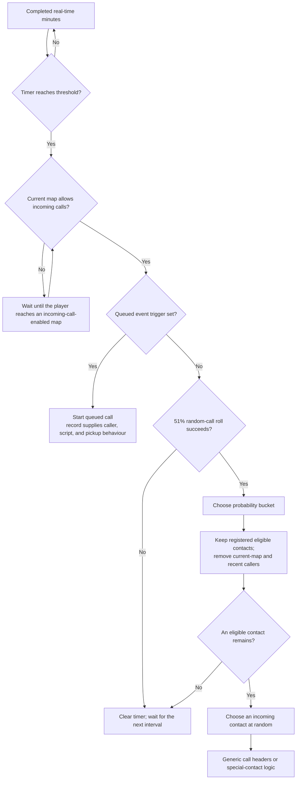
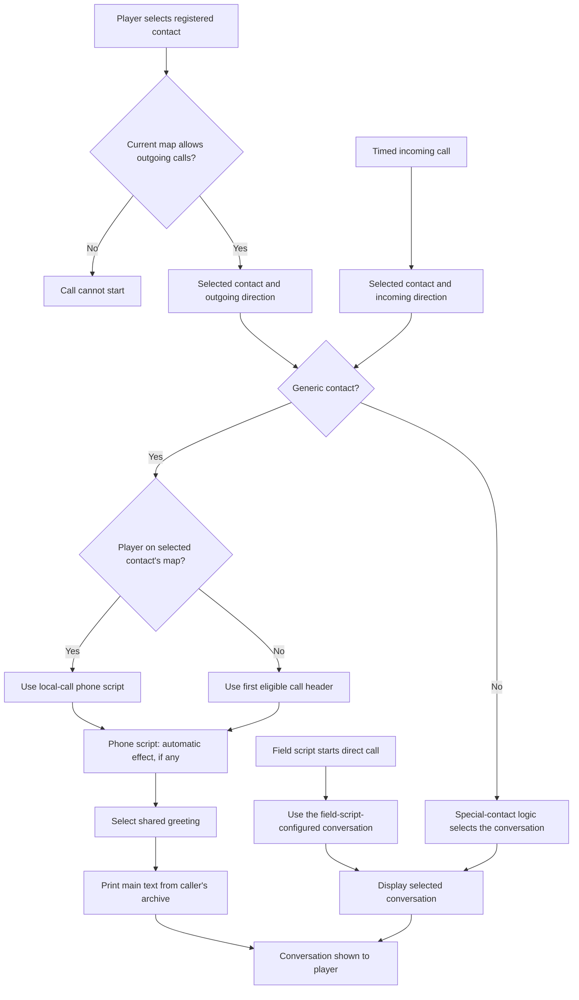
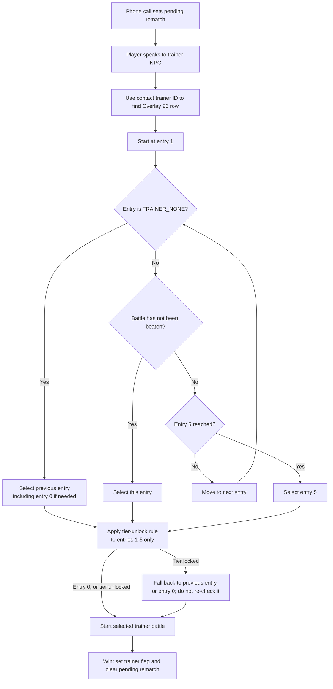

# Pokégear Phone System

> Author(s): [MrHam88](https://github.com/DevHam88/).  
> Research: [pret/pokeheartgold](https://github.com/pret/pokeheartgold), Eclipse (Luna), Senate, BlackShark, Mixone.  

This guide explains the Pokégear phone system in Pokémon HeartGold and SoulSilver: registering contacts, ordinary outgoing calls, random incoming calls, story/event calls, text archives, trainer rematches, Gym Leader rematches, and post-call gifts.  

The system is spread across several files. The most important distinction is that a **contact**, a **phone script**, a **phone conversation**, and a **field script** are different things. Various conditions, timers, and RNG are involved in triggering calls and selecting conversations.

Unless stated otherwise, offsets and byte values are for US HeartGold; overlay offsets refer to decompressed files.

---

## Overview

The system is easiest to follow in the same order as a call moves through it:

1. [**Phonebook data**](#phonebook-data) defines who can be contacted and their static properties: contact type, map, trainer battle, schedule, local-call phone script, and sort order.
2. [**Incoming and outgoing calls**](#incoming-and-outgoing-calls) explains how a call starts and, for a random incoming call, how the caller is chosen.
3. [**Phone conversations**](#phone-conversations) explains what the chosen contact says and does. A generic contact (contact type `0`) uses call headers and phone scripts; a special contact uses its own selection logic.
4. [**Trainer rematches**](#trainer-rematches) and [**Gifts after calls and rematches**](#gifts-after-calls-and-rematches) explain the persistent consequences that some phone scripts or special conversations create.

At a high level:

```text
player choice, timed incoming check, or direct field script
  -> selected caller (or caller supplied by a queued/direct event)
  -> contact type: generic call-header selection, or specialised contact selection
  -> selected phone script or specialised call code
  -> displayed phone conversation and any automatic effect
```

### Data structure
The following table maps the phone data and code.

| Component | Location | Role |
|---|---|---|
| Contact records | `tel/pmtel_book.dat` | 75 contacts with their contact type, trainer battle, map, item, local-call phone script, schedule, and random-call bucket. |
| Contact text-archive lookup | ARM9 `0x10847C`-`0x108511` | One message-archive ID for each contact ID; archive message `0` is the contact name. |
| Generic conversation data | Overlay 101 `0x1143C`-`0x13B6B` | Call headers, phone scripts, and common greeting selections for contacts of type `0`. |
| Queued system-event definitions | Overlay 2 `0xE104`-`0xE151` | Caller, phone-script ID, and forced-pickup setting for the 13 queued triggers. |
| Rematch battle lookup | Overlay 26 `0x20C`-`0x4FF` | Six battle IDs for each of 63 ordinary-trainer or Gym Leader rematch rows. |
| Saved phone state | Save data | Registered-contact order; 75 per-contact rematch and phone-call-gift records; Mom's five-item purchase queue; random-caller history; and queued event triggers. |

---

## Phonebook data

> Research: [PokeHeartGold: phonebook reader](https://github.com/pret/pokeheartgold/blob/master/src/phonebook_dat.c), [phone-contact structures](https://github.com/pret/pokeheartgold/blob/master/include/gear_phone.h).

The ROM file is a direct NitroFS file: `tel/pmtel_book.dat`. It is **not** a NARC member.  

<details>
<summary>For binary hacking, extract and edit this file directly</summary>

1. Extract or open the direct NitroFS file `tel/pmtel_book.dat`.
2. Read the 32-bit little-endian count at `0x00`.
3. Contact record `n` starts at `0x04 + (n * 0x14)`.
4. Use the table in [Phonebook data](#phonebook-data) for field offsets.
5. Keep the record count and record size unchanged unless you also understand every contact-ID-indexed table in the game.

For example, record-relative offset `0x0A` is the two-byte local-call phone-script ID. Record-relative offset `0x0F` is the random-call bucket. All multi-byte values are little-endian.

</details>

### File layout

The first four bytes are a little-endian entry count (75). They are followed by 20-byte contact records for each entry.

| Offset | Size (bytes) | Decomp field | Meaning |
|:---:|:---:|---|---|
| `00` | 1 | `id` | Contact ID (`PHONE_CONTACT_*`). |
| `01` | 1 | `type` | Contact type. It chooses the contact's call-selection route: generic headers for type `0`, or specialised logic for the other values; see [Contact type values](#contact-type-values). |
| `02` | 1 | `unk2` | Unknown. There is no *known* consumer of this byte. |
| `03` | 1 | `trainerClass` | Title label shown in the Pokégear contact list. Standard trainer classes and special phone-contact labels use different text paths; see [Title](#title). |
| `04` | 2 | `trainerId` | The contact's original trainer battle ID, or `TRAINER_NONE` (`0`) for a non-trainer. Ordinary trainer rematches use this to find an overlay 26 rematch lookup row. |
| `06` | 2 | `mapId` | The contact's **map-header ID**. It controls local-call behaviour, random-call filtering, location text, and the limited rematch/gift map marker; see [What `mapId` controls](#what-mapid-controls). |
| `08` | 2 | `gift` | Rematch reward item. Awarded after the rematch battle by the shared NPC field-script path. |
| `0A` | 2 | `phoneScriptIfLocal` | Generic contact's **local-call phone-script ID**: used for an outgoing call when the player is on this contact's `mapId`. |
| `0C` | 1 | `unkC` | Greeting-set index. Values `0`-`7` select a row from the shared phone-greeting table; `FF` suppresses the greeting. |
| `0D` | 1 | `rematchWeekday` | Weekday used by the ordinary phone-trainer schedule and Gym Leader schedule. Other rematch availability conditions also apply; see [Rematch availability conditions](#rematch-availability-conditions). |
| `0E` | 1 | `rematchTimeOfDay` | Morning `0`, day `1`, or night `2`, used with the weekday by those schedule checks. |
| `0F` | 1 | `unkF` | Random incoming-call "probability bucket". The game chooses bucket `0` (50% of the time), bucket `1` (30% of the time), and bucket `2` (20% of the time). |
| `10` | 1 | `sortParam[0]` | Stored Pokégear title-sort rank. |
| `11` | 1 | `sortParam[1]` | Stored Pokégear alphabetical-sort rank. |
| `12` | 1 | `sortParam[2]` | Stored Pokégear location-sort rank. |
| `13` | 1 | `sortParam[3]` | Padding (`00` in vanilla). |

:::caution  
The entry count controls only how many 20-byte records the file loader reads. Raising it does not create a usable new contact; the phone system has a hardcoded 75-contact limit. See [Expanding beyond 75 contacts](#expanding-beyond-75-contacts) for the coordinated work a real expansion needs.  
:::

### Contact type values

> Research: [PokeHeartGold: contact-type call dispatcher](https://github.com/pret/pokeheartgold/blob/master/src/application/pokegear/phone/overlay_101_021F1D74.c), [contact-type constants](https://github.com/pret/pokeheartgold/blob/master/include/application/pokegear/phone/phone_internal.h#L54).

`type` is a numeric contact-type selector, not a trainer class and not a random-call frequency. It selects the contact's call-selection route; it does **not** directly identify one display routine. The vanilla values are:

<details>
<summary>Click for details...</summary>

| Value | Decomp name | Contacts / effect |
|:---:|---|---|
| `0` | `GENERIC` | 45 contacts (60% of the phonebook). Uses generic call-header and phone-script tables. |
| `1` | `MOM` | Mom's savings and gift-queue logic. |
| `2` | `PROF_ELM` | Elm's story-flag, badge, Egg, and Pokérus logic. |
| `3` | `PROF_OAK` | Oak's dedicated call logic. |
| `4` | `KURT` | Kurt's dedicated call logic. |
| `5` | `BIKE_SHOP` | Bike Shop call logic. |
| `6` | `KENJI` | Black Belt Kenji call logic. |
| `7` | `BILL` | Bill call logic. |
| `8` | `DAYCAREMAN` | Day-Care Man call logic. |
| `9` | `DAYCARELADY` | Day-Care Lady call logic. |
| `10` | `BUENA` | Buena call logic. |
| `11` | `ETHAN_LYRA` | Childhood-friend call logic. |
| `12` | `GYMLEADER` | Fighting Dojo/Gym Leader rematch logic. |
| `13` | `BAOBA` | Safari Zone Warden call logic. |
| `14` | `IRWIN` | Juggler Irwin call logic. |
| `15` | `UNK15` | Unnamed/unknown call logic. |

</details>

Changing this byte changes which selection route reads the contact. For example, changing an ordinary trainer from `0` to `12` does not create a Gym Leader rematch: the Gym Leader logic expects Gym Leader message layouts and Fighting Dojo state.

### Title

> Research: [PokeHeartGold: phone contact-list display](https://github.com/pret/pokeheartgold/blob/master/src/application/pokegear/phone/overlay_101_021F1D74.c).

The title label in the phone list comes from the normal `trainerClass` text archive, from archive `271`, or is empty.

| title (`trainerClass` in decomp) range/value | Source of the displayed label |
|---|---|
| `0`-`199` | Normal trainer-class formatter. Vanilla class-name data is populated only through class `128`; a hack using `129`-`199` must also supply normal class-name text. |
| `200` (`PHONE_MOM`) | Empty label. Mom displays no trainer class. |
| `201`-`207` | Message archive 271, starting at message 38 plus `trainerClass - 201`. |

The special values are:  
- 201 Pokémon Professor
- 202 Childhood Friend
- 203 Poké Ball Creator
- 204 Day-Care
- 205 Radio Personality
- 206 Poké Maniac
- 207 Safari Warden

Elm and Oak both display "Pokémon Professor", while Ethan/Lyra display "Childhood Friend", for example. The name itself still comes from message `0` of that contact's [own phone text archive](#dialogue-common-greeting-text-and-contact-specific-text).

#### Compatibility with expanded trainer classes

<details>
<summary>Click for details...</summary>

This is a real compatibility limit for hacks that add trainer classes. The phone UI does not ask the normal trainer-class-name system whether a class is valid. Its logic is hardcoded as:

```text
if trainerClass == 200:
    show no class label                 # Mom
else if trainerClass >= 201:
    show message 38 + (trainerClass - 201) from archive 271
else:
    show the normal trainer-class name
```

Therefore the normal-class branch of an unpatched Pokégear phone UI accepts **0-199**, although vanilla class-name data exists only for `0`-`128`. Values 200-207 are reserved for non-trainer phone contacts, but the comparison actually catches **every value from 201 upward**.

:::caution  
If a hack adds normal trainer classes at 200 or above, changing the trainer-class text archive alone is insufficient.  
:::

A hypothetical trainer class **210** would be interpreted as a special phone title and reads message `38 + (210 - 201) = 47` from archive 271. It will display whatever message 47 contains; it does not gain a normal class name merely because a hack added class 210 elsewhere.

Separately, `trainerClass` is one unsigned byte. A phonebook row can therefore store only `0` through `255` as either a normal trainer-class ID or a special phone-contact title selector. Expanding normal trainer classes and moving the special values above them cannot extend this field beyond `255` without changing the phonebook record format and every reader of it.

</details>

### Trainer IDs for trainers and non-trainers

Vanilla non-trainer contacts use `TRAINER_NONE` (`0`), in the `trainerId` field: Mom, Elm, Oak, Ethan/Lyra, Kurt, the Day-Care couple, Buena, Bill, and the other special contacts do not carry a "real" trainer battle ID.

Trainer contacts carry their original battle ID, regardless of whether the contact can ever be rematched. The battle/rematch code decides whether that ID has a usable rematch row; the gift field and phone-item state do not require a rematch lookup. In the vanilla contact table there are 63 rows which do **not** have trainerId of `TRAINER_NONE`, matching the 63 overlay 26 rematch sets. Custom non-trainer contacts should use `TRAINER_NONE` (`0`) when no field trainer exists.

### What `mapId` controls

> Research: [PokeHeartGold: generic call display and encounter selection](https://github.com/pret/pokeheartgold/blob/master/src/application/pokegear/phone/scripts/phone_scripts_generic.c), [incoming-call filtering](https://github.com/pret/pokeheartgold/blob/master/src/field/overlay_2_gear_phone.c).

`mapId` has several proven uses:

- When a phone conversation is initialised, the location name of the header in `mapId` is stored in a message buffer (`3`), to be potentially used in conversations. The player's current location name is similarly stored in buffer `2`.
- Random incoming calls exclude a contact when the player is on the same `mapId`.
- Most special-contact logic and the generic logic use a same-map check to select their "local" response.
- Every generic phone call (contact type `0`) prepares two Pokémon-name message buffers before it prints its selected archive message: buffer `10` receives a random member of the caller's `trainerId` battle party, and buffer `11` receives a species selected from the wild-encounter data for this `mapId`. For buffer `11`, a contact whose `trainerClass` byte is exactly `11` (`0x0B`, Fisherman) selects one of the five Good Rod slots (with the night-fishing replacement at night); all other values select one of the twelve land slots for the current morning/day/night. A map with no wild encounters supplies Rattata instead. This is implemented by `GearPhoneCall_Generic` and `getRandomEncounterSlot` in Pokégear Overlay 101's generic phone-script code.
- If the contact's map-header ID is exactly `96` (`0x0060`, `MAP_NATIONAL_PARK`), the random incoming-call manager excludes that contact when flag `0x996` (`2454`, decomp name: `FLAG_UNK_996`) is set. The decomp calls its direct helper `Save_VarsFlags_CheckBugContestFlag`. The generic rematch/gift header conditions use the same check.
- The Pokégear map shows its pending battle marker when a **generic** contact (type `0`) at that `mapId` has either a valid ordinary rematch or a queued **phone-call gift**.

### Sorting phone numbers

> Research: [PokeHeartGold: phone-list sorting and saved order](https://github.com/pret/pokeheartgold/blob/master/src/application/pokegear/phone/overlay_101_021F0880.c).

There are a number of ways of sorting phone numbers in the Pokégear. The first three use a stored one-byte rank in each contact record. The ordering is **not** derived or recalculated from displayed text or `mapId` at runtime, so changes to titles, names, and locations require changes to these sort parameters as well.

- Title (`sortParam[0]`)
- Alphabet (`sortParam[1]`)
- Location (`sortParam[2]`)
- Manual arrangement

The selected rank determines the displayed order, then the Pokégear saves that resulting contact-ID order when it closes. See [Registered contacts](#registered-contacts) for the saved list and its layout.

## Registering phone numbers

> Research: [PokeHeartGold: phone-related field commands](https://github.com/pret/pokeheartgold/blob/master/src/scrcmd_c.c). Command names are cross-referenced with the [DSPRE HGSS script-command reference](https://github.com/DS-Pokemon-Rom-Editor/DSPRE/blob/master/DS_Map/Resources/HGSSCommands.md).

The static phonebook table does not immediately and fully populate contacts in the player's Pokégear. The player’s registered contact IDs are saved separately; see [Registered contacts](#registered-contacts).

Normal field scripts use the following command IDs. The first name is the established scrcmd/DSPRE name; the second is the decomp name for the same command.

| Opcode | scrcmd / editor name | Decomp name | Use |
|---|---|---|---|
| `0x0092` | `RecordPokegearNumber contact` | `RegisterGearNumber contact` | Add a valid contact ID to the player's phonebook. |
| `0x0093` | `CheckPokegearNumberRegistered contact result` | `CheckRegisteredPhoneNumber contact result` | Write 0 or 1 depending on registration state. |

:::info
Unlike in the original Generation II games, the Pokégear phonebook can hold every available contact. This means there is no vanilla field-script command or game code to de-register a phone contact.
:::

---

## Incoming and outgoing calls

> Research: [PokeHeartGold: phone ring manager and queued-event table](https://github.com/pret/pokeheartgold/blob/master/src/field/overlay_2_gear_phone.c), [map-header phone permissions](https://github.com/pret/pokeheartgold/blob/master/include/map_header.h).

Incoming and outgoing calls use different map permissions and different dialogue selection paths.

| Direction | Map-header field | Engine check | What it controls |
|---|---|---|---|
| Outgoing | `outgoingCalls` | `MapHeader_CanPlacePhoneCalls` | Whether the player can successfully start a call from the Pokégear. |
| Incoming | `incomingCalls` | `MapHeader_CanReceivePhoneCalls` | Whether random callers and queued event calls can ring on the current map. |

These are independent one-bit fields in `MapHeader`. A map can permit outgoing calls while blocking incoming calls.

DSPRE's map-header editor can set or clear `outgoingCalls` and `incomingCalls` independently.

### Outgoing

An outgoing call begins when the player selects a registered contact in the Pokégear. `outgoingCalls` must be enabled in the current map header. The selected contact's `type`, `mapId`, and, for contacts of type `0`, the generic outgoing call headers determine the conversation; this is distinct from the incoming random-call and queued-event paths below.

### Incoming: time trigger

> Research: [PokeHeartGold: incoming-call timer and trigger scheduler](https://github.com/pret/pokeheartgold/blob/master/src/unk_02092BE8.c).

The game keeps a runtime counter of elapsed **real-time minutes** for incoming calls. This timing gate is shared by queued system-event calls and ordinary random calls. While the player is in the normal overworld and no field task is running, completed minutes are added to this counter. At `10` minutes, the next normal input update when the player is standing still or has finished a movement checks for a call. It is not based on steps, frames, or a random per-step chance.

Queued system-event calls are checked first. Their triggering code can set the counter to one minute below the current threshold, making the queued call eligible after the next completed minute; this uses the threshold dynamically. A map which disallows incoming calls does not clear the counter; the check instead waits until the player reaches an allowed map. The timer is runtime state, so it is reset when a call is accepted or otherwise cleared.

#### Changing the shared incoming-call threshold

The vanilla ten-minute interval can be changed with two ARM9 immediate-byte edits. Both values must be changed to the same whole-minute value `N` (`1`-`255`). Map other revisions independently.

| ARM9 file offset | RAM address | Vanilla bytes | Meaning | Change for `N` minutes |
|:---:|:---:|---|---|---|
| `0x92DB2` | `0x02092DB2` | `0A 20` | Sets the call interval to `10` minutes. | Replace `0A` with `N`; retain `20`. |
| `0x92E44` | `0x02092E44` | `0A 29` | Compares the first elapsed-time update against `10` minutes. | Replace `0A` with `N`; retain `29`. |

For example, to use twenty minutes, change `0A 20` to `14 20` at `0x92DB2` and `0A 29` to `14 29` at `0x92E44`. The second edit keeps the first-update safeguard consistent with the interval. A queued trigger which sets the timer to one minute below the threshold still becomes eligible after one completed minute, because it uses the changed threshold value dynamically; a queued trigger which does not expedite itself waits for the shared threshold.

The shared incoming-call check:

1. Rejects maps where incoming calls are disabled.
2. Handles queued event calls first.
3. Continues to the ordinary random-call branch only when no queued call is started.



---

#### Incoming: random frequency

> Research: [PokeHeartGold: random-caller selection](https://github.com/pret/pokeheartgold/blob/master/src/field/overlay_2_gear_phone.c), [recent-caller save helpers](https://github.com/pret/pokeheartgold/blob/master/src/save_misc.c).

The following behaviour applies only to the ordinary random-call branch:

1. Makes a `51%` roll (`0`-`50` inclusive out of `0`-`99`). A failed roll clears the elapsed-minute counter, so the next ordinary attempt is after another ten minutes.
2. Chooses an `unkF` bucket: 0 (50%), 1 (30%), or 2 (20%).
3. Keeps only registered contacts whose `type` is `0` (generic contact), `10` (Buena), `11` (Ethan/Lyra), `12` (Gym Leader), or `14` (Irwin). All other types are excluded from this ordinary random-caller pool, though they may still be called by the player, start an event call, or be started by a field script.
4. Removes contacts on the player's current map, contacts already recorded in that bucket's call history, Buena in unsuitable conditions, and National Park contacts during the Bug-Catching Contest.
5. Randomly chooses from the remaining contacts. If no candidate remains, it clears the elapsed-minute counter.

The call starts with `isScriptedCall = 0`. A contact of type `0` uses the generic call-data route; contact types `10`, `11`, `12`, and `14` each use their own selection logic.

##### Where the allowed-type list is defined

<details>
<summary>Click for details...</summary>

At Overlay 2 file offset `0xC45C` (RAM `0x02251FDC`), the random-candidate builder contains this literal chain of five comparisons:

```text
type == 0 || type == 12 || type == 11 || type == 10 || type == 14
```

These Thumb comparisons must be patched to allow another contact type.

</details>

##### What "recently called" means

<details>
<summary>Click for details...</summary>

Each `unkF` bucket has its own recent-caller history. The candidate builder excludes contacts recorded in the selected bucket. If every otherwise eligible contact is already recorded, it clears that bucket's history so the pool cannot remain empty forever. When the player accepts an ordinary random incoming call, it adds that contact to the selected bucket and discards the oldest entry when the bucket is full. Queued event and field-scripted calls do not use this history.

See [Random-caller history](#random-caller-history) for the saved layout.

</details>

---

#### Incoming: queued system-event trigger

> Research: [PokeHeartGold: queued-event table and ring manager](https://github.com/pret/pokeheartgold/blob/master/src/field/overlay_2_gear_phone.c), [queued-trigger constants](https://github.com/pret/pokeheartgold/blob/master/include/constants/phone_constants.h).

Queued event calls are not ordinary random calls and are not entries in the normal event-flag or variable systems. `PhoneCallPersistentState.callTriggerFlags[2]` is a separate two-byte packed bitfield in the phone-call persistent save data. Bits `0` through `12` are the 13 trigger IDs below.  

In vanilla, native game code sets these bits when it detects its own condition, such as an Egg hatching, cycling 1,024 steps, or a full PC. Field scripts can also set one with unnamed command `ScrCmd_148` (`0x0094`): it takes two bytes, `triggerId` (`0`-`12`) and `expedite` (`0` or nonzero). It sets that trigger bit; when `expedite` is nonzero, it advances the shared incoming-call timer to one minute before its threshold if necessary. `UnsetPhoneCallTrigger` (`0x0095`) takes one `triggerId` byte and clears that bit.  

The caller, predefined phone script, and pickup behaviour do not live in the bitfield. They come from a separate 13-record table in Overlay 2 (`ov02_02253C84` in `src/field/overlay_2_gear_phone.c`). Its RAM address `0x02253C84` converts to **file offset `0xE104`**. It occupies `0x4E` bytes: `0xE104` through `0xE151` inclusive. Record `n` is the definition for trigger bit `n`; its file offset is `0xE104 + (n * 6)`.

```text
callerId (u8), unknown (u8), phoneScriptId (u16 little-endian), forcePickUp (u8), unknown (u8)
```

| Bit | File offset | Trigger ID | Caller ID | Phone script ID | Condition that queues it | `forcePickUp` |
|:---:|:---:|---|:---:|:---:|---|:---:|
| `0` | `E104` | `ELM_EGG_HATCHED` | `1` Elm | `000D` | The gift Togepi Egg hatches. | `0` |
| `1` | `E10A` | `ELM_POKERUS` | `1` Elm | `0007` | Pokérus is discovered. | `0` |
| `2` | `E110` | `BIKE_SHOP_STEPS` | `15` Bike Shop | `0055` | 1,024 bicycling steps, before the Bike Shop call flag is set. | `1` |
| `3` | `E116` | `BILL_PC_FULL` | `9` Bill | `005D` | Every PC storage slot is full; the one-time Bill condition allows it. | `1` |
| `4` | `E11C` | `OAK_DEX_PROGRESS` | `2` Oak | `0000` | A National Dex ownership milestone is reached before its acknowledgement flag is set. | `0` |
| `5` | `E122` | `DAYCARE_HAS_EGG` | `6` Day-Care Man | `0000` | An egg is available and the Day-Care call flags allow it. | `0` |
| `6` | `E128` | `BAOBA_NEW_POKEMON` | `24` Baoba | `0000` | A new Safari Zone species/area arrangement is available. | `0` |
| `7` | `E12E` | `BAOBA_NEXT_TEST` | `24` Baoba | `008E` | Safari Zone test progression requests the next test. | `1` |
| `8` | `E134` | `BAOBA_OBJECT_ARRANGEMENT` | `24` Baoba | `008F` | Safari Zone object-arrangement progression. | `1` |
| `9` | `E13A` | `BAOBA_MORE_OBJECTS` | `24` Baoba | `0090` | Safari Zone more-objects progression. | `1` |
| `10` | `E140` | `BAOBA_EVEN_MORE_OBJECTS` | `24` Baoba | `0091` | Safari Zone even-more-objects progression. | `1` |
| `11` | `E146` | `BAOBA_MEMORY_LOSS` | `24` Baoba | `0092` | Safari Zone memory-loss progression. | `1` |
| `12` | `E14C` | `MOM_BOUGHT_SOMETHING` | `0` Mom | `001B` | Mom spends the player's saved money on an item. | `0` |

When a set trigger is selected, the ring manager reads its matching table record, assigns the caller and `phoneScriptId`, and marks the call as an event call (`isScriptedCall = 3`). The `forcePickUp` byte decides what happens next:

| `forcePickUp` | Result |
|:---:|---|
| `0` | The phone rings normally. The player opens or answers the Pokégear phone as usual. |
| `1` | The game begins field scene script `0x7FF` immediately. The player does not get a normal opportunity to ignore the ring. |

The table above accounts for all 13 triggers. Its `forcePickUp = 1` rows are Bike Shop, Bill, and the five Baoba progression calls; the other six ring normally. Both unknown bytes are `00` in every record; their purpose is not established, so leave them unchanged.

:::caution No in-place space for a fourteenth event-call record  
The 13-record table ends at Overlay 2 offset `0xE151`, but the six following zero-looking bytes are **not** free space. The Celebi cutscene's live `VecFx32 { 0, 0x1000, 0 }` constant begins at `0xE154` and occupies `0xE154`-`0xE15F`; its first `u32` is zero, which makes `0xE154`-`0xE157` appear unused in a hex editor. Writing record 13 at `0xE152` would overwrite that vector's `x` component.

Only `0xE152`-`0xE153` are alignment padding. A fourteenth record requires a relocated or expanded table and matching code changes; see [Expanding queued event calls](#expanding-queued-event-calls).  
:::

#### Vanilla trigger setters (decomp references)

<details>
<summary>Click for details...</summary>

> Research: [PokeHeartGold: trigger scheduling](https://github.com/pret/pokeheartgold/blob/master/src/unk_02092BE8.c), [queued-event definitions](https://github.com/pret/pokeheartgold/blob/master/src/field/overlay_2_gear_phone.c).

The event-record table above defines what each pending bit does. This table instead records every vanilla path which **sets** a bit. It is a source map for advanced hackers: most paths call `sub_02092E14`, which sets the persistent bit and, when its final argument is true, advances the shared incoming-call timer. Bit `1` is set by a field script, and bit `6` writes the persistent bit directly.

| Bit | Vanilla setter and condition | Expedites the incoming timer? |
|:---:|---|:---:|
| `0` | `sub_02093134` in `src/unk_02092BE8.c`, called by `src/hatch_egg_task.c` after an egg hatches. It sets the bit only when `MonIsFromTogepiEgg` identifies the special Elm Egg. | Yes |
| `1` | New Bark's field script, `files/fielddata/script/scr_seq/scr_seq_0003.s`, uses `ScrCmd_148 CALL_TRIGGER_ELM_POKERUS, FALSE` after its Pokérus check. This is the vanilla example of a script setting a queued-call bit. | No |
| `2` | `FieldSystem_UpdateBikeShop` in `src/field/field_control.c`: the Bike Shop call has not already happened, bit `2` is not already pending, and `GAME_STAT_STEPS_BIKED` is at least `1024`. | Yes |
| `3` | `sub_02093070` in `src/unk_02092BE8.c`: Bill is registered, the full-PC call flag is clear, and every PC storage slot is full. This helper is called after several battle and storage-related return paths. | Yes |
| `4` | `sub_020930C4` in `src/unk_02092BE8.c`: Oak is registered, the National Dex owned count has reached a nonzero multiple of `50`, and the corresponding Oak acknowledgement flag is clear. | No |
| `5` | `sub_0209316C` in `src/unk_02092BE8.c`, called when the Day-Care generates an Egg in `src/get_egg.c`: the Day-Care Man is registered, and the script-flag guard permits the Egg call. | Yes |
| `6` | `SaveData_SafariZone_CheckAreasWithUpdatedEncounters` in `src/unk_02097268.c`: after at least one day has passed outside an active Safari session, it compares the Safari Zone's encounter lists before and after the daily object-level update. It sets bit `6` if an area now has changed encounters, and clears it when none do. | No |
| `7` | `sub_02092E54` in `src/unk_02092BE8.c`: no Baoba bits `7`-`11` are already pending, Safari progress variable `0x4057` (`16471`, decomp name: `VAR_UNK_4057`) is `3`, and the Safari Zone's three-hour timer has elapsed. | Yes |
| `8` | `sub_02092E54`: Safari progress is at least `6`, the player has the National Dex, the three-hour timer reports its ordinary elapsed state, and the Safari object-unlock level is `0`. | Yes |
| `9` | `sub_02092E54`: the same post-National-Dex three-hour branch, with object-unlock level `1` or `2`. | Yes |
| `10` | `sub_02092E54`: the same branch, with object-unlock level `3`; it is also chosen by the routine's exceptional elapsed-time result when the unlock level is at least `3`. | Yes |
| `11` | `sub_02092E54`: the routine's exceptional elapsed-time result when the object-unlock level is below `3`. | Yes |
| `12` | `src/battle/battle_setup.c` calls `MomGift_TryEnqueueGiftOnBalanceChange` after Mom's savings balance changes. If that helper successfully queues a purchase, it sets bit `12`. The purchase and its quantity are stored in Mom's separate gift queue. | Yes |

`VAR_UNK_4057` is a normal script variable read by the Baoba evaluator; it is distinct from the queued-call bitfield. The three-hour test is `sub_0202F798` in `src/safari_zone.c`. The exact story meaning of every value of this variable is not yet named by the decomp, so the table deliberately states the proven values and conditions rather than assigning unsupported labels to them.

</details>

Mom's purchase call and the item collection are separate: the queued call announces the purchase, while the home field script retrieves the stored item, checks Bag space, and clears `CALL_TRIGGER_MOM_BOUGHT_SOMETHING` only after a successful award.

---

### Incoming: field-script trigger

> Research: [PokeHeartGold: `SetPhoneCall` and `RunPhoneCall`](https://github.com/pret/pokeheartgold/blob/master/src/scrcmd_c.c). See also the [community HGSS script-command and ARM9 research](https://projectpokemon.org/home/forums/topic/54137-hgss-list-of-scripting-commands-and-arm9-offsets/).

Not every incoming call uses the queued trigger-bit table. A normal field script can configure and immediately launch a phone call with these commands. Elm's stolen-Pokémon call is a vanilla direct field-scripted call: it selects `PHONE_SCRIPT_002` and does not set or consume any queued event-trigger bit.

| Opcode | scrcmd / editor name | Source name | Use |
|---|---|---|---|
| `0x01AE` | `SetPhoneCall contact scriptedFlag predefinedScript` | `SetPhoneCall` | Configure a field-scripted phone call. |
| `0x01AF` | `RunPhoneCall` | `RunPhoneCall` | Launch the configured phone call. |

---

## Phone conversations

> Research: [PokeHeartGold: phone-call dispatch and effects](https://github.com/pret/pokeheartgold/blob/master/src/application/pokegear/phone/overlay_101_021F1D74.c).

In this guide, a **phone script** is the compact Pokégear definition that supplies message IDs and an optional automatic effect. It is separate from a normal **field script**, which can register a number, queue a call, or launch a direct call. A **phone conversation** is the interaction shown to the player when the Pokégear displays a phone script or runs specialised call code.

There are two selection routes:

- A **generic contact** is exactly a phonebook contact of type `0`. There are 45 of these 75 contacts. Generic contacts use Overlay 101 call headers and phone scripts, described below.
- A **special contact** has any other contact type. Its own selection logic chooses what the call does; it may use a dedicated display routine or the basic generic display code. The generic call headers below do not control it.

The conditions for special contacts are defined in the [phone scripts source directory](https://github.com/pret/pokeheartgold/tree/master/src/application/pokegear/phone/scripts). This guide details [Professor Elm's calls](#professor-elm-story-calls-and-status-calls) and [Gym Leader calls](#calling-a-gym-leader).

Generic calls are **linear**. Once the game selects a call header, the greeting, main message, and any automatic effect happen without a Yes/No choice. The player may choose to place an outgoing call, but cannot choose its result after it starts. Some special contacts use interactive calls instead: Mom can ask about savings and Gym Leaders can ask whether to arrange a rematch. Not every special contact is interactive.

### Generic phone conversations: the four parts

> Research: [PokeHeartGold: generic call headers and greetings](https://github.com/pret/pokeheartgold/blob/master/src/application/pokegear/phone/phone_generic_headers.c), [phone-script definitions](https://github.com/pret/pokeheartgold/blob/master/src/application/pokegear/phone/phone_script_defs.c), [generic call selection](https://github.com/pret/pokeheartgold/blob/master/src/application/pokegear/phone/scripts/phone_scripts_generic.c).

Each generic call has four separate parts:

| Part | What it controls | Location |
|---|---|---|
| [**Call headers**](#call-headers-selecting-a-conversation) | Which phone script can run, based on priority, condition, and chance. | Overlay 101: `0x11F4C`-`0x13B6B`. |
| [**Phone scripts**](#phone-scripts-message-and-automatic-effect) | Message IDs and an optional automatic effect: rematch, phone-call gift, flag, or random word. | Overlay 101: `0x1143C`-`0x11EEB`. |
| [**Greeting selection**](#greeting-selection-selecting-an-opening-remark) | Which common opening remark to use, based on contact, direction, time of day, and player gender. | Contact record `unkC`; Overlay 101: `0x11EEC`-`0x11F4B`; archive `0640`. |
| [**Dialogue text**](#dialogue-common-greeting-text-and-contact-specific-text) | The common greeting text and the caller-specific main message. | Shared archive `0640`; caller archive selected through `sPhoneMessageGmm`. |

For a generic contact, the game checks the relevant call headers in order and uses the first eligible phone script. Its automatic effect is applied first, then the game prints the shared greeting (unless the contact suppresses greetings), followed by the selected message from the caller's archive.



### Call headers: selecting a conversation

> Research: [PokeHeartGold: generic call headers](https://github.com/pret/pokeheartgold/blob/master/src/application/pokegear/phone/phone_generic_headers.c), [generic header conditions and selection](https://github.com/pret/pokeheartgold/blob/master/src/application/pokegear/phone/scripts/phone_scripts_generic.c).

Every contact has 16 six-byte call-header slots: eight incoming and eight outgoing, regardless of contact type. Only the generic contact route (type `0`) uses them to select a conversation; special-contact logic uses its own selection route.

Each slot has this layout:

```text
byte 0: condition type
byte 1: chance value
bytes 2-3: `scriptType` — selects the code which displays the selected phone script
bytes 4-5: little-endian phone-script ID
```

The generic selector checks up to eight slots for the current direction, in order. Unused slots use `NIL` (`00 64 00 00 00 00`), a terminator with unused 100%-chance/script-`0` fields, or `NONE` (`FF 00 00 00 00 00`), a zeroed placeholder. An outgoing call made while the player is on the contact's own `mapId` bypasses those outgoing slots. It forces `scriptType` to `0` and uses the contact record's `phoneScriptIfLocal` value as the phone-script ID.

#### Call-header condition types

The first byte of a call header determines whether its phone script is eligible. Where a condition reaches its final chance test, it makes a random roll from `0` through `99` and succeeds when the result is **less than or equal to** the header's chance byte. Thus chance `100` always succeeds, while values `0`-`99` succeed `1%`-`100%` of the time.

<details>
<summary>Click for details...</summary>

| Byte | Decomp name | Header is eligible when... |
|:---:|---|---|
| `00` | `NIL` | Stops the current group of up to eight call headers. Vanilla uses `00 64 00 00 00 00`; the chance and phone-script fields are not read. |
| `01` | `RAND1` | Its chance roll succeeds. Identical to `RAND6`. |
| `02` | `FIGHTPOSTROCKETS` | No rematch is pending and no phone-call gift is queued (`PhoneRematch.seeking` and `PhoneRematch.giftItem` are clear); if this header uses `scriptType` `0` and selects a `REMATCH` phone script, flag `0x0C6` (`198`, decomp name: `FLAG_BEAT_RADIO_TOWER_ROCKETS`) is set; then its chance roll succeeds. |
| `03` | `POSTROCKETWEEKTIME` | `FLAG_BEAT_RADIO_TOWER_ROCKETS` (`0x0C6`) is set, the contact's weekday (`rematchWeekday`) and time-of-day (`rematchTimeOfDay`) fields match the current time, and its chance roll succeeds. |
| `04` | `BUGCONTESTDAYS` | The current RTC weekday is Tuesday, Thursday, or Saturday, and its chance roll succeeds. The Bug-Catching Contest need not be active. |
| `05` | `DURINGROCKETS` | Script variable `0x4077` (`16503`, decomp name: `VAR_SCENE_ROCKET_TAKEOVER`) is `2`, `3`, or `4`, and its chance roll succeeds. |
| `06` | `RAND6` | Its chance roll succeeds. Identical to `RAND1`. |
| `07` | `FIGHTPOSTROCKETSNOTBUGCONTEST` | `FLAG_BEAT_RADIO_TOWER_ROCKETS` (`0x0C6`) is set; a rematch is already pending (`PhoneRematch.seeking` is set); either the contact's `mapId` is not National Park or `FLAG_UNK_996` (`0x996`) is clear; then its chance roll succeeds. |
| `08` | `GIFTNOTBUGCONTEST` | A phone-call gift is already queued (`PhoneRematch.giftItem` is set); either the contact's `mapId` is not National Park or `FLAG_UNK_996` (`0x996`) is clear; then its chance roll succeeds. |
| `FF` | `NONE` | Stops the current group of up to eight call headers. Vanilla uses `FF 00 00 00 00 00` for unused slots. |

`NIL` and `NONE` are scan terminators; neither selects a phone script.

</details>

`scriptType` is unrelated to the contact type and to the result stored in the phone script. For generic call headers, vanilla uses these three values:

<details>
<summary>Click for details...</summary>

| `scriptType` | What the selected code does |
|:---:|---|
| `0` | Applies the record's automatic effect, prints the greeting, then prints the record's gender-specific message. |
| `1` | Does the same, but first prepares a random Pokémon from the caller's trainer party and a random wild Pokémon from the caller's map for text substitutions. |
| `2` | Does the same, but randomly chooses one of eleven consecutive message variants before printing it. |

The field is a direct index into the game's table of call code. It is not another contact category; special-contact selection logic can select other values from that same table.

</details>

<details>
<summary>Call-header binary reference</summary>

The generic selector is `PhoneCall_GetScriptId_Generic`; its internal call-header walker is `PhoneScriptGeneric_GetScriptIdInternal`. The generic display-code pointers for `scriptType` `0`, `1`, and `2` are in the Overlay 101 dispatch table at file offset `0x10F3C`; they point to RAM addresses `0x021F2681`, `0x021F2F51`, and `0x021F2FFD` respectively.

</details>

### Phone scripts: message and automatic effect

> Research: [PokeHeartGold: phone-script definitions](https://github.com/pret/pokeheartgold/blob/master/src/application/pokegear/phone/phone_script_defs.c), [phone-script lookup and automatic effects](https://github.com/pret/pokeheartgold/blob/master/src/application/pokegear/phone/overlay_101_021F1D74.c).

A phone script is also six bytes. Its first two bytes select messages for male and female players in the caller's archive; its remaining bytes describe an optional automatic effect.

```text
byte 0: message ID for a male player
byte 1: message ID for a female player
bytes 2-3: little-endian word: low 4 bits = result value; upper 12 bits = parameter 0
bytes 4-5: little-endian parameter 1
```

| Result value | Decomp name | Effect |
|:---:|---|---|
| `0` | `NONE` | Prints dialogue only. |
| `1` | `UNK1` | Sets or clears a save flag (identical to value `2`). |
| `2` | `FLAG` | Sets or clears a save flag (identical to value `1`). |
| `3` | `REMATCH` | Sets the caller's pending rematch state. |
| `4` | `ITEM` | Queues a phone-call gift for collection from the NPC. |
| `5` | `WORD` | Inserts a random word or message fragment. |

:::warning
The packed parameters for individual `ITEM`, `FLAG`, and `WORD` records are not all documented in decomp: exercise caution when changing effects.
:::

<details>
<summary>Phone-script binary reference</summary>

The first phone scripts are `00 00 00 00 00 00` for ID `0`, `01 02 00 00 00 00` for `PHONE_SCRIPT_001`, and `21 22 00 00 00 00` for `PHONE_SCRIPT_002`. These first scripts are Elm messages; copying one to another caller can produce different wording because the caller's archive changes.

`PhoneCall_GetScriptDefPtrByID` resolves a phone script, and `PhoneCall_ApplyGenericNPCcallSideEffect` interprets its `REMATCH`, `ITEM`, `UNK1`, `FLAG`, and `WORD` results.

</details>

### Greeting selection: selecting an opening remark

> Research: [PokeHeartGold: greeting table](https://github.com/pret/pokeheartgold/blob/master/src/application/pokegear/phone/phone_generic_headers.c), [greeting display code](https://github.com/pret/pokeheartgold/blob/master/src/application/pokegear/phone/overlay_101_021F1D74.c).

The greeting is independent of the selected phone script. The Overlay 101 table occupies `0x11EEC`-`0x11F4B`: eight rows of 12 one-byte message IDs. The contact record's `unkC` byte selects the row; row `g` begins at `0x11EEC + (g × 0x0C)`. `FF` suppresses the greeting.

Each selected byte is a message ID in shared archive `0640`. The 12 bytes in each row are arranged as follows:

| Byte within row | Call direction | Time of day | Player gender |
|:---:|---|---|---|
| `00`-`01` | Outgoing | Morning | Male / female |
| `02`-`03` | Outgoing | Day | Male / female |
| `04`-`05` | Outgoing | Night | Male / female |
| `06`-`07` | Incoming | Morning | Male / female |
| `08`-`09` | Incoming | Day | Male / female |
| `0A`-`0B` | Incoming | Night | Male / female |

The table contains only rows `0`-`7`. A generic contact can safely reuse one of those rows or use `FF`.

### Dialogue: common greeting text and contact-specific text

> Research: [PokeHeartGold: phone text-archive mapping](https://github.com/pret/pokeheartgold/blob/master/src/phonebook_dat.c#L60).

The greeting table uses shared archive `0640`. A fixed ARM9 lookup maps each contact ID to its caller-specific archive: 75 little-endian `u16` archive IDs at `0x10847C`-`0x108511` (RAM `0x0210847C`-`0x02108511`, decomp's `sPhoneMessageGmm` table).

The caller's contact ID indexes it directly: contact ID `c` reads the two-byte archive ID at `0x10847C + (c × 2)`. For example, contact ID `0` (Mom) contains `0x0298`, selecting archive `664`; contact ID `1` (Elm) contains `0x02CC`, selecting archive `716`.

To remap an existing contact, replace its two-byte little-endian table entry with the desired message-archive ID. The new archive must provide message `0` for the contact name and every message ID used by that contact's phone scripts or specialised call logic. Reusing another contact's archive is mechanically valid but will also reuse its name and any matching message IDs. This fixed 75-entry table has no count field; adding a contact still requires the coordinated work in [Expanding beyond 75 contacts](#expanding-beyond-75-contacts).

A phone script supplies a main-message ID, but that ID is always read from the **current caller's** archive. The same phone script can therefore show different wording when used by another contact. Changing text changes wording only; it does not change the condition or automatic effect which selected it.

### Professor Elm: story calls and status calls

> Research: [PokeHeartGold: Professor Elm call logic](https://github.com/pret/pokeheartgold/blob/master/src/application/pokegear/phone/scripts/phone_scripts_prof_elm.c), [Route 30's direct call](https://github.com/pret/pokeheartgold/blob/master/files/fielddata/script/scr_seq/scr_seq_0227_R30.s).

Elm is contact type `2`, so he does not use generic call headers. His selector has three routes:

| Call route | How the conversation is chosen |
|---|---|
| Direct field-script call | Call mode `2` treats the supplied index as one of five fixed entries, selecting phone scripts `002`-`006`. Vanilla map scripts use indices `0`-`3`: the stolen-Pokémon call, the Egg collection call, the Team Rocket radio call, and a request to visit Elm's Lab. Index `4` is defined as another Lab request, but has no field-script use in the supplied source. |
| Queued incoming call | The queued-event record supplies the phone-script ID directly. This route includes the hatched-Egg call (`013`) and the Pokérus call (`007`). |
| Player's outgoing call | The selector walks the priority list below and returns the first matching phone script. |

All three routes use display handler `0`, the ordinary phone-script display code. The direct-call and queued-call routes therefore choose an existing phone script; they do not use generic call headers.

For an outgoing call, the first matching condition wins:

| First matching condition | Phone script | Purpose |
|---|:---:|---|
| Player is on Elm's map | `001` | Local-call conversation. |
| `FLAG_GOT_ELMS_PANIC_CALL` (`0x0EE`, `238`) is clear | `008` | Before the stolen-Pokémon call has happened. |
| `FLAG_GAVE_RIVAL_NAME_TO_OFFICER` (`0x079`, `121`) is clear | `009` | Before the player names the rival. |
| `FLAG_GOT_PICK_UP_EGG_CALL_FROM_ELM` (`0x09F`, `159`) is clear | `010` | Before Elm directs the player to collect the Egg. |
| `FLAG_GOT_EGG_FROM_ELMS_ASSISTANT` (`0x070`, `112`) is clear | `011` | Before the player receives the Egg. |
| Fewer than seven badges; `FLAG_SYS_HATCHED_TOGEPI_EGG` (`0x983`, `2435`) is clear | `012` | Egg has not hatched. |
| Fewer than seven badges; Egg hatched; `FLAG_GOT_EVERSTONE_FROM_ELM` (`0x11A`, `282`) is clear | `013` | Egg has hatched, before Elm gives the Everstone. |
| Fewer than seven badges; Egg hatched; Everstone flag set | `014` or `015` | Random ordinary conversation. |
| `VAR_SCENE_ROCKET_TAKEOVER` (`0x4077`, `16503`) is `2`-`4` | `016` | Radio Tower takeover. |
| Seven badges | `017` | Before the eighth badge. |
| `FLAG_GAME_CLEAR` (`0x964`, `2404`) is clear | `018` | Before the first Hall of Fame completion. |
| `FLAG_GOT_SS_TICKET_FROM_ELM` (`0x0F2`, `242`) is clear | `019` | Before Elm gives the S.S. Ticket. |
| Everstone flag clear | `012` or `013` | Selected by whether the Egg has hatched. |
| `FLAG_WAS_TOLD_ABOUT_POKERUS` (`0x065`, `101`) is set | `020`-`022` | One of three random late-game conversations. |
| Otherwise | `020` or `021` | One of two random late-game conversations. |

---

## Trainer rematches

> Research: [PokeHeartGold: rematch-table selector](https://github.com/pret/pokeheartgold/blob/master/src/overlay_26_022598C0.c), [shared phone-trainer field script](https://github.com/pret/pokeheartgold/blob/master/files/fielddata/script/scr_seq/scr_seq_0953.s).

### Ordinary phone-trainer rematches

Ordinary trainer rematches use phone state and a fixed trainer-ID table in Overlay 26 at `0x20C`. It has 63 rows of 12 bytes (`0x20C`-`0x4FF`), each holding six little-endian `u16` trainer battle IDs: the original trainer ID and five possible rematch teams.

| Entry | Relative offset | Tier unlock flag | Meaning |
|:---:|:---:|---|---|
| `0` | `00` | None | Original/base battle ID. It identifies the row and is the selector’s final fallback. |
| `1` | `02` | `0x97C` (`2428`) | Duplicate base battle ID. Vanilla never sets this flag. It is a redundant positive-index fallback: selecting it produces the same battle as entry `0`. |
| `2` | `04` | `0x97D` (`2429`) | First distinct rematch team. Set by the Radio Tower story sequence. |
| `3` | `06` | `0x97E` (`2430`) | Second distinct rematch team. Set by the Hall of Fame sequence. |
| `4` | `08` | `0x97F` (`2431`) | Third distinct rematch team. Set when the player receives the Earth Badge at Viridian Gym. |
| `5` | `0A` | `0x980` (`2432`) | `TRAINER_NONE` (`0x0000`) in every vanilla ordinary-trainer row. It is a terminator in vanilla, but can hold a fourth distinct rematch team in a hack. |

An **entry** is a physical slot in a table row. A **rematch tier** is an entry used as a progressively unlocked battle team: entries `1` through `5` can serve as tiers, while entry `0` is the base battle and fallback. The decomp calls the corresponding flag check a “rematch group”; there is no separate tier data structure.

Rows `0`-`46` are ordinary trainers; rows `47`-`62` are Gym Leaders.

<details>
<summary>Vanilla Overlay 26 table</summary>

| Row | Overlay 26 offset | Trainer | Entry 0 | Entry 1 | Entry 2 | Entry 3 | Entry 4 | Entry 5 |
|:---:|---|---|---|---|---|---|---|---|
| 0 | `0x020C` | Bird Keeper Jose | `414` | `414` | `303` | `446` | `602` | `0` |
| 1 | `0x0218` | Picnicker Erin | `151` | `151` | `335` | `453` | `603` | `0` |
| 2 | `0x0224` | Picnicker Liz | `27` | `27` | `276` | `277` | `518` | `0` |
| 3 | `0x0230` | School Kid M Chad | `397` | `397` | `434` | `435` | `507` | `0` |
| 4 | `0x023C` | Sailor Huey | `211` | `211` | `440` | `441` | `509` | `0` |
| 5 | `0x0248` | Bug Catcher Wade | `4` | `4` | `461` | `460` | `512` | `0` |
| 6 | `0x0254` | Youngster Joey | `8` | `8` | `279` | `280` | `510` | `0` |
| 7 | `0x0260` | School Kid M Jack | `178` | `178` | `430` | `431` | `503` | `0` |
| 8 | `0x026C` | Ace Trainer M Gaven | `102` | `102` | `456` | `457` | `604` | `0` |
| 9 | `0x0278` | Black Belt Kenji | `17` | `17` | `250` | `278` | `605` | `0` |
| 10 | `0x0284` | Hiker Parry | `145` | `145` | `451` | `452` | `606` | `0` |
| 11 | `0x0290` | Picnicker Tiffany | `402` | `402` | `466` | `467` | `522` | `0` |
| 12 | `0x029C` | Hiker Anthony | `61` | `61` | `100` | `155` | `523` | `0` |
| 13 | `0x02A8` | Ace Trainer F Reena | `114` | `114` | `444` | `445` | `607` | `0` |
| 14 | `0x02B4` | Fisherman Wilton | `124` | `124` | `325` | `450` | `608` | `0` |
| 15 | `0x02C0` | Ace Trainer F Jamie | `113` | `113` | `458` | `459` | `609` | `0` |
| 16 | `0x02CC` | Juggler Irwin | `7` | `7` | `454` | `455` | `527` | `0` |
| 17 | `0x02D8` | Poké Maniac Brent | `131` | `131` | `172` | `173` | `530` | `0` |
| 18 | `0x02E4` | School Kid M Alan | `24` | `24` | `432` | `433` | `505` | `0` |
| 19 | `0x02F0` | Pokéfan M Derek | `44` | `44` | `438` | `439` | `610` | `0` |
| 20 | `0x02FC` | Picnicker Gina | `65` | `65` | `142` | `334` | `520` | `0` |
| 21 | `0x0308` | Fisherman Tully | `123` | `123` | `323` | `324` | `517` | `0` |
| 22 | `0x0314` | Pokéfan F Beverly | `182` | `182` | `436` | `437` | `611` | `0` |
| 23 | `0x0320` | Bird Keeper Vance | `137` | `137` | `447` | `448` | `612` | `0` |
| 24 | `0x032C` | Fisherman Ralph | `57` | `57` | `462` | `463` | `515` | `0` |
| 25 | `0x0338` | Camper Todd | `66` | `66` | `274` | `275` | `525` | `0` |
| 26 | `0x0344` | Bug Catcher Arnie | `78` | `78` | `360` | `449` | `513` | `0` |
| 27 | `0x0350` | Lass Dana | `400` | `400` | `464` | `465` | `528` | `0` |
| 28 | `0x035C` | Lass Krise | `184` | `184` | `613` | `614` | `615` | `0` |
| 29 | `0x0368` | Youngster Ian | `64` | `64` | `616` | `617` | `618` | `0` |
| 30 | `0x0374` | Firebreather Walt | `388` | `388` | `619` | `620` | `621` | `0` |
| 31 | `0x0380` | Bug Catcher Doug | `140` | `140` | `622` | `623` | `624` | `0` |
| 32 | `0x038C` | Bug Catcher Rob | `48` | `48` | `625` | `626` | `627` | `0` |
| 33 | `0x0398` | Biker Reese | `313` | `313` | `628` | `629` | `630` | `0` |
| 34 | `0x03A4` | Biker Aiden | `574` | `574` | `631` | `632` | `633` | `0` |
| 35 | `0x03B0` | Biker Ernest | `579` | `579` | `634` | `635` | `636` | `0` |
| 36 | `0x03BC` | Teacher Hillary | `382` | `382` | `637` | `638` | `639` | `0` |
| 37 | `0x03C8` | School Kid M Billy | `331` | `331` | `640` | `641` | `642` | `0` |
| 38 | `0x03D4` | Twins Kay & Tia | `569` | `569` | `643` | `644` | `645` | `0` |
| 39 | `0x03E0` | Bird Keeper Josh | `565` | `565` | `646` | `647` | `648` | `0` |
| 40 | `0x03EC` | School Kid M Torin | `567` | `567` | `649` | `650` | `651` | `0` |
| 41 | `0x03F8` | Young Couple Tim & Sue | `559` | `559` | `652` | `653` | `654` | `0` |
| 42 | `0x0404` | Hiker Kenny | `358` | `358` | `655` | `656` | `657` | `0` |
| 43 | `0x0410` | Camper Tanner | `561` | `561` | `658` | `659` | `660` | `0` |
| 44 | `0x041C` | Fisherman Kyle | `59` | `59` | `661` | `662` | `663` | `0` |
| 45 | `0x0428` | Fisherman Kyler | `558` | `558` | `664` | `665` | `666` | `0` |
| 46 | `0x0434` | Gentleman Alfred | `401` | `401` | `672` | `673` | `674` | `0` |
| 47 | `0x0440` | Gym Leader Falkner | `20` | `20` | `712` | `0` | `0` | `0` |
| 48 | `0x044C` | Gym Leader Bugsy | `21` | `21` | `713` | `0` | `0` | `0` |
| 49 | `0x0458` | Gym Leader Whitney | `30` | `30` | `714` | `0` | `0` | `0` |
| 50 | `0x0464` | Gym Leader Morty | `31` | `31` | `715` | `0` | `0` | `0` |
| 51 | `0x0470` | Gym Leader Jasmine | `33` | `33` | `717` | `0` | `0` | `0` |
| 52 | `0x047C` | Gym Leader Chuck | `34` | `34` | `718` | `0` | `0` | `0` |
| 53 | `0x0488` | Gym Leader Pryce | `32` | `32` | `716` | `0` | `0` | `0` |
| 54 | `0x0494` | Gym Leader Clair | `35` | `35` | `719` | `0` | `0` | `0` |
| 55 | `0x04A0` | Gym Leader Brock | `253` | `253` | `720` | `0` | `0` | `0` |
| 56 | `0x04AC` | Gym Leader Misty | `254` | `254` | `721` | `0` | `0` | `0` |
| 57 | `0x04B8` | Gym Leader Lt. Surge | `255` | `255` | `722` | `0` | `0` | `0` |
| 58 | `0x04C4` | Gym Leader Erika | `256` | `256` | `723` | `0` | `0` | `0` |
| 59 | `0x04D0` | Gym Leader Janine | `257` | `257` | `724` | `0` | `0` | `0` |
| 60 | `0x04DC` | Gym Leader Sabrina | `258` | `258` | `725` | `0` | `0` | `0` |
| 61 | `0x04E8` | Gym Leader Blaine | `259` | `259` | `726` | `0` | `0` | `0` |
| 62 | `0x04F4` | Gym Leader Blue | `261` | `261` | `727` | `0` | `0` | `0` |

</details>

#### Rematch flow

After the phone call has set a pending rematch, the game selects the trainer battle as follows:



1. A generic phone script or special-contact logic sets `PhoneRematch.seeking` for the contact.
2. The trainer battle lookup checks that bit and uses the contact's `trainerId` from `pmtel_book.dat` to find its Overlay 26 row.
3. Starting at entry `1`, it checks entries in order:
   - If an entry contains `TRAINER_NONE` (`0`), it selects the immediately preceding entry and stops. This can select entry `0`: `TRAINER_NONE` in entry `1` selects entry `0`; `TRAINER_NONE` in entry `5` selects entry `4`.
   - Otherwise, if that trainer battle has not been beaten, it selects that entry and stops.
   - Otherwise, it continues to the next entry.
   - If it reaches the end without either condition, it selects entry `5`.
4. If the selected entry is `1` through `5`, the game checks its tier-unlock flag: `0x97B + entry index`. If that flag is clear, it returns the previous entry without rechecking whether that earlier battle has been beaten or whether its own tier flag is set. If no earlier rematch entry exists, it returns entry `0`.
5. The shared field script starts the returned trainer battle even if that battle has already been beaten. After a win, it sets that battle's trainer flag and clears `PhoneRematch.seeking`.

This means rematch teams can be fought repeatedly. Trainer flags normally move selection towards the next team, but they do not prevent a selected fallback team from being fought again after another qualifying phone call.

Entry `0` is therefore a real fallback, not only the row's lookup ID. For example, a custom unbeaten entry `1` with `0x97C` clear falls back to entry `0`.

In vanilla, entry `1` duplicates the base battle and entry `5` is `TRAINER_NONE`. Once entry `4` has been beaten, the scan reaches entry `5`, selects entry `4`, and allows that final upgraded team to be fought repeatedly.

:::caution
`0xFFFF` is not a safe placeholder in a rematch row. The selector skips it only while searching for an unbeaten candidate or walking backwards for an unlocked fallback. It does not skip it when a later `TRAINER_NONE` (`0`) terminator selects the preceding entry, and it does not validate the resulting trainer ID. Do not use `0xFFFF` as a repeat marker or immediately before a `TRAINER_NONE` terminator.
:::

#### Field-script support for phone-trainer NPCs

> Research: [PokeHeartGold: relevant script commands](https://github.com/pret/pokeheartgold/blob/master/src/scrcmd_c.c), [shared phone-trainer field script](https://github.com/pret/pokeheartgold/blob/master/files/fielddata/script/scr_seq/scr_seq_0953.s).

Vanilla's shared phone-trainer field script uses these commands to turn the pending state into a battle or an item. They are useful when editing an existing trainer NPC script; they do not themselves offer or schedule a new rematch.

| Opcode | Command name | Arguments | Effect |
|---|---|---|---|
| `0x008E` | `GetPhoneBookRematch` | `contact, result` | Writes the selected rematch trainer battle ID to `result`, or `0` when that contact has no usable pending rematch. The field script passes the nonzero result to its trainer-battle path. |
| `0x00D8` | `GetRematchMsgParams` | `introMsg, winMsg, loseMsg` | Writes the three standard rematch battle-message IDs for the active trainer script. It formats battle dialogue only; it does not read or change phone state. |
| `0x01CC` | `LoadPhoneDat` | `trainerBattleId, result` | Finds the phonebook record whose `trainerId` matches, copies it into the current caller context, and writes its contact ID to `result`; writes `FF` if no matching record exists. Vanilla uses it before the shared trainer-NPC flow. |
| `0x01CD` | `GetPhoneContactMsgIds` | `messageIndex, archive, message` | Writes the current caller's phone text-archive ID and one of the shared trainer-NPC message IDs. Vanilla uses indices `0`-`4` for registration, refusal, and item dialogue. |
| `0x01CE` | `ScrCmd_462` *(unnamed)* | `contact` | Clears that contact's pending-rematch bit (`seeking`). It does not clear a phone-call gift. Vanilla calls it after a rematch battle. |
| `0x0265` | `GetPhoneContactRandomGiftBerry` | `result` | Writes the current caller's static rematch-reward item. It resolves only `ITEM_CHERI_BERRY` to one of the first ten berries; every other item ID is unchanged. |
| `0x0266` | `GetPhoneContactGiftItem` | `result` | Writes the current caller's already-resolved phone-call gift, then clears that gift and its `hasGift` bit immediately. |

The usual vanilla sequence is: load the contact from the trainer battle ID; use `GetPhoneBookRematch`; if it returns a battle ID, start that battle and then clear `seeking`; otherwise use `GetPhoneContactGiftItem` to check for a phone-call gift. This is why a pending rematch takes precedence over a phone-call gift when the player speaks to the NPC.

**Independent check:** make a normal phone-trainer rematch pending, then speak to that trainer. `GetPhoneBookRematch` follows the nonzero battle path. After winning, speaking to the trainer again follows the no-rematch path. If a phone-call item had been queued instead, `GetPhoneContactGiftItem` returns it once; a second check returns `0` because the command clears it before the Bag-space check.

### Gym Leader rematches

> Research: [PokeHeartGold: Gym Leader call logic](https://github.com/pret/pokeheartgold/blob/master/src/application/pokegear/phone/scripts/phone_scripts_gym_leader.c).

All sixteen Gym Leaders use contact type `12`. They do not use generic call headers or the ordinary Radio Tower availability condition. Their shared selector chooses display handler `13` for an outgoing call and `14` for an incoming call; these are handler indexes, not contact types or phone-script IDs.

#### Calling a Gym Leader

The outgoing handler uses the following sequence:

| Condition | Conversation result |
|---|---|
| Player is on the Gym Leader's map | Local-call message; no rematch offer. |
| Player has fewer than 16 badges | Message explaining that the rematch cannot yet be arranged. |
| A rematch with that leader is already pending | Pending-rematch message. |
| The contact's `rematchWeekday` or `rematchTimeOfDay` does not match | Schedule message. |
| Otherwise | The leader asks whether to arrange a rematch. Choosing Yes sets that leader's `PhoneRematch.seeking` bit; choosing No does not. |

An incoming Gym Leader call does not offer a rematch. It either acknowledges that leader's existing pending rematch or selects one of three ordinary incoming messages.

The handler contains an apparent five-Leader capacity check, but its vanilla helper only inspects Falkner's pending state and can count at most one pending rematch. It therefore always accepts an otherwise valid offer; the handler's capacity-full message is not reached in unmodified gameplay.

#### Gym Leader battle selection

After an offer is accepted, the Fighting Dojo field script uses the matching Gym Leader's Overlay 26 row and the shared [rematch flow](#rematch-flow). In vanilla, each Gym Leader row has the base battle in entries `0` and `1`, the first upgraded battle in entry `2`, and `TRAINER_NONE` in entries `3`-`5`.

Editing a Gym Leader row can change or extend its battle tiers; it does not alter the 16-badge, schedule, and pending-state requirements above.

### Extending Rematch Tiers

The rematch-table mechanics apply to ordinary phone trainers and Gym Leaders: once a rematch has been offered, the matching Overlay 26 row supplies its battle ID. These changes alter battle-team progression only; they do not alter the separate rematch availability conditions.

#### Add a later tier: entry `5`

Replace `TRAINER_NONE` in entry `5` with a new trainer battle ID, then set tier flag `0x980` from a field script at the desired later milestone (after defeating Trainer Red, for example). Once entry `4` has been beaten, the selector can use the new entry `5` team. This does not require a new table or a larger row.

For an ordinary trainer row, vanilla already supplies entries `1`-`4`. For a Gym Leader row, vanilla entries `3`-`5` are `TRAINER_NONE`; populate every preceding entry that the selector must pass, because the first `TRAINER_NONE` ends its scan. The Gym Leader's separate offer requirements still apply.

#### Add an earlier tier: entry `1`

Replace the duplicate base battle ID in entry `1` with a new trainer battle ID, then set tier flag `0x97C` from a field script at the desired milestone. After the base battle has been beaten, the selector uses this new team when `0x97C` is set; before then, it falls back to entry `0`. This changes the rematch progression only. For Gym Leaders, it does not bypass their separate rematch availability conditions: 16 badges, schedule, and pending state.

### Rematch availability conditions

> Research: [PokeHeartGold: ordinary generic rematch conditions](https://github.com/pret/pokeheartgold/blob/master/src/application/pokegear/phone/scripts/phone_scripts_generic.c).

Rematch availability conditions decide whether a phone call can set `PhoneRematch.seeking`. They are separate from tier unlocks, which decide which battle is selected after `seeking` is set.

Ordinary trainers use different conditions depending on who starts the call:

| Direction | How a new rematch is offered | Requirements |
|---|---|---|
| Player calls trainer | A scheduled offer | Radio Tower cleared; matching weekday and time of day; chance roll. |
| Trainer calls player | A random offer | Radio Tower cleared; chance roll; no weekday or time check. |

The player-call route applies when the trainer is on a different map. A call to a trainer on the current map uses that contact's local-call phone script instead. If a rematch is already pending, the ordinary-trainer phone scripts select an existing-rematch message rather than making another offer.

Weekday and time are therefore not universal rematch requirements: they apply to ordinary trainers only when the player initiates the new offer. Gym Leaders are a separate case; their outgoing logic also checks those fields, as described above.

#### Radio Tower availability condition (ordinary contacts only)

This subsection applies only to ordinary generic contacts, not Gym Leaders. `FLAG_BEAT_RADIO_TOWER_ROCKETS` (flag `0x0C6`, decimal `198`) is their shared rematch availability condition. It is independent of rematch-tier flag `0x97D`, which controls whether the Overlay 26 selector can use vanilla entry `2`; the Radio Tower completion sequence sets both, but the phone conditions and battle-team selector read them separately. A hack may leave the availability condition at its vanilla point, change the phone-condition tests to another flag, or deliberately align it with `0x97C`.

This flag is read by generic call-header conditions `02` (`FIGHTPOSTROCKETS`), `03` (`POSTROCKETWEEKTIME`), and `07` (`FIGHTPOSTROCKETSNOTBUGCONTEST`). Condition `02` reads it only when its selected phone script is a `REMATCH`; conditions `03` and `07` always read it. See [Call-header condition types](#call-header-condition-types) for their complete eligibility checks.

`FIGHTPOSTROCKETS` applies this check only when its selected phone script is a rematch; unlike `POSTROCKETWEEKTIME`, it does not read the phonebook record's weekday or time bytes. Other call-header conditions prevent another offer while `PhoneRematch.seeking` is already set, prevent calls while a phone-call gift is waiting, and exclude National Park during the Bug-Catching Contest. These are separate rematch availability conditions, so changing only the two schedule bytes does not remove them.

The Radio Tower flag is tested at three Overlay 101 file offsets. Its load address is `0x021E7740`.

| Header condition | What the condition adds | Function entry | `0x0C6` load |
| --- | --- | --- | --- |
| `FIGHTPOSTROCKETS` | Rejects a rematch script before Radio Tower; also rejects a caller already seeking a rematch or holding a phone-call gift. | `0xB578` (RAM `0x021F2CB8`) | `0xB5A4` |
| `FIGHTPOSTROCKETSNOTBUGCONTEST` | Requires Radio Tower, rejects National Park during an active Bug-Catching Contest, and requires an already-pending rematch. | `0xB608` (RAM `0x021F2D48`) | `0xB612` |
| `POSTROCKETWEEKTIME` | Requires Radio Tower, then checks the contact's weekday and time-of-day bytes. | `0xB5D0` (RAM `0x021F2D10`) | `0xB5D8` |

Overlay 101 calls these three conditions separately at `0xB4C4`, `0xB4CE`, and `0xB4E2`. Each condition loads `0x0C6` with the Thumb instruction `MOVS R1, #0xC6`, so patch every condition whose availability rule should change. A replacement flag from `0x0000` through `0x00FF` can use the existing one-byte immediate; `0x0100` or above, including `0x97C`, requires code that loads a full 16-bit flag ID. Do not move the normal setter for `0x0C6`: the flag also controls unrelated game behaviour.

The following existing low-byte milestone flags can be substituted as read-only availability conditions:

| Vanilla milestone flag | Immediate byte | Replacement availability condition first passes after |
|---|:---:|---|
| `FLAG_GOT_POKEGEAR` (`0x09C`, `156`) | `9C` | Receiving the Pokégear. |
| `FLAG_GOT_EGG_FROM_ELMS_ASSISTANT` (`0x070`, `112`) | `70` | Receiving the Togepi Egg; Route 32 progression is blocked until this flag is set. |
| `FLAG_GOT_TM30_FROM_MORTY` (`0x0A6`, `166`) | `A6` | Beating Morty and receiving TM30. |
| `FLAG_GOT_HM03` (`0x0A2`, `162`) | `A2` | Receiving HM03 after the Kimono Girls, when Surf travel becomes available. |

These are existing vanilla flags, not free flags for new state. They are suitable only as read-only milestone conditions; reusing or changing their normal setters would affect their original game behaviour. Changing this availability condition also does not alter tier unlocks or create trainer rematch teams; the applicable weekday/time, chance, and pending-state conditions still apply.

---

## Gifts after calls and rematches

> Research: [PokeHeartGold: phone gift commands](https://github.com/pret/pokeheartgold/blob/master/src/scrcmd_c.c), [phone-script item effects](https://github.com/pret/pokeheartgold/blob/master/src/application/pokegear/phone/overlay_101_021F1D74.c), [Mom's purchases](https://github.com/pret/pokeheartgold/blob/master/src/mom_gift.c).

There are two item paths:

| Gift path | Storage | Retrieval |
|---|---|---|
| Rematch reward | `PhoneBookEntry.gift` | Awarded after the rematch battle. The field script's `GetPhoneContactRandomGiftBerry` command resolves `ITEM_CHERI_BERRY` to one of the first ten berries. |
| Phone-call gift | `PhoneRematch.giftItem` | A `PHONESCRIPTTYPE_ITEM` outcome resolves and queues an item before the player reaches the NPC. Overlay 101 resolves `ITEM_CHERI_BERRY` to one of the first ten berries and `ITEM_POKE_BALL` to an Ultra Ball, Great Ball, or Poké Ball. |

Rematch rewards are not items given merely for having a contact. In vanilla, the nonzero rewards are Joey (HP Up), Kenji (PP Up), Huey (Protein), Vance (Carbos), Parry (Iron), Erin (Calcium), and Ian (a random berry through the Cheri special case).

The NPC field script checks for an available rematch before retrieving a phone-call gift, so the player collects a queued gift only when no rematch battle is selected.

The two paths deliberately resolve their special cases in different places:

- A **rematch reward** remains the raw `PhoneBookEntry.gift` value until the shared NPC field script calls `GetPhoneContactRandomGiftBerry` (`0x0265`) after the battle. That command is the only rematch-reward special case: it replaces `ITEM_CHERI_BERRY` with a random one of the first ten berries. Every other item ID, including `ITEM_POKE_BALL`, is returned unchanged.
- A **phone-call gift** is resolved earlier, by the Overlay 101 phone code when it applies a `PHONESCRIPTTYPE_ITEM` phone script. It uses its own RNG to convert either sentinel before saving the result in `PhoneRematch.giftItem`: `ITEM_CHERI_BERRY` becomes one of the first ten berries and `ITEM_POKE_BALL` becomes an Ultra Ball, Great Ball, or Poké Ball. `GetPhoneContactGiftItem` (`0x0266`) only retrieves that already selected item and clears it; it does not make another roll.

Consequently, a normal `PHONESCRIPTTYPE_ITEM` definition cannot award a fixed Cheri Berry or Poké Ball. In contrast, `PhoneBookEntry.gift = ITEM_POKE_BALL` is a fixed Poké Ball rematch reward.

Mom's purchases use their own five-entry queue rather than `PhoneRematch.giftItem`. The home scripts use these additional commands:

| Opcode | Command name | Arguments | Effect |
|---|---|---|---|
| `0x032D` | `MomGiftCheck` | `result` | Writes `1` when Mom's queue has a first entry, otherwise `0`. |
| `0x032B` | `ScrCmd_811` *(unnamed)* | `item, quantity` | Reads the first queued Mom item and its quantity without removing it. |
| `0x032C` | `ScrCmd_812` *(unnamed)* | None | Removes the first queued Mom item and shifts the remaining entries forwards. |

These commands are not interchangeable with `GetPhoneContactGiftItem` (`0x0266`): that command reads and clears a phone-call gift belonging to the current phone contact, while the three commands above address Mom's global purchase queue.

:::caution
`GetPhoneContactGiftItem` clears a phone-call gift before the field script checks Bag space. If the Bag is full, the player receives the full-Bag message but the gift has already been lost.
:::

---

## Saved phone state

> Research: [PokeHeartGold: Pokégear save data](https://github.com/pret/pokeheartgold/blob/master/src/save_pokegear.c). For earlier community save research, see [Project Pokémon's Pokégear contact notes](https://projectpokemon.org/home/forums/topic/49014-hgss-pokegear-phone-numbers-memory-location/).

The phonebook is ROM data; registered contacts and temporary phone state are saved separately.

### Registered contacts

`SavePokegear.phoneContacts[]` is a 75-byte contact-ID list at structure-relative offset `0x60C`. Empty trailing slots are `FF`; the used entries are the player’s registered contacts.

Its order is also the saved manual order of the contact list. When the player moves contacts, or chooses title, alphabetical, or location sorting, the phone app writes its resulting order back to this same list when it closes. The title, alphabet, and location ranks themselves remain ROM data in `pmtel_book.dat`; see [Sorting phone numbers](#sorting-phone-numbers).

See [Registering phone numbers](#registering-phone-numbers) for the field-script commands which add a contact.

### Random-caller history

> Research: [PokeHeartGold: recent-caller save helpers](https://github.com/pret/pokeheartgold/blob/master/src/save_misc.c).

The recent-caller history is persistent save data, not a timer. It is stored separately from the Pokégear save block: the eight-byte `SAVE_MISC_DATA.unk_0280` field at structure offset `0x280`. `FF` marks an unused slot.

| `unkF` bucket | History bytes in `SAVE_MISC_DATA + 0x280` | Remembered contact IDs |
|:---:|---|:---:|
| `0` | `00`-`03` | `4` |
| `1` | `04`-`05` | `2` |
| `2` | `06`-`07` | `2` |

The helpers are identified by the decomp as `sub_0202AA44`, `sub_0202AA9C`, `sub_0202AAD4`, and `sub_0202AB18`. The actual save-file location of `SAVE_MISC_DATA` is outside this guide's scope, so use the structure-relative offset rather than assuming a fixed offset in every save file.

### Per-contact rematches and phone-call gifts

Pending rematches and phone-call gifts are stored together in the `PhoneCallPersistentState.rematches` array inside the Pokégear save block. The array has **75** four-byte records, one for every vanilla contact ID.

For contact ID `c`, its record begins at `SavePokegear` structure-relative offset `0x4B8 + (c × 4)`. Its layout is:

| Record-relative offset | Size | Meaning |
|:---:|:---:|---|
| `00` | `u16` | Bit `0`: pending rematch (`seeking`). Bit `1`: phone-call gift present (`hasGift`). |
| `02` | `u16` | The queued phone-call gift's item ID (`giftItem`). This is meaningful only while bit `1` is set. |

The state helpers reject contact IDs `75` and higher. In ARM9 they are at `0x2F0C4` (set/clear `seeking`), `0x2F100` (set/clear `giftItem` and `hasGift`), and `0x2F128` (read `giftItem`). Each calculates the record address as `base + (contact ID × 4)` and checks `contact ID < 75`.

This allows one pending rematch and one phone-call gift per contact. It does **not** provide extra slots merely because the bits are stored in a `u16`: the remaining bits have no documented, supported purpose, and bit `2` is initialised in vanilla. Do not treat them as free custom flags.

### Mom's purchase queue

Mom's purchases use a separate five-entry FIFO queue, not a per-contact phone-call-gift record. It begins at `PhoneCallPersistentState` offset `0x12C` (or `SavePokegear` offset `0x5E4`); each four-byte entry is a little-endian `u16` item ID followed by a `u16` quantity. The following bank-balance field begins at `PhoneCallPersistentState` offset `0x140`, so this queue also has no in-place sixth slot.

---

## Case studies

These short traces connect the separate data and code paths described above. They are intended as navigation aids rather than replacement instructions for the linked sections.

### Picnicker Gina's Leaf Stone call

> Research: [PokeHeartGold: generic call headers](https://github.com/pret/pokeheartgold/blob/master/src/application/pokegear/phone/phone_generic_headers.c), [phone-script definitions](https://github.com/pret/pokeheartgold/blob/master/src/application/pokegear/phone/phone_script_defs.c), [shared phone-trainer field script](https://github.com/pret/pokeheartgold/blob/master/files/fielddata/script/scr_seq/scr_seq_0953.s).

Gina's Leaf Stone call is an **incoming** generic call and a **phone-call gift**. It is not a rematch reward.

First, the [incoming random-call selector](#incoming-random-frequency) must choose Gina: she must be registered, eligible for the chosen `unkF` bucket, and not excluded by the current map or her bucket's recent-caller history. The generic code then checks Gina's incoming call headers in priority order. Her seven candidate headers are followed by a terminating control row:

| Priority | Condition | Chance value | Phone script | Purpose |
|:---:|---|:---:|:---:|---|
| 1 | `DURINGROCKETS` | `100` | `259` | Rocket-takeover conversation. |
| 2 | `FIGHTPOSTROCKETSNOTBUGCONTEST` | `100` | `255` | Conversation while a rematch is already pending. |
| 3 | `GIFTNOTBUGCONTEST` | `100` | `258` | Conversation while a phone-call gift is waiting. |
| 4 | `FIGHTPOSTROCKETS` | `30` | `254` | Offers a rematch. |
| 5 | `FIGHTPOSTROCKETS` | `10` | `257` | Offers a Leaf Stone. |
| 6 | `RAND1` | `50` | `252` | Ordinary conversation. |
| 7 | `RAND1` | `100` | `253` | Ordinary fallback conversation. |

The first eligible row wins. Thus an active Rocket takeover, a pending rematch, or an already queued gift takes precedence. If none apply, Gina's rematch row is tested before the Leaf Stone row. A chance value of `30` succeeds 31% of the time, and a value of `10` succeeds 11% of the time; the Leaf Stone row is reached only when the earlier rematch roll fails.

Phone script `257` selects Gina's archive message `13` and has the `ITEM` result with `ITEM_LEAF_STONE`. Its automatic effect queues one Leaf Stone before the text appears. Gina's contact record has greeting-set value `1`, so the game chooses the appropriate incoming greeting from shared archive `0640` before it prints message `13`. See [Call headers](#call-headers-selecting-a-conversation), [Phone scripts](#phone-scripts-message-and-automatic-effect), [Greeting selection](#greeting-selection-selecting-an-opening-remark), and [Dialogue text](#dialogue-common-greeting-text-and-contact-specific-text) for the individual data layouts.

The call does not give the item directly. When the player next talks to Gina, her shared NPC field script first checks that a rematch is not pending, then retrieves the queued phone-call gift. The Leaf Stone is awarded only if there is Bag space; a full Bag displays the full-Bag message but loses the queued gift. This behaviour is the shared gift path described in [Gifts after calls and rematches](#gifts-after-calls-and-rematches).

### Youngster Joey's rematch

> Research: [PokeHeartGold: generic call headers](https://github.com/pret/pokeheartgold/blob/master/src/application/pokegear/phone/phone_generic_headers.c), [ordinary generic call logic](https://github.com/pret/pokeheartgold/blob/master/src/application/pokegear/phone/scripts/phone_scripts_generic.c), [Overlay 26 rematch selector](https://github.com/pret/pokeheartgold/blob/master/src/overlay_26_022598C0.c).

Joey is a generic (type `0`) phone trainer on Route 30. His contact record supplies the original trainer battle, a Monday/day schedule, and a fixed HP Up rematch reward.

If no rematch is already pending and the player calls from another map on Monday during the day, Joey's outgoing `POSTROCKETWEEKTIME` call header selects phone script `033`. It requires the Radio Tower flag `0x0C6` and sets Joey's pending-rematch state. If Joey is chosen for an ordinary random incoming call, his separate incoming header can offer the same rematch without the weekday/time requirement. Either route leads to the same pending state; see [Rematch availability conditions](#rematch-availability-conditions).

When the player next speaks to Joey, the shared trainer field script finds his Overlay 26 row from his trainer ID. After Joey's original battle has been beaten, the selector reaches entry `2` and uses its upgraded battle when tier flag `0x97D` is set. After the battle, the field script clears the pending rematch and gives Joey's fixed HP Up rematch reward. See [Rematch flow](#rematch-flow) and [Gifts after calls and rematches](#gifts-after-calls-and-rematches).

### Professor Elm's stolen-Pokémon call

> Research: [PokeHeartGold: Route 30 field script](https://github.com/pret/pokeheartgold/blob/master/files/fielddata/script/scr_seq/scr_seq_0227_R30.s), [Professor Elm's phone logic](https://github.com/pret/pokeheartgold/blob/master/src/application/pokegear/phone/scripts/phone_scripts_prof_elm.c).

Elm's stolen-Pokémon call is a direct field-scripted call, not a random or queued incoming call. The Route 30 field script sets flag `0x0EE` (`238`, decomp name: `FLAG_GOT_ELMS_PANIC_CALL`), then configures Elm with call mode `2` and predefined script index `0` before launching the call. Elm's special-contact logic maps that index to `PHONE_SCRIPT_002`.

The call therefore does not wait for the ten-minute timer, use the random-caller pool, or consume a queued trigger bit. It demonstrates the separate field-script route: the map script supplies the caller and conversation, while Elm's specialised call code displays it. See [Incoming: field-script trigger](#incoming-field-script-trigger) and [Phone conversations](#phone-conversations).

### Mom's purchase call

> Research: [PokeHeartGold: Mom's purchases and trigger scheduling](https://github.com/pret/pokeheartgold/blob/master/src/mom_gift.c), [Mom's home field script](https://github.com/pret/pokeheartgold/blob/master/files/fielddata/script/scr_seq/scr_seq_0144.s).

Mom's savings code first puts an item and quantity into her separate five-entry purchase queue. It then sets queued trigger bit `12`, `CALL_TRIGGER_MOM_BOUGHT_SOMETHING`. At the next permitted timed incoming-call check, the queued-call path takes priority over ordinary random callers. Overlay 2 record `12` selects Mom and `PHONE_SCRIPT_027`, which announces the purchase.

The call does not give the item. At home, Mom's field script checks the queue, reads its first item and quantity, and checks Bag space. Only after a successful award does it remove that queue entry and clear trigger bit `12`; a full Bag leaves both intact. See [Incoming: queued system-event trigger](#incoming-queued-system-event-trigger), [Mom's purchase queue](#moms-purchase-queue), and [Gifts after calls and rematches](#gifts-after-calls-and-rematches).

### Falkner's Gym Leader rematch

> Research: [PokeHeartGold: Gym Leader phone logic](https://github.com/pret/pokeheartgold/blob/master/src/application/pokegear/phone/scripts/phone_scripts_gym_leader.c), [Overlay 26 rematch selector](https://github.com/pret/pokeheartgold/blob/master/src/overlay_26_022598C0.c).

Falkner is a special contact (type `12`), so his outgoing call does not use generic call headers or the ordinary Radio Tower availability condition. The player must call from another map, hold all 16 badges, have no rematch already pending, and call at Falkner's configured weekday and time. The call then asks whether to arrange the battle; accepting sets Falkner's pending-rematch state.

The Fighting Dojo field script uses the same shared lookup as an ordinary phone trainer: Falkner's trainer ID finds Overlay 26 row `47`. The row contains his original battle in entries `0` and `1`, then his rematch in entry `2`; the standard tier selector chooses the appropriate battle. This shows that Gym Leaders have their own **offer** logic but share the ordinary trainer-table and field-script **battle** path. See [Gym Leader rematches](#gym-leader-rematches) and [Rematch flow](#rematch-flow).

---

## Example edits

*Planned section.* Each example will give one targeted edit, its expected in-game result, and an independent test procedure.

- Increase the chance of receiving Picnicker Gina's Leaf Stone, including the different header-priority and chance changes which can affect it.
- Enable ordinary trainer rematches earlier and add new entry-`1` rematch battles.
- Add entry-`5` rematch battles unlocked after defeating Trainer Red.
- Reduce the frequency of ordinary random incoming calls.
- Change a rematch reward.
- Create a direct field-scripted call and queue a system-event call.

---

## Expanding queued event calls

Queued-trigger expansion is independent of contact expansion: a new event may reuse an existing contact, and trigger `13` needs no contact-table or save-format expansion. See [Incoming: queued system-event trigger](#incoming-queued-system-event-trigger) for the existing record layout and its occupied space after the vanilla table.

### Accepting trigger ID 13

> Research: [PokeHeartGold: queued-call state](https://github.com/pret/pokeheartgold/blob/master/src/save_pokegear.c), [queued-event selection](https://github.com/pret/pokeheartgold/blob/master/src/field/overlay_2_gear_phone.c).

The existing two-byte `callTriggerFlags` field can store bit `13`; it does not require a save-format change. After safely relocating or expanding the event-record table, six immediate-byte edits must change the valid trigger count from `13` (`0D`) to `14` (`0E`). These edits make `SetPhoneCallTrigger 13, ...` set the bit, make the incoming selector scan it, and make answering the call clear it.

| File | File offset | Vanilla bytes | Replacement bytes | Purpose |
|---|:---:|---|---|---|
| ARM9 | `0x2F01E` | `0D 29` | `0E 29` | Accept trigger ID `13` in the persistent-bit setter. |
| ARM9 | `0x2F052` | `0D 29` | `0E 29` | Accept trigger ID `13` in the persistent-bit clearer. |
| ARM9 | `0x2F08E` | `0D 29` | `0E 29` | Read trigger bit `13` in the persistent-bit checker. |
| Overlay 2 | `0xC6A2` | `0D 21` | `0E 21` | Allocate 14 bytes for queued trigger candidates. |
| Overlay 2 | `0xC6AC` | `0D 22` | `0E 22` | Clear all 14 candidate bytes. |
| Overlay 2 | `0xC6FA` | `0D 2C` | `0E 2C` | Scan trigger IDs `0` through `13`. |

The ARM9 comparisons are the set, clear, and check helpers in `src/save_pokegear.c`; the Overlay 2 values are in `ov02_02252218` in `src/field/overlay_2_gear_phone.c`. The script command `0x0094` already accepts its trigger ID as a byte, so no command-format change is required. This guide does not yet provide a relocation patch for the event-record table.

**Test after relocating the table:** define record 13 at its new location, use `0x0094` with `triggerId = 13` and a nonzero expedite byte, then wait on an incoming-call-enabled map. The intended caller must ring, answering must clear the bit, and the same call must not recur after save/reload. This test proves the new index's set, scan, and clear paths; it does not validate the table relocation itself.

---

## Expanding beyond 75 contacts

This is a binary-patching project, not a phonebook-file edit. A complete expansion needs to address all of the following:

- the phonebook count and every contact-ID range check or fixed loop;
- the saved registered-contact/order list and the per-contact rematch/phone-call-gift array, including the data which immediately follows them and the total save-block size;
- contact-indexed UI data and sort ranks;
- for each new generic contact: 16 contact-specific call headers (eight incoming and eight outgoing), a caller text-archive mapping and archive content, and a local-call phone script; and
- migration or deliberate invalidation of existing saves.

Greeting rows may be reused, as they are already shared in vanilla. The individual limits described elsewhere on this page are parts of this one expansion task, not separate data-only edits.

---

<!-- PUBLISHING BLOCKER (Liam only): Submit an HGSS scrcmd-reference update before publishing. Define `0x0094` / `ScrCmd_148` as `SetPhoneCallTrigger triggerId, expedite` (two literal bytes; trigger IDs 0-12; nonzero expedite advances the shared incoming-call timer to threshold - 1), and define `0x0095` as `UnsetPhoneCallTrigger triggerId` (one literal byte; trigger IDs 0-12). -->
